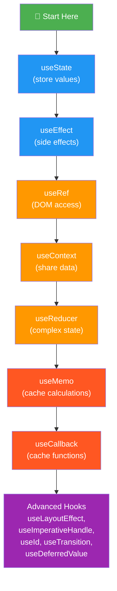
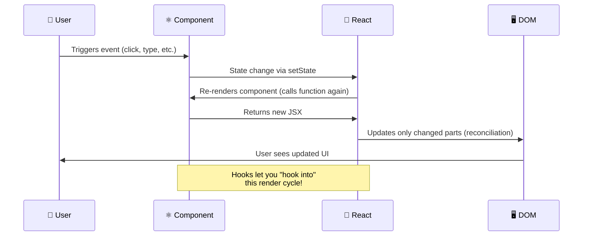

# ⚛️ React Hooks — Complete Beginner's Guide

> **Learn every React hook from scratch** — with diagrams, theory, and hands-on examples. No prior React experience needed beyond the basics!

---

## 👋 Who Is This For?

This repo is for you if:
- ✅ You know basic JavaScript (variables, functions, arrays)
- ✅ You've seen React components but don't fully understand hooks
- ✅ You learn best by reading + doing + seeing diagrams
- ❌ You don't need to know class components or old React

---

## 🗺️ What Are Hooks?

Before hooks (pre-React 16.8), you needed **class components** to use state and lifecycle features. Hooks let you use those features inside **function components** — which are simpler and cleaner.

```
📦 React Component (Function)
│
├── 🪝 useState        → Remember values between renders
├── 🪝 useEffect       → Run side effects (fetch, timers, etc.)
├── 🪝 useContext      → Share data without prop drilling
├── 🪝 useRef          → Reference DOM elements / persist values
├── 🪝 useReducer      → Manage complex state logic
├── 🪝 useMemo         → Cache expensive calculations
├── 🪝 useCallback     → Cache function references
├── 🪝 useLayoutEffect → Run effects before browser paints
├── 🪝 useImperativeHandle → Customize ref exposure
├── 🪝 useId           → Generate unique IDs
├── 🪝 useTransition   → Mark state updates as non-urgent
└── 🪝 useDeferredValue → Defer re-rendering of heavy UI
```

---

## 📚 Hook Index

| # | Hook | Difficulty | Use It For | Go To Guide |
|---|------|-----------|------------|-------------|
| 1 | `useState` | 🟢 Beginner | Storing & updating values | [📖 Guide](./hooks/useState/README.md) |
| 2 | `useEffect` | 🟢 Beginner | Side effects, data fetching | [📖 Guide](./hooks/useEffect/README.md) |
| 3 | `useContext` | 🟡 Intermediate | Global state without prop drilling | [📖 Guide](./hooks/useContext/README.md) |
| 4 | `useRef` | 🟡 Intermediate | DOM access, persisting values | [📖 Guide](./hooks/useRef/README.md) |
| 5 | `useReducer` | 🟡 Intermediate | Complex state machines | [📖 Guide](./hooks/useReducer/README.md) |
| 6 | `useMemo` | 🟠 Advanced | Caching expensive calculations | [📖 Guide](./hooks/useMemo/README.md) |
| 7 | `useCallback` | 🟠 Advanced | Caching function references | [📖 Guide](./hooks/useCallback/README.md) |
| 8 | `useLayoutEffect` | 🟠 Advanced | Pre-paint DOM measurements | [📖 Guide](./hooks/useLayoutEffect/README.md) |
| 9 | `useImperativeHandle` | 🔴 Expert | Customizing refs | [📖 Guide](./hooks/useImperativeHandle/README.md) |
| 10 | `useId` | 🟢 Beginner | Accessible unique IDs | [📖 Guide](./hooks/useId/README.md) |
| 11 | `useTransition` | 🟠 Advanced | Non-blocking UI updates | [📖 Guide](./hooks/useTransition/README.md) |
| 12 | `useDeferredValue` | 🟠 Advanced | Deferring heavy renders | [📖 Guide](./hooks/useDeferredValue/README.md) |

---

## 🏗️ Repository Structure

```
react-practice/
│
├── README.md                        ← You are here
│
├── hooks/
│   ├── useState/
│   │   ├── README.md                ← Full theory + examples
│   │   ├── cheatsheet.md            ← Quick reference
│   │   ├── example1-basics/
│   │   │   └── App.jsx              ← Simplest possible example
│   │   ├── example2-realworld/
│   │   │   └── App.jsx              ← Realistic use case
│   │   └── example3-advanced/
│   │       └── App.jsx              ← Advanced pattern
│   │
│   ├── useEffect/   (same structure)
│   ├── useContext/  (same structure)
│   ├── useRef/      (same structure)
│   ├── useReducer/  (same structure)
│   ├── useMemo/     (same structure)
│   ├── useCallback/ (same structure)
│   ├── useLayoutEffect/ (same structure)
│   ├── useImperativeHandle/ (same structure)
│   ├── useId/       (same structure)
│   ├── useTransition/ (same structure)
│   └── useDeferredValue/ (same structure)
│
└── my-app/                          ← Vite + React app to run examples
    ├── src/
    │   └── App.jsx                  ← Paste any example here to run it!
    └── package.json
```

---

## 🚀 How To Run Examples

Each hook folder has 3 example files. To run any of them:

**Step 1:** Copy the code from an example file
```bash
# Example: open the useState basics example
cat hooks/useState/example1-basics/App.jsx
```

**Step 2:** Paste it into `my-app/src/App.jsx`

**Step 3:** Start the dev server
```bash
cd my-app
npm install    # only needed once
npm run dev
```

**Step 4:** Open `http://localhost:5173` in your browser 🎉

---

## 🧭 Suggested Learning Path



---

## 🔑 The 3 Golden Rules of Hooks

> These rules are **enforced by React** — break them and your app will behave unexpectedly!

### Rule 1: Only Call Hooks at the Top Level
```jsx
// ✅ CORRECT — hook called at top level
function MyComponent() {
  const [count, setCount] = useState(0);  // always runs
  // ...
}

// ❌ WRONG — hook inside a condition
function MyComponent() {
  if (someCondition) {
    const [count, setCount] = useState(0);  // BAD! conditional hook
  }
}
```

### Rule 2: Only Call Hooks from React Functions
```jsx
// ✅ CORRECT — hook inside a component
function MyComponent() {
  const [count, setCount] = useState(0);
}

// ✅ CORRECT — hook inside a custom hook
function useMyHook() {
  const [count, setCount] = useState(0);
}

// ❌ WRONG — hook inside a regular function
function regularFunction() {
  const [count, setCount] = useState(0);  // BAD!
}
```

### Rule 3: Custom Hooks Must Start with "use"
```jsx
// ✅ CORRECT
function useFetchData(url) { ... }

// ❌ WRONG — React won't know it's a hook
function fetchData(url) { ... }
```

---

## 🧠 How React Renders — The Big Picture

Understanding this diagram will make ALL hooks make sense:



---

## 📖 Each Hook's README Contains

Every hook folder has a thorough `README.md` with:

| Section | What You'll Learn |
|---------|------------------|
| 🎯 What is it? | Plain English + analogy |
| 🧠 Mental Model | Diagram showing how it works |
| 📖 Syntax | Every parameter explained |
| ⚙️ Under the Hood | How React handles it internally |
| ✅ When to use | Real use cases |
| ❌ Anti-patterns | Common mistakes + fixes |
| 🔄 Lifecycle flow | Mermaid diagram of execution order |
| 💡 Examples 1-3 | Line-by-line commented code |
| 🧪 Mini Quiz | Test your understanding |
| 🔗 Related Hooks | What to learn next |
| 📚 Further Reading | Official docs + resources |

---

## 🛠️ Tech Stack

| Tool | Purpose |
|------|---------|
| [React 18+](https://react.dev) | UI library |
| [Vite](https://vitejs.dev) | Build tool (super fast!) |
| JavaScript (ES6+) | Language — no TypeScript needed |
| Plain CSS | Styling |

---

## 📝 How Each Example File Is Written

Every `App.jsx` in this repo follows this pattern:

```jsx
/**
 * JSDoc block at the top explaining:
 * - What this example demonstrates
 * - Which hook is being used
 * - What the user will see
 */

import React, { useState } from 'react'; // import React and the hook we need

function App() { // define the main component (think of it as a blueprint)

  const [count, setCount] = useState(0); // create a state variable starting at 0

  return ( // return the JSX (HTML-like syntax) that React will render
    <div>
      <p>Count: {count}</p> {/* display the current count */}
      <button onClick={() => setCount(count + 1)}> {/* button that adds 1 */}
        Click me!
      </button>
    </div>
  );
}

export default App; // make this component available to other files
```

---

## 🤝 Contributing

Found a typo? Have a better example? Open a PR! This repo is meant to grow with the community.

---

## 📄 License

MIT — free to use, share, and learn from.

---

<div align="center">

Made with ❤️ for React learners everywhere

**Happy Coding! ⚛️**

</div>
