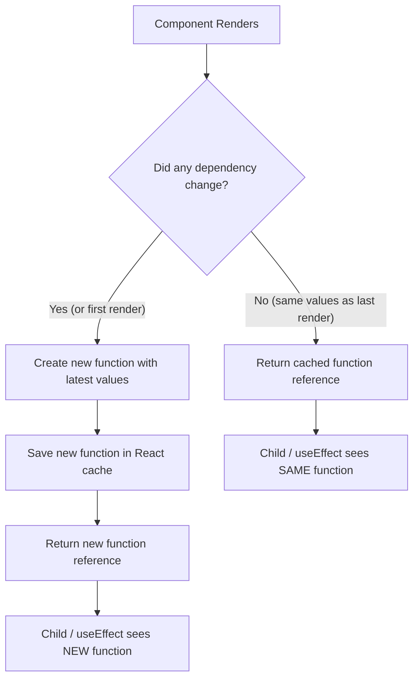
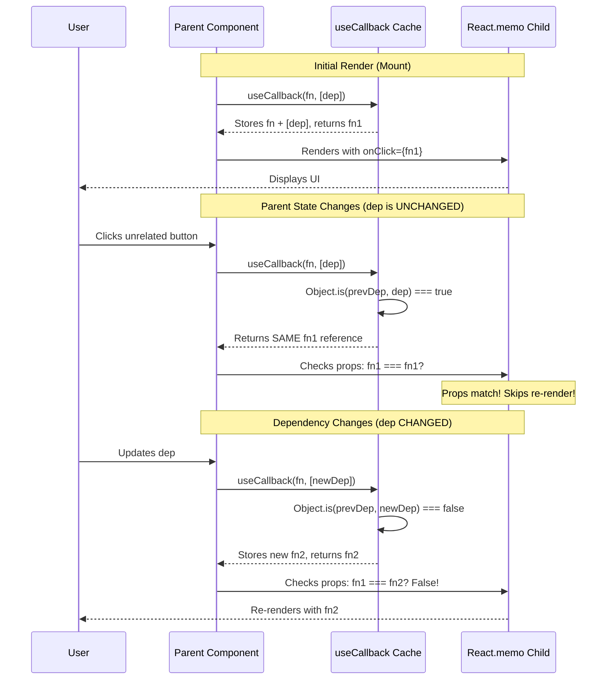

# `useCallback` — Remembering Functions Between Renders

Welcome to the `useCallback` learning module! If you have ever wondered why React sometimes re-renders child components when nothing seemed to change, or why a `useEffect` keeps firing over and over again, `useCallback` is the hook that solves that puzzle.

---

### 🎯 What is useCallback?

Imagine you have a favorite **cookie recipe** written on a recipe card. Every time you bake cookies (a **render** in React), you don't need to rewrite the entire recipe from scratch on a brand-new index card — you can just **reuse the exact same laminated recipe card** you already have, unless one of the ingredients (your **dependencies**) actually changes.

In React, **every time a component re-renders, any function defined inside that component is created brand new from scratch**. Even if the code inside the function looks identical character-for-character, JavaScript treats the new function as a completely different object in memory (just like two identical-looking sheets of paper are still two separate sheets).

**`useCallback`** is a built-in React Hook that **caches (remembers) a function definition** between re-renders. Instead of creating a brand-new function on every render, React hands you back the **exact same function reference** from the previous render — *unless* one of the values in its dependency list has changed.

> **Jargon Buster:**
> - **Reference (or Referential Equality):** In JavaScript, `() => {} === () => {}` is `false` because each arrow function creates a new object in memory. Holding onto the *same* function in memory so `prevFn === nextFn` is `true` is called preserving **referential equality**.
> - **Memoization:** A fancy word for **caching** — saving the result of something so you don't have to recreate or recompute it next time.
> - **Re-render:** When React calls your component function again because state or props changed.

---

### 🧠 Mental Model

Think of `useCallback` as a **smart coat check** for your functions. When your component renders, React checks the dependency list: if nothing on the list changed, React hands you back the exact same function you checked in earlier. If something *did* change, React creates a fresh function with the updated values and stores that one instead.



---

### 📖 Syntax

```jsx
import { useCallback } from 'react';

const cachedFn = useCallback(
  () => {
    // Your function logic here
  },
  [dependency1, dependency2]
);
```

| Parameter | Type | Required | Description | Default |
| :--- | :--- | :--- | :--- | :--- |
| `fn` | `Function` | **Yes** | The function value you want React to cache. React will return this exact function (without calling it!) on the initial render, and on future renders if dependencies haven't changed. | None |
| `dependencies` | `Array` | **Yes** | The list of all reactive values (props, state, variables/functions declared inside the component) referenced inside `fn`. React compares each item using `Object.is`. | None |
| *(Return value)* | `Function` | — | Returns the cached function `fn` from the last render if dependencies are unchanged, or the newly passed `fn` if any dependency changed. | — |

---

### ⚙️ How It Works Under The Hood

1. **First Render (Mount):**
   When your component renders for the very first time, React runs `useCallback(fn, deps)`. React does **not** call `fn` — it simply stores `[fn, deps]` in an internal slot attached to that component's Fiber node (React's internal data structure for tracking a component) and returns `fn`.

2. **Subsequent Renders (Updates):**
   When your component re-renders, JavaScript still *evaluates* the inline function expression you passed to `useCallback` (creating a temporary function object), **but** React compares every item in the new `deps` array against the previous `deps` array using `Object.is()`.
   - **If every dependency is identical (`Object.is` returns `true` for all items):** React throws away the temporary new function and returns the **previously saved `fn` reference**.
   - **If any dependency changed (or if `deps` is omitted):** React updates its internal slot with the new `[fn, deps]` and returns the **new `fn` reference**.

3. **Why does this matter?**
   Because `useCallback` keeps the function reference identical (`prevFn === nextFn`), anything that checks "did my props or dependencies change?" — like `React.memo` or `useEffect` — sees that the function is **the exact same function** and skips unnecessary work!

---

### ✅ When To Use useCallback

Here are the most common, genuinely useful scenarios for `useCallback`:

1. **Passing callbacks to `React.memo`-wrapped child components:**
   If a parent component passes an `onClick` or `onSubmit` handler to a heavy child component wrapped in `React.memo`, `useCallback` ensures the child doesn't re-render just because the parent re-rendered.
2. **Using a function inside a `useEffect` dependency array:**
   If a `useEffect` calls a helper function defined in the component, wrapping that helper in `useCallback` prevents the effect from re-running on every single render.
3. **Writing custom hooks that return functions:**
   If you build a reusable custom hook (like `useToggle` or `useFetch`), wrapping the returned functions in `useCallback` lets consumers safely use them in their own `useEffect` or `React.memo` components.
4. **Debounced or throttled event handlers:**
   When wrapping a search or resize handler in a debounce utility, `useCallback` keeps the debounced function stable so its internal timer isn't reset on every render.
5. **Subscribing to external event listeners or WebSockets:**
   When adding and removing listeners (`window.addEventListener` / `removeEventListener`), a stable callback reference ensures you cleanly remove the exact listener you added.
6. **Passing callbacks into React Context values:**
   If a Context Provider passes action functions (like `login` or `logout`) to dozens of consumers, memoizing those functions prevents every consumer from re-rendering unnecessarily.

---

### ❌ Common Mistakes & Anti-patterns

#### Mistake 1: Wrapping every single function in `useCallback` (Premature Optimization)

If a button is a plain `<button>` or a child component is **not** wrapped in `React.memo`, `useCallback` adds extra memory and comparison overhead for zero benefit.

**❌ BAD:**
```jsx
function SimpleCounter() {
  const [count, setCount] = useState(0);

  // Unnecessary! <button> is a built-in DOM element, not React.memo
  const handleClick = useCallback(() => {
    setCount((c) => c + 1);
  }, []);

  return <button onClick={handleClick}>Count: {count}</button>;
}
```

**✅ GOOD:**
```jsx
function SimpleCounter() {
  const [count, setCount] = useState(0);

  // Clean, simple, and actually faster for a plain button
  const handleClick = () => {
    setCount((c) => c + 1);
  };

  return <button onClick={handleClick}>Count: {count}</button>;
}
```

---

#### Mistake 2: Missing Dependencies (Stale Closure Bug)

If you read a state variable inside `useCallback` but forget to list it in the dependency array `[]`, the function will forever remember the **old** value from when it was first created!

**❌ BAD:**
```jsx
function Greeter() {
  const [name, setName] = useState('Alice');

  // BUG: name is missing from [], so alert always says "Hello, Alice!"
  const greet = useCallback(() => {
    alert(`Hello, ${name}!`);
  }, []);

  return (
    <>
      <input value={name} onChange={(e) => setName(e.target.value)} />
      <button onClick={greet}>Greet</button>
    </>
  );
}
```

**✅ GOOD:**
```jsx
function Greeter() {
  const [name, setName] = useState('Alice');

  // Include 'name' in the dependency array so greet updates when name changes
  const greet = useCallback(() => {
    alert(`Hello, ${name}!`);
  }, [name]);

  return (
    <>
      <input value={name} onChange={(e) => setName(e.target.value)} />
      <button onClick={greet}>Greet</button>
    </>
  );
}
```

---

#### Mistake 3: Using `useCallback` without `React.memo` on the Child

`useCallback` alone does **not** stop a child component from re-rendering. In React, when a parent re-renders, all of its children re-render by default unless the child is wrapped in `React.memo`.

**❌ BAD:**
```jsx
// Child is NOT wrapped in React.memo, so it still re-renders every time Parent does!
function ExpensiveChild({ onAction }) {
  return <button onClick={onAction}>Run Action</button>;
}

function Parent() {
  const [count, setCount] = useState(0);
  const handleAction = useCallback(() => console.log('Action!'), []);
  return (
    <div>
      <button onClick={() => setCount(count + 1)}>{count}</button>
      <ExpensiveChild onAction={handleAction} />
    </div>
  );
}
```

**✅ GOOD:**
```jsx
// Wrap the child in React.memo so it actually skips re-rendering when props are equal
const ExpensiveChild = React.memo(function ExpensiveChild({ onAction }) {
  return <button onClick={onAction}>Run Action</button>;
});

function Parent() {
  const [count, setCount] = useState(0);
  const handleAction = useCallback(() => console.log('Action!'), []);
  return (
    <div>
      <button onClick={() => setCount(count + 1)}>{count}</button>
      <ExpensiveChild onAction={handleAction} />
    </div>
  );
}
```

---

#### Mistake 4: Putting State in Dependencies When a Functional Updater Works

If your callback only needs to update state based on the previous state, use `setCount(prev => prev + 1)` instead of reading `count` directly. That lets you keep `[]` empty so the function never changes!

**❌ BAD:**
```jsx
// Re-creates handleIncrement on every single click because [count] changes
const handleIncrement = useCallback(() => {
  setCount(count + 1);
}, [count]);
```

**✅ GOOD:**
```jsx
// Created once! React passes the latest state as 'prev' automatically
const handleIncrement = useCallback(() => {
  setCount((prev) => prev + 1);
}, []);
```

---

### 🔄 Execution / Lifecycle Flow

This diagram shows **when** `useCallback` runs during a component's render lifecycle and how a `React.memo` child responds:



---

### 💡 Example 1 — The Basics

This example demonstrates `useCallback` paired with `React.memo` so that typing in an input or incrementing an unrelated counter doesn't force the memoized child button to re-render.

```jsx
import React, { useState, useCallback } from 'react'; // Import React, useState, and useCallback from React

const MemoizedButton = React.memo(function MemoizedButton({ onIncrement, label }) { // Wrap child component in React.memo to skip re-renders when props stay identical
  console.log(`Rendering button: ${label}`); // Log to console whenever this child component actually re-renders
  return ( // Return the JSX for the child button
    <button onClick={onIncrement} style={{ padding: '8px 16px', margin: '4px' }}> {/* Attach the memoized click handler and basic styling */}
      {label} {/* Display the button label text */}
    </button> // Close the button element
  ); // End of return statement
}); // Close React.memo wrapper

export default function App() { // Export the main App component as default
  const [count, setCount] = useState(0); // State for the main counter value starting at 0
  const [darkMode, setDarkMode] = useState(false); // Unrelated state to toggle theme and trigger parent re-renders

  const handleIncrement = useCallback(() => { // Memoize the increment function so its reference never changes
    setCount((prevCount) => prevCount + 1); // Use functional state update so we don't need 'count' in dependencies
  }, []); // Empty dependency array means this function is created only once

  const themeStyle = { // Define inline styles based on the current darkMode state
    backgroundColor: darkMode ? '#1e293b' : '#f8fafc', // Dark slate background in dark mode, light gray otherwise
    color: darkMode ? '#f8fafc' : '#1e293b', // Light text in dark mode, dark text otherwise
    padding: '24px', // Add comfortable inner spacing around the container
    borderRadius: '8px', // Round the corners of the container
    fontFamily: 'sans-serif', // Use a clean sans-serif font
  }; // End of themeStyle object

  return ( // Return the main component UI
    <div style={themeStyle}> {/* Apply the dynamic theme styles to the wrapper div */}
      <h2>useCallback Basics</h2> {/* Display the section heading */}
      <p>Count: <strong>{count}</strong></p> {/* Show the current count value */}
      <MemoizedButton onIncrement={handleIncrement} label="Increment Count" /> {/* Pass the stable handleIncrement callback to the memoized child */}
      <button // Render a second button to toggle the unrelated theme state
        onClick={() => setDarkMode((prev) => !prev)} // Toggle darkMode boolean on click
        style={{ padding: '8px 16px', margin: '4px' }} // Add matching button padding and margin
      > {/* Close opening button tag */}
        Toggle Theme ({darkMode ? 'Dark' : 'Light'}) {/* Show current theme mode on the button */}
      </button> {/* Close theme toggle button */}
      <p style={{ fontSize: '0.85rem', opacity: 0.8 }}> {/* Add a small helper note */}
        Open the console: toggling the theme will NOT re-render "Increment Count"! {/* Explain what the user should observe in DevTools */}
      </p> {/* Close helper paragraph */}
    </div> // Close main container div
  ); // End of return statement
} // Close App component
```

**What you will see in the browser:**
- A card with a heading **"useCallback Basics"**, a counter (`Count: 0`), an **"Increment Count"** button, and a **"Toggle Theme (Light)"** button.
- Clicking **Toggle Theme** switches the card between light and dark mode, while the browser console proves `MemoizedButton` did **not** re-render!

---

### 💡 Example 2 — Real World Use Case

A realistic **Live Search Filter with Memoized Product List**: typing a note or changing the cart count won't re-render the heavy product cards, and `useCallback` keeps the `onAddToCart` handler stable for every memoized product row.

```jsx
import React, { useState, useCallback } from 'react'; // Import React, useState, and useCallback

const INITIAL_PRODUCTS = [ // Define a static list of sample store products outside the component
  { id: 1, name: 'Wireless Keyboard', price: 79 }, // First product item
  { id: 2, name: 'USB-C Hub', price: 45 }, // Second product item
  { id: 3, name: 'Noise-Canceling Headphones', price: 199 }, // Third product item
  { id: 4, name: 'Ergonomic Mouse', price: 59 }, // Fourth product item
]; // End of product catalog array

const ProductRow = React.memo(function ProductRow({ product, onAddToCart }) { // Memoize each product row so it only re-renders if its props change
  console.log(`Rendered row: ${product.name}`); // Log row renders so we can verify memoization works
  return ( // Return the product row UI
    <div style={{ display: 'flex', justifyContent: 'space-between', padding: '8px 0', borderBottom: '1px solid #e2e8f0' }}> {/* Flex row with bottom divider */}
      <span>{product.name} — ${product.price}</span> {/* Display product name and price */}
      <button onClick={() => onAddToCart(product)}>Add to Cart</button> {/* Call the stable onAddToCart callback with this product */}
    </div> // Close product row div
  ); // End of return statement
}); // Close React.memo wrapper

export default function App() { // Export the main App component
  const [search, setSearch] = useState(''); // State for the search input text
  const [cart, setCart] = useState([]); // State for items added to the shopping cart
  const [couponCode, setCouponCode] = useState(''); // Unrelated state for a coupon input field

  const handleAddToCart = useCallback((product) => { // Memoize the add-to-cart handler so ProductRow keeps the same function prop
    setCart((prevCart) => [...prevCart, product]); // Append the selected product using functional state update
  }, []); // Empty dependency array because setCart updater needs no external state

  const filteredProducts = INITIAL_PRODUCTS.filter((item) => // Filter products based on the search query
    item.name.toLowerCase().includes(search.toLowerCase()) // Case-insensitive substring match on product name
  ); // End of filter call

  return ( // Return the store UI
    <div style={{ maxWidth: '480px', padding: '20px', fontFamily: 'sans-serif' }}> {/* Centered container with clean typography */}
      <h2>Tech Store ({cart.length} in cart)</h2> {/* Heading showing live cart item count */}
      <input // Search input to filter products
        type="text" // Standard text input
        placeholder="Search products..." // Helpful placeholder text
        value={search} // Controlled input bound to search state
        onChange={(e) => setSearch(e.target.value)} // Update search state as user types
        style={{ width: '100%', padding: '8px', marginBottom: '12px' }} // Full-width input styling
      /> {/* Close search input */}
      <div style={{ marginBottom: '16px' }}> {/* Container for the list of filtered products */}
        {filteredProducts.map((product) => ( // Loop over each matching product
          <ProductRow key={product.id} product={product} onAddToCart={handleAddToCart} /> // Render memoized ProductRow with stable callback
        ))} {/* Close map loop */}
      </div> {/* Close product list container */}
      <input // Unrelated coupon input to demonstrate skipped re-renders
        type="text" // Standard text input
        placeholder="Enter coupon code (rows won't re-render)..." // Explain what typing here demonstrates
        value={couponCode} // Controlled input bound to couponCode state
        onChange={(e) => setCouponCode(e.target.value)} // Update couponCode state on change
        style={{ width: '100%', padding: '8px' }} // Full-width input styling
      /> {/* Close coupon input */}
    </div> // Close main container
  ); // End of return statement
} // Close App component
```

---

### 💡 Example 3 — Advanced Pattern

Composing `useCallback` with `useEffect` and `useRef` to build a **stable debounced API-style search** that only re-creates its fetch function when the category filter changes, preventing infinite `useEffect` loops.

```jsx
import React, { useState, useEffect, useCallback, useRef } from 'react'; // Import React and four core hooks

export default function App() { // Export the main App component
  const [query, setQuery] = useState('react'); // State for the user's search term
  const [category, setCategory] = useState('all'); // State for the selected topic category
  const [results, setResults] = useState([]); // State for simulated search results
  const [fetchCount, setFetchCount] = useState(0); // Track how many times the search function actually executed
  const timerRef = useRef(null); // Ref to store the active debounce timer ID across renders

  const runSearch = useCallback((searchTerm, activeCategory) => { // Memoize the search function; only recreate when category changes
    setFetchCount((prev) => prev + 1); // Increment the execution counter
    const mockDatabase = [ // Simulated dataset of learning articles
      { id: 1, title: 'React useCallback Guide', tag: 'hooks' }, // First mock article
      { id: 2, title: 'CSS Grid Layout Tips', tag: 'styling' }, // Second mock article
      { id: 3, title: 'React useMemo Deep Dive', tag: 'hooks' }, // Third mock article
      { id: 4, title: 'Responsive Flexbox', tag: 'styling' }, // Fourth mock article
    ]; // End of mockDatabase array
    const filtered = mockDatabase.filter((item) => { // Filter items by search term and category
      const matchesText = item.title.toLowerCase().includes(searchTerm.toLowerCase()); // Check if title matches search text
      const matchesCat = activeCategory === 'all' || item.tag === activeCategory; // Check if category matches or is 'all'
      return matchesText && matchesCat; // Include item only if both conditions pass
    }); // End of filter callback
    setResults(filtered); // Update results state with the filtered articles
  }, []); // Empty deps because searchTerm and activeCategory are passed as arguments

  useEffect(() => { // Effect that debounces calls to runSearch whenever query or category changes
    clearTimeout(timerRef.current); // Cancel any pending search timer from the previous keystroke
    timerRef.current = setTimeout(() => { // Schedule a new search after 350ms of inactivity
      runSearch(query, category); // Invoke our stable memoized search function
    }, 350); // 350ms debounce delay
    return () => clearTimeout(timerRef.current); // Cleanup timer if component unmounts or dependencies change
  }, [query, category, runSearch]); // Safe to include runSearch here because useCallback keeps it stable

  return ( // Return the debounced search UI
    <div style={{ maxWidth: '480px', padding: '20px', fontFamily: 'sans-serif' }}> {/* Styled container */}
      <h2>Debounced Search (Fetches: {fetchCount})</h2> {/* Show title and live fetch count */}
      <div style={{ display: 'flex', gap: '8px', marginBottom: '12px' }}> {/* Row for search input and category dropdown */}
        <input // Text input for search query
          value={query} // Controlled value from query state
          onChange={(e) => setQuery(e.target.value)} // Update query on every keystroke
          placeholder="Search articles..." // Input placeholder
          style={{ flex: 1, padding: '8px' }} // Expand input to fill available space
        /> {/* Close input */}
        <select value={category} onChange={(e) => setCategory(e.target.value)} style={{ padding: '8px' }}> {/* Category filter dropdown */}
          <option value="all">All</option> {/* Option to show all categories */}
          <option value="hooks">Hooks</option> {/* Option to filter by hooks */}
          <option value="styling">Styling</option> {/* Option to filter by styling */}
        </select> {/* Close select dropdown */}
      </div> {/* Close controls row */}
      <ul> {/* Unordered list for displaying matching articles */}
        {results.map((item) => ( // Map over each matching result
          <li key={item.id}>{item.title} <em>({item.tag})</em></li> // Render article title and category tag
        ))} {/* Close results map */}
      </ul> {/* Close unordered list */}
    </div> // Close main container
  ); // End of return statement
} // Close App component
```

---

### 🧪 Mini Quiz

Test your understanding! Click each question to reveal the answer.

<details>
<summary><strong>1. Does <code>useCallback</code> call the function you pass to it?</strong></summary>

**No!** `useCallback(fn, deps)` **returns** the cached function `fn` so you can pass it to a button, child component, or `useEffect` to be called later. (If you want to run a function and cache its *return value*, use `useMemo` instead.)

</details>

<details>
<summary><strong>2. Why does wrapping a handler in <code>useCallback</code> NOT stop a normal child component from re-rendering?</strong></summary>

Because React re-renders all child components whenever their parent re-renders by default. `useCallback` only keeps the function prop's reference equal (`prevFn === nextFn`). You must also wrap the child component in **`React.memo`** so the child actually checks its props and skips re-rendering.

</details>

<details>
<summary><strong>3. How can you avoid putting a state variable like <code>count</code> in your <code>useCallback</code> dependency array when updating state?</strong></summary>

Use the **functional updater form** of `setState`: `setCount((prev) => prev + 1)`. Because React passes the latest state as `prev`, your callback doesn't need to read `count` from the outer scope, letting you keep `[]` empty!

</details>

---

### 🔗 Related Hooks

- **`useMemo`**: Caches the **result** (return value) of calling a function, whereas `useCallback` caches the **function itself**. In fact, `useCallback(fn, deps)` is equivalent to `useMemo(() => fn, deps)`.
- **`useEffect`**: Often consumes functions wrapped in `useCallback` inside its dependency array so the effect doesn't re-run on every render.
- **`useRef`**: Can hold a mutable value (like a timer ID or latest callback) without triggering re-renders when updated.
- **`React.memo`**: Higher-order component (not a hook, but a close partner!) that skips re-rendering a child component when its props — including `useCallback` functions — remain unchanged.

---

### 📚 Further Reading

- [React Official Docs — `useCallback`](https://react.dev/reference/react/useCallback)
- [React Official Docs — `React.memo`](https://react.dev/reference/react/memo)
- [Kent C. Dodds — When to `useMemo` and `useCallback`](https://kentcdodds.com/blog/usememo-and-usecallback)
- [Josh W. Comeau — Understanding `useMemo` and `useCallback`](https://www.joshwcomeau.com/react/usememo-and-usecallback/)
