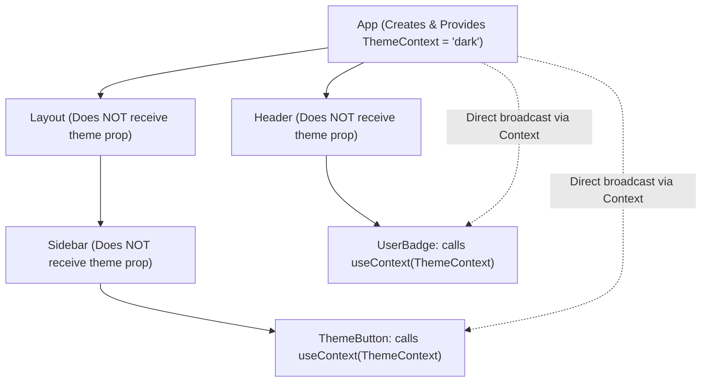
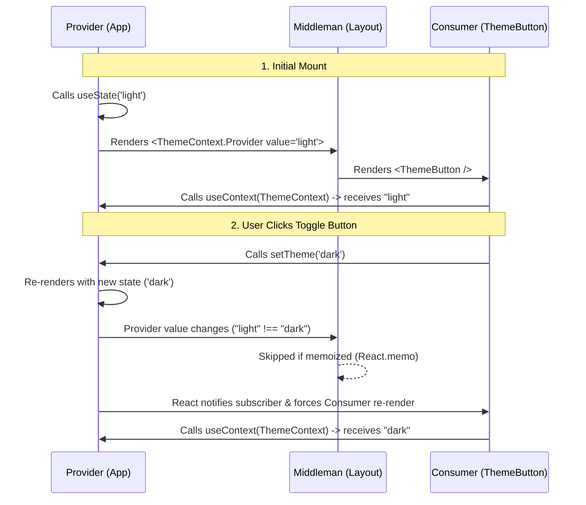

# `useContext` — Share Data Across Your App Without Prop Drilling

> **One-sentence summary:** `useContext` lets any component in your React tree read shared data directly—without passing props manually through every layer in between.

---

### 🎯 What is useContext?

Imagine your React app is a **tall apartment building**, and the **top-floor penthouse** (`App`) has the Wi-Fi password (your data, like the currently logged-in user or the dark-mode theme).

Now suppose the **basement laundry room** (`Footer` or `ThemeButton`) needs that Wi-Fi password.

Without `useContext`, you have to hand a sticky note with the password to the 4th floor (`Layout`), who hands it to the 3rd floor (`Sidebar`), who hands it to the 2nd floor (`Menu`), who finally hands it to the basement (`ThemeButton`)—even though floors 4, 3, and 2 don't care about the Wi-Fi password at all! In React, passing props through middleman components that don't use them is called **prop drilling**.

`useContext` is like **installing a building-wide intercom / bulletin board** (called a **Context**):
1. You create the bulletin board once with `createContext()`.
2. The penthouse wraps the building in a `<Provider>` and pins the Wi-Fi password to the board.
3. Any room on any floor can call `useContext(WifiContext)` and read the password **directly**—no middlemen required!

**Key terms in plain English:**
- **Prop:** Data passed from a parent component down to its direct child (like handing a note to the person next to you).
- **Prop Drilling:** Passing a prop through multiple intermediate components just to reach a deeply nested child.
- **Context:** A shared channel created with `createContext` that holds data for a whole subtree of components.
- **Provider:** A wrapper component (`<MyContext.Provider value={...}>`) that supplies the current value to everything inside it.
- **Consumer:** Any component inside the Provider that calls `useContext(MyContext)` to read that value.

---

### 🧠 Mental Model



Notice the dashed arrows: `Layout`, `Sidebar`, and `Header` stay completely clean and unaware of `theme`, while `ThemeButton` and `UserBadge` tune in directly to `ThemeContext`.

---

### 📖 Syntax

```jsx
import { createContext, useContext } from 'react';

// 1. Create a Context object (usually outside any component)
const MyContext = createContext(defaultValue);

// 2. Wrap a parent tree in the Provider and pass a `value`
function Parent() {
  return (
    <MyContext.Provider value={someValue}>
      <Child />
    </MyContext.Provider>
  );
}

// 3. Read the value inside any descendant component
function Child() {
  const value = useContext(MyContext);
  return <div>{value}</div>;
}
```

| Parameter | Type | Required | Description | Default |
| :--- | :--- | :--- | :--- | :--- |
| `SomeContext` | `React.Context<T>` | Yes | The context object returned by `createContext(defaultValue)`. Note: pass the context object itself, **not** `SomeContext.Provider` or `SomeContext.Consumer`. | None |
| `defaultValue` *(in `createContext`)* | `any` | No *(recommended)* | Fallback value returned by `useContext` **only** when a component has no matching `<SomeContext.Provider>` above it in the tree. | `undefined` |
| **Return Value** | `any` | — | The current `value` prop of the **nearest** `<SomeContext.Provider>` above the calling component, or `defaultValue` if none exists. | `defaultValue` |

---

### ⚙️ How It Works Under The Hood

You don't need to memorize React's source code, but understanding the mechanics makes bugs easy to spot:

1. **Context is a reference object, not a store:** Calling `createContext(defaultValue)` creates a plain JavaScript object with a `_currentValue` field, a `Provider` component, and a `Consumer` component. It does **not** hold state on its own.
2. **Walking up the Fiber tree:** When your component calls `useContext(MyContext)`, React walks **upward** through the parent component tree (React's internal "Fiber" nodes) until it finds the **closest** `<MyContext.Provider>`.
3. **Reading `value`:** React reads whatever you passed to that Provider's `value={...}` prop. If React reaches the root of your app without finding a Provider, it falls back to the `defaultValue` you passed to `createContext(defaultValue)`.
4. **Automatic re-renders on change:** React registers your component as a **subscriber** to `MyContext`. Whenever the Provider's `value` changes (compared using `Object.is`, which works like `===`), React automatically schedules a re-render for **every** component that called `useContext(MyContext)`—even if a middleman component between the Provider and Consumer used `React.memo`!
5. **Combining with `useState` or `useReducer`:** Because Context itself doesn't store state, you almost always pair it with `useState` or `useReducer` inside the Provider component so the `value` can change over time.

---

### ✅ When To Use useContext

- **Theming (Dark / Light mode):** Every button, card, and navbar needs to know the active theme without passing `theme` to 30 components.
- **Authentication & Current User:** Sharing the logged-in user object, permissions, and `login` / `logout` functions across headers, profiles, and protected routes.
- **Language / Localization (i18n):** Making the current locale (`"en"`, `"es"`, `"fr"`) and translation helper available to every text label in the app.
- **App-wide UI Notifications / Toasts:** Allowing any deeply nested button or API handler to trigger a toast banner at the top of the screen.
- **Shopping Cart or Multi-Step Form State:** Sharing cart items or wizard form answers across separate summary, sidebar, and checkout components.
- **Dependency Injection / Feature Flags:** Providing configuration, API clients, or feature toggles to a subtree (and swapping them easily in tests).

---

### ❌ Common Mistakes & Anti-patterns

#### Mistake 1: Creating a brand-new object in `value` on every render

Passing an inline object literal like `value={{ user, setUser }}` creates a **new object reference** every time the Provider re-renders—even when `user` didn't change—forcing every consumer to re-render unnecessarily.

```jsx
// ❌ BAD: New object created on every render of App
function App() {
  const [user, setUser] = useState('Ada');
  return (
    <UserContext.Provider value={{ user, setUser }}>
      <Dashboard />
    </UserContext.Provider>
  );
}
```

```jsx
// ✅ GOOD: Memoize the context value with useMemo
function App() {
  const [user, setUser] = useState('Ada');
  const contextValue = useMemo(() => ({ user, setUser }), [user]);
  return (
    <UserContext.Provider value={contextValue}>
      <Dashboard />
    </UserContext.Provider>
  );
}
```

#### Mistake 2: Forgetting to wrap the consumer in a Provider

If you call `useContext` in a component that is **not** inside `<MyContext.Provider>`, React silently returns `defaultValue` (often `undefined` or `null`), causing confusing crashes like `Cannot read properties of undefined`.

```jsx
// ❌ BAD: App calls useContext, but the Provider is rendered INSIDE App (too low!)
const ThemeContext = createContext();

function App() {
  const theme = useContext(ThemeContext); // undefined! No Provider above App
  return (
    <ThemeContext.Provider value="dark">
      <p>Theme is: {theme}</p>
    </ThemeContext.Provider>
  );
}
```

```jsx
// ✅ GOOD: Provider wraps the child component that calls useContext
const ThemeContext = createContext('light');

function Toolbar() {
  const theme = useContext(ThemeContext); // 'dark'
  return <p>Theme is: {theme}</p>;
}

function App() {
  return (
    <ThemeContext.Provider value="dark">
      <Toolbar />
    </ThemeContext.Provider>
  );
}
```

#### Mistake 3: Putting everything into one giant "God Context"

If `user`, `theme`, `cartItems`, and `mousePosition` all live in one `AppContext`, then moving the mouse or adding a cart item re-renders **every** component that only wanted `theme`.

```jsx
// ❌ BAD: Unrelated state bundled together causes unnecessary re-renders
<AppContext.Provider value={{ user, theme, cart, notifications }}>
  <AppShell />
</AppContext.Provider>
```

```jsx
// ✅ GOOD: Split contexts by concern (or by update frequency)
<AuthProvider>
  <ThemeProvider>
    <CartProvider>
      <AppShell />
    </CartProvider>
  </ThemeProvider>
</AuthProvider>
```

#### Mistake 4: Using `useContext` when simple props (1–2 levels) are clearer

Context makes components slightly less reusable because they become tied to that specific Context. For a direct parent-to-child relationship, regular props are simpler and easier to trace.

```jsx
// ❌ BAD: Overkill—creating a Context just to pass a button label one level down
const LabelContext = createContext('Click');
function Card() {
  return <LabelContext.Provider value="Save"><Button /></LabelContext.Provider>;
}
```

```jsx
// ✅ GOOD: Just pass a regular prop when the component is 1-2 levels deep
function Card() {
  return <Button label="Save" />;
}
```

---

### 🔄 Execution / Lifecycle Flow



---

### 💡 Example 1 — The Basics

This example creates a `ThemeContext` with a counter and a theme toggle button. Notice how `Toolbar` doesn't receive any props, yet `ThemedCard` inside it reads both `theme` and `toggleTheme` directly!

```jsx
import { createContext, useContext, useState } from 'react'; // Import React hooks and createContext

const ThemeContext = createContext(null); // Create a context object with null as the default fallback

function ThemedCard() { // Define a deeply nested child component that needs theme data
  const { theme, toggleTheme, clicks, increment } = useContext(ThemeContext); // Read shared values directly from ThemeContext
  const isDark = theme === 'dark'; // Check whether dark mode is currently active

  return ( // Return JSX for the themed card UI
    <div style={{ padding: 20, borderRadius: 8, background: isDark ? '#1e293b' : '#f1f5f9', color: isDark ? '#f8fafc' : '#0f172a' }}> {/* Apply colors based on the active theme */}
      <h2>Current Theme: {theme}</h2> {/* Display the current theme name */}
      <p>Shared Counter: {clicks}</p> {/* Display the shared click count */}
      <button onClick={toggleTheme}>Toggle Theme</button> {/* Call toggleTheme from context when clicked */}
      <button onClick={increment} style={{ marginLeft: 8 }}>+1 Count</button> {/* Call increment from context when clicked */}
    </div> // Close the card container
  ); // End return statement
} // End ThemedCard component

function Toolbar() { // Define a middleman component that passes zero props down
  return ( // Return JSX wrapping ThemedCard
    <div> {/* Container div for layout */}
      <p>I am Toolbar — I do not receive any theme props!</p> {/* Show that Toolbar has no props */}
      <ThemedCard /> {/* Render ThemedCard directly without prop drilling */}
    </div> // Close container div
  ); // End return statement
} // End Toolbar component

export default function App() { // Define and export the root App component
  const [theme, setTheme] = useState('light'); // Store the current theme ('light' or 'dark') in state
  const [clicks, setClicks] = useState(0); // Store a shared counter in state
  const toggleTheme = () => setTheme((prev) => (prev === 'light' ? 'dark' : 'light')); // Flip theme between light and dark
  const increment = () => setClicks((c) => c + 1); // Increment the shared counter by 1

  return ( // Return JSX wrapped in ThemeContext.Provider
    <ThemeContext.Provider value={{ theme, toggleTheme, clicks, increment }}> {/* Broadcast state and updaters to all descendants */}
      <Toolbar /> {/* Render Toolbar inside the Provider */}
    </ThemeContext.Provider> // Close the Provider
  ); // End return statement
} // End App component
```

**What you will see in the browser:**
- A light-gray card (`#f1f5f9`) with dark text saying `Current Theme: light` and `Shared Counter: 0`, plus a note above it showing `Toolbar` received no props.
- Clicking **Toggle Theme** switches the card to a dark slate background (`#1e293b`) with white text (`Current Theme: dark`).
- Clicking **+1 Count** increments the counter (`1`, `2`, `3`...) inside `ThemedCard`.

---

### 💡 Example 2 — Real World Use Case

In a real application, **authentication** (who is logged in, their role, and `login` / `logout` actions) is needed by the top navbar, the main dashboard, and action buttons—all at different levels of the tree.

```jsx
import { createContext, useContext, useMemo, useState } from 'react'; // Import React utilities for context, state, and memoization

const AuthContext = createContext(null); // Create AuthContext to hold user session data and auth actions

function useAuth() { // Create a custom hook so consumers don't have to import AuthContext directly
  const ctx = useContext(AuthContext); // Read the current AuthContext value
  if (!ctx) throw new Error('useAuth must be used inside <AuthProvider>'); // Fail loudly with a helpful message if Provider is missing
  return ctx; // Return the verified context object
} // End useAuth custom hook

function Navbar() { // Define a top navigation bar component
  const { user, logout } = useAuth(); // Read current user and logout function from AuthContext
  return ( // Return navbar JSX
    <header style={{ display: 'flex', justifyContent: 'space-between', padding: 12, borderBottom: '1px solid #cbd5e1' }}> {/* Flex header bar */}
      <strong>MyApp Dashboard</strong> {/* App brand title */}
      {user ? ( // Check if a user is logged in
        <div> {/* Logged-in status container */}
          <span>Signed in as <b>{user.name}</b> ({user.role}) </span> {/* Show user name and role */}
          <button onClick={logout}>Log Out</button> {/* Trigger logout action from context */}
        </div> // Close status container
      ) : ( // Otherwise show guest message
        <span>Not signed in</span> // Guest indicator text
      )} {/* End conditional rendering */}
    </header> // Close header
  ); // End return
} // End Navbar component

function DashboardContent() { // Define main content area that adapts to login state
  const { user, login } = useAuth(); // Read user and login function from AuthContext
  if (!user) { // If no user is logged in, show a login prompt
    return ( // Return login card JSX
      <div style={{ padding: 20 }}> {/* Padded container */}
        <p>Please sign in to view your workspace.</p> {/* Prompt message */}
        <button onClick={() => login('Ada Lovelace', 'Admin')}>Sign In as Admin</button> {/* Log in as Admin */}
        <button onClick={() => login('Grace Hopper', 'Editor')} style={{ marginLeft: 8 }}>Sign In as Editor</button> {/* Log in as Editor */}
      </div> // Close container
    ); // End return
  } // End unauthenticated branch
  return ( // Return authenticated workspace JSX
    <main style={{ padding: 20 }}> {/* Padded main section */}
      <h2>Welcome back, {user.name}!</h2> {/* Personalized greeting */}
      <p>Access level: <strong>{user.role}</strong></p> {/* Show role-based access */}
      {user.role === 'Admin' && <p>Admin Panel Unlocked: Manage team billing &amp; keys.</p>} {/* Show extra controls only for Admins */}
    </main> // Close main section
  ); // End return
} // End DashboardContent component

export default function App() { // Define and export the root App component
  const [user, setUser] = useState(null); // Store the logged-in user object (null when logged out)
  const login = (name, role) => setUser({ name, role }); // Set user state with name and role
  const logout = () => setUser(null); // Clear user state on logout
  const authValue = useMemo(() => ({ user, login, logout }), [user]); // Memoize context value so it only changes when user changes

  return ( // Return app wrapped in AuthContext.Provider
    <AuthContext.Provider value={authValue}> {/* Provide auth state and actions to Navbar and DashboardContent */}
      <Navbar /> {/* Render Navbar */}
      <DashboardContent /> {/* Render DashboardContent */}
    </AuthContext.Provider> // Close Provider
  ); // End return
} // End App component
```

---

### 💡 Example 3 — Advanced Pattern

**Splitting State and Dispatch Contexts + `useReducer`:**
When you put both `state` and `dispatch` in one context, components that **only** trigger actions (like an "Add to Cart" button) still re-render every time `state` changes. By splitting `CartStateContext` and `CartDispatchContext`, action-only components never re-render when the cart updates!

```jsx
import { createContext, useContext, useReducer } from 'react'; // Import context and reducer hooks from React

const CartStateContext = createContext(null); // Create a dedicated context for reading cart state
const CartDispatchContext = createContext(null); // Create a dedicated context for dispatching cart actions

function cartReducer(state, action) { // Define a pure reducer function to handle all cart state transitions
  switch (action.type) { // Branch based on the dispatched action type
    case 'ADD_ITEM': { // Handle adding an item to the cart
      const existing = state.items.find((i) => i.id === action.item.id); // Check if the item is already in the cart
      const items = existing // Decide whether to increment quantity or append a new item
        ? state.items.map((i) => (i.id === action.item.id ? { ...i, qty: i.qty + 1 } : i)) // Increment qty for matching item
        : [...state.items, { ...action.item, qty: 1 }]; // Append new item with initial qty of 1
      return { ...state, items }; // Return updated cart state
    } // End ADD_ITEM case
    case 'REMOVE_ITEM': // Handle removing one unit or deleting the item
      return { ...state, items: state.items.filter((i) => i.id !== action.id) }; // Filter out the item by id
    case 'CLEAR_CART': // Handle emptying the entire cart
      return { items: [] }; // Reset items array to empty
    default: // Handle unknown action types
      throw new Error(`Unhandled action type: ${action.type}`); // Throw an explicit error for debugging
  } // End switch
} // End cartReducer

function useCartState() { // Custom hook to safely read CartStateContext
  const ctx = useContext(CartStateContext); // Subscribe to state context
  if (!ctx) throw new Error('useCartState must be used inside CartProvider'); // Guard against missing Provider
  return ctx; // Return cart state
} // End useCartState

function useCartDispatch() { // Custom hook to safely read CartDispatchContext
  const ctx = useContext(CartDispatchContext); // Subscribe only to dispatch (stable reference, never triggers re-renders!)
  if (!ctx) throw new Error('useCartDispatch must be used inside CartProvider'); // Guard against missing Provider
  return ctx; // Return dispatch function
} // End useCartDispatch

function ProductRow({ product }) { // Component that only dispatches actions (never reads cart items)
  const dispatch = useCartDispatch(); // Subscribe only to CartDispatchContext so it won't re-render on cart changes
  return ( // Return product row JSX
    <div style={{ display: 'flex', gap: 12, marginBottom: 8 }}> {/* Row layout */}
      <span>{product.name} (${product.price})</span> {/* Display product name and price */}
      <button onClick={() => dispatch({ type: 'ADD_ITEM', item: product })}>Add to Cart</button> {/* Dispatch ADD_ITEM */}
    </div> // Close row
  ); // End return
} // End ProductRow

function CartSummary() { // Component that reads cart state and dispatches remove/clear actions
  const { items } = useCartState(); // Subscribe to CartStateContext to render live items
  const dispatch = useCartDispatch(); // Subscribe to CartDispatchContext for remove/clear buttons
  const total = items.reduce((sum, item) => sum + item.price * item.qty, 0); // Compute total price from items
  return ( // Return cart summary JSX
    <div style={{ marginTop: 16, padding: 12, border: '1px solid #cbd5e1', borderRadius: 8 }}> {/* Summary box */}
      <h3>Cart ({items.length} unique) — Total: ${total}</h3> {/* Show item count and total cost */}
      {items.map((item) => ( // Loop over each item in the cart
        <div key={item.id} style={{ display: 'flex', gap: 8, marginBottom: 4 }}> {/* Item row */}
          <span>{item.name} x{item.qty}</span> {/* Show name and quantity */}
          <button onClick={() => dispatch({ type: 'REMOVE_ITEM', id: item.id })}>Remove</button> {/* Dispatch REMOVE_ITEM */}
        </div> // Close item row
      ))} {/* End map */}
      {items.length > 0 && <button onClick={() => dispatch({ type: 'CLEAR_CART' })}>Clear Cart</button>} {/* Clear button when non-empty */}
    </div> // Close summary box
  ); // End return
} // End CartSummary

export default function App() { // Root App component composing the split providers
  const [state, dispatch] = useReducer(cartReducer, { items: [] }); // Initialize reducer with empty cart
  const catalog = [{ id: 1, name: 'Mechanical Keyboard', price: 120 }, { id: 2, name: 'USB-C Hub', price: 45 }]; // Sample product list

  return ( // Return JSX with nested State and Dispatch Providers
    <CartStateContext.Provider value={state}> {/* Provide reactive cart state */}
      <CartDispatchContext.Provider value={dispatch}> {/* Provide stable dispatch function */}
        <div style={{ padding: 20 }}> {/* Page container */}
          <h2>Shop</h2> {/* Section heading */}
          {catalog.map((p) => <ProductRow key={p.id} product={p} />)} {/* Render product rows */}
          <CartSummary /> {/* Render live cart summary */}
        </div> {/* Close page container */}
      </CartDispatchContext.Provider> {/* Close Dispatch Provider */}
    </CartStateContext.Provider> // Close State Provider
  ); // End return
} // End App component
```

---

### 🧪 Mini Quiz

1. **What happens if a component calls `useContext(ThemeContext)` without any `<ThemeContext.Provider>` above it in the component tree?**

<details>
<summary>Show Answer</summary>

React returns the **`defaultValue`** that you passed to `createContext(defaultValue)` (or `undefined` if you didn't pass one). It does **not** throw an error automatically, which is why wrapping `useContext` in a custom hook with a `null` check is a popular best practice.

</details>

2. **Why is `<MyContext.Provider value={{ count, setCount }}>` considered an anti-pattern?**

<details>
<summary>Show Answer</summary>

Because `{ count, setCount }` creates a **brand-new object reference** on every render of the Provider component. Since React compares context values with `Object.is`, every consumer component will re-render even when `count` hasn't changed. Wrapping the object in `useMemo(() => ({ count, setCount }), [count])` fixes this.

</details>

3. **If a parent component is wrapped in `React.memo`, will a child inside it still re-render when a Context it consumes changes?**

<details>
<summary>Show Answer</summary>

**Yes!** `useContext` bypasses `React.memo` on intermediate components. React directly notifies every component that subscribed to that Context via `useContext`, ensuring UI updates always stay in sync.

</details>

---

### 🔗 Related Hooks

- **`useState`**: Context only *transports* data—it doesn't store or update it. You almost always pair `useContext` with `useState` inside the Provider so consumers can read and update shared state.
- **`useReducer`**: For complex shared state (shopping carts, multi-step forms, undo/redo), pairing `useReducer` with two split contexts (State + Dispatch) is the cleanest scalable pattern.
- **`useMemo` & `useCallback`**: Used inside Provider components to keep object and function references stable so consumers don't re-render unnecessarily.

---

### 📚 Further Reading

- [React Official Docs: `useContext`](https://react.dev/reference/react/useContext)
- [React Official Docs: Passing Data Deeply with Context](https://react.dev/learn/passing-data-deeply-with-context)
- [React Official Docs: Scaling Up with Reducer and Context](https://react.dev/learn/scaling-up-with-reducer-and-context)
- [Kent C. Dodds: How to use React Context effectively](https://kentcdodds.com/blog/how-to-use-react-context-effectively)
