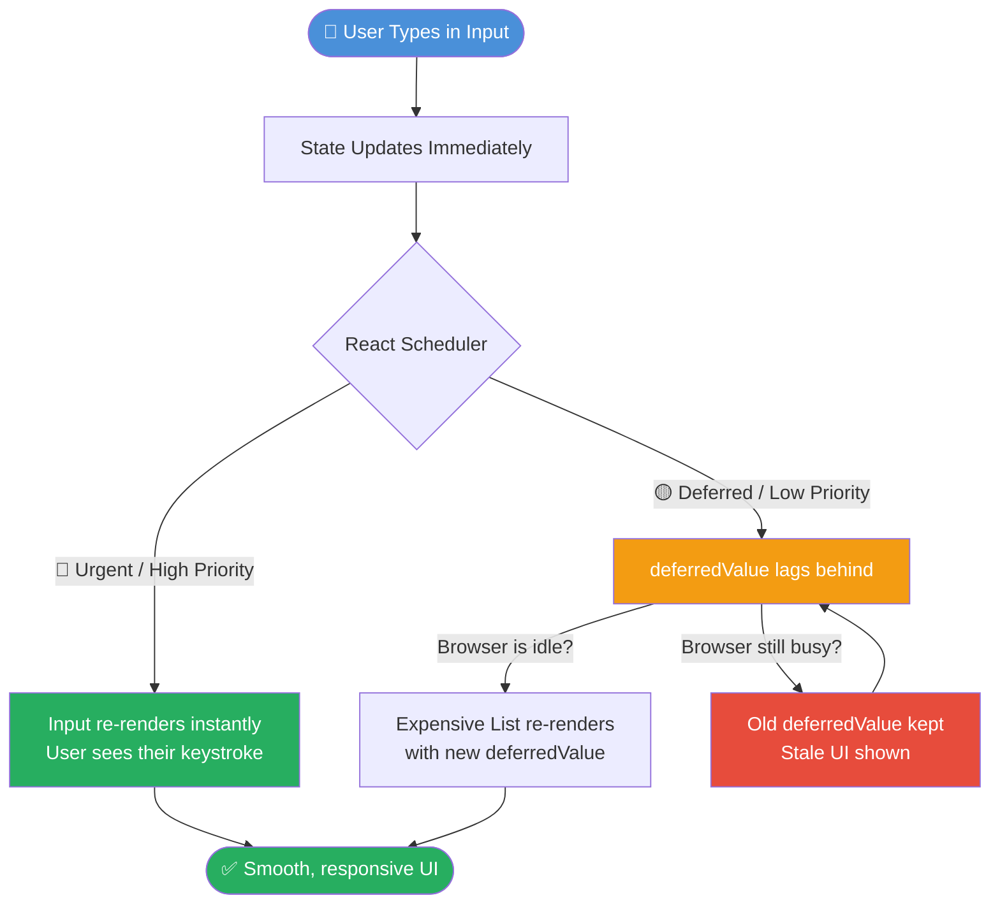
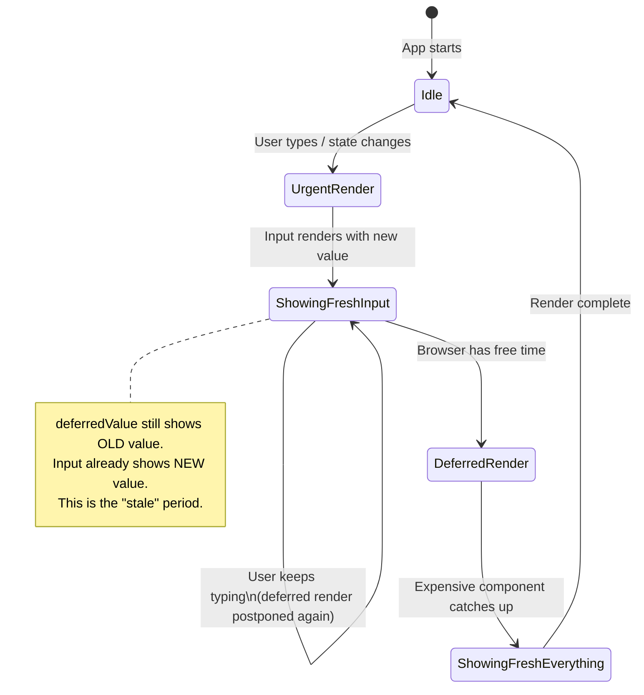
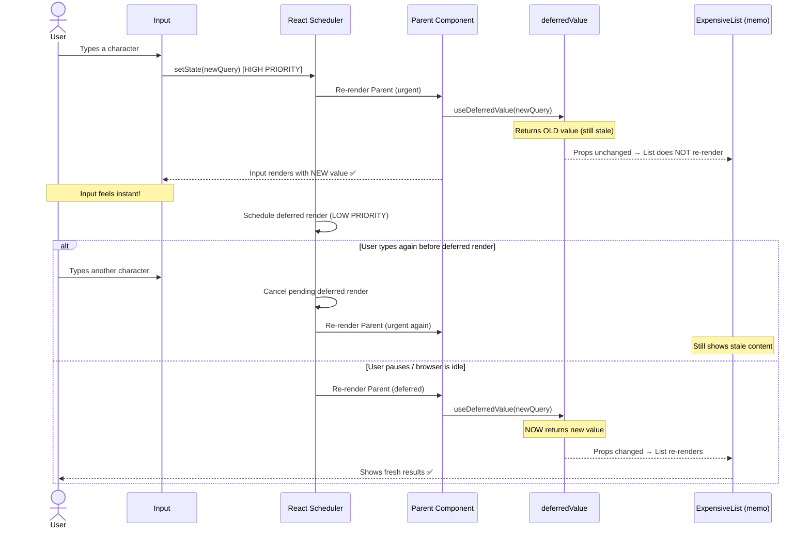
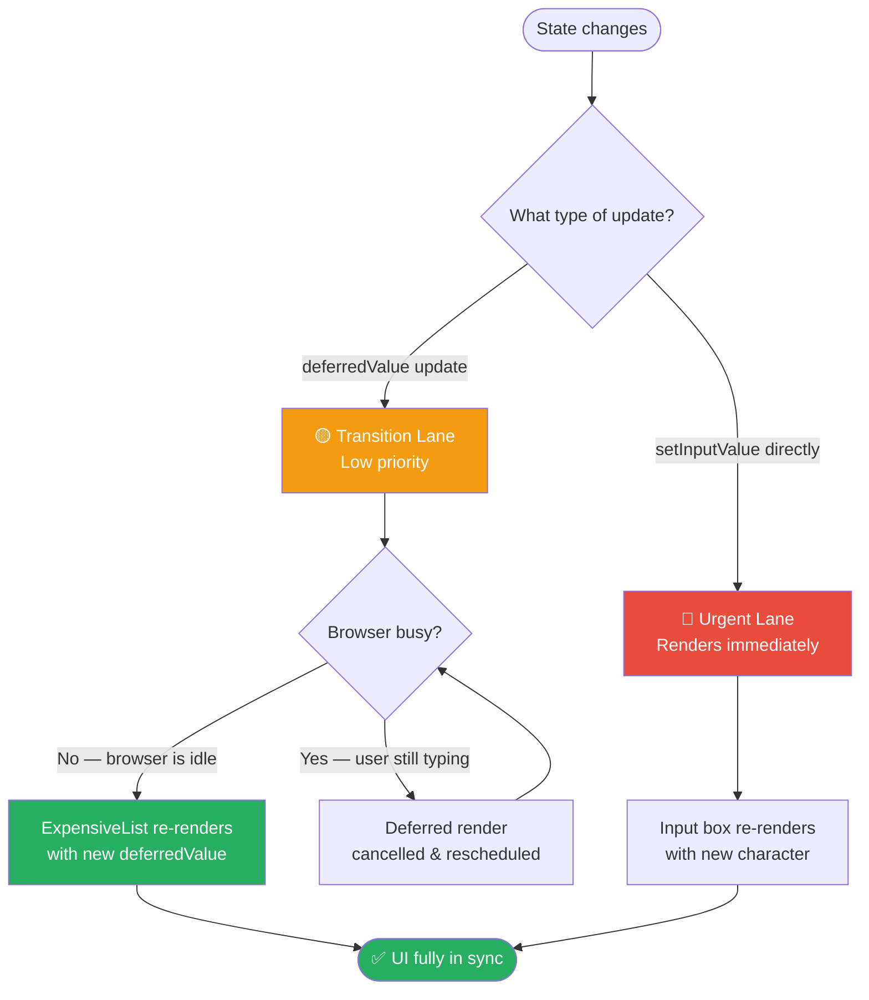

# 🪝 useDeferredValue — Complete Beginner's Guide

> **Level:** Beginner → Intermediate
> **React Version:** 18+
> **Prerequisites:** Basic React, useState, useEffect

---

## 📋 Table of Contents

1. [What is useDeferredValue?](#-what-is-usedeferredvalue)
2. [Mental Model](#-mental-model)
3. [Syntax](#-syntax)
4. [How It Works Under The Hood](#️-how-it-works-under-the-hood)
5. [When To Use useDeferredValue](#-when-to-use-usedeferredvalue)
6. [Common Mistakes & Anti-patterns](#-common-mistakes--anti-patterns)
7. [Execution / Lifecycle Flow](#-execution--lifecycle-flow)
8. [Example 1 — The Basics](#-example-1--the-basics)
9. [Example 2 — Real World Use Case](#-example-2--real-world-use-case)
10. [Example 3 — Advanced Pattern](#-example-3--advanced-pattern)
11. [Mini Quiz](#-mini-quiz)
12. [Related Hooks](#-related-hooks)
13. [Further Reading](#-further-reading)

---

## 🎯 What is useDeferredValue?

### Plain English Explanation

Imagine you are a restaurant chef. A new order ticket comes in every few seconds. If you stop cooking the current meal every time a new ticket arrives to re-read it, you will never finish anything. Instead, you **finish what you are cooking now**, and only check the latest ticket when you have a free moment.

**`useDeferredValue` works exactly like that chef.**

When some data in your React app changes rapidly (like a user typing in a search box), `useDeferredValue` lets React say:

> "Keep showing the old result for now. When things calm down and I have spare time, I'll re-render with the new value."

This prevents your UI from freezing or feeling sluggish when expensive calculations or long lists need to re-render.

### The Key Idea in One Sentence

> `useDeferredValue` accepts a value and gives you back a **deferred (delayed) copy** of it — React will update the deferred copy only when the browser is idle and not busy with higher-priority updates.

### Real World Analogy Table

| Real World | React Equivalent |
|---|---|
| New order ticket (restaurant) | New state value from user input |
| Chef finishing current dish first | React finishing urgent renders |
| Chef reading the latest ticket when free | React updating deferred value when idle |
| Stale food shown while cooking | Old UI shown while new render is pending |

### What Problem Does It Solve?

Before `useDeferredValue`, if you had a list of 10,000 items that needed to re-render every keystroke, the page would **stutter or freeze**. The input itself might feel laggy.

`useDeferredValue` lets the input remain **instantly responsive** (high priority) while the expensive list re-render **waits in the background** (low priority).

---

## 🧠 Mental Model

### How State Flows Without useDeferredValue

```
User types → state updates → EVERYTHING re-renders → page stutters
```

### How State Flows With useDeferredValue



### The Two Renders Concept



---

## 📖 Syntax

### Exact Syntax

```jsx
import { useDeferredValue } from 'react';

function MyComponent() {
  const [inputValue, setInputValue] = useState('');

  const deferredValue = useDeferredValue(inputValue);

  // inputValue  → updates immediately (urgent)
  // deferredValue → updates later (deferred/low-priority)

  return (
    <div>
      <input value={inputValue} onChange={e => setInputValue(e.target.value)} />
      <ExpensiveList query={deferredValue} />
    </div>
  );
}
```

### With Initial Value (React 19+)

```jsx
// React 19 added an optional second argument: initialValue
const deferredValue = useDeferredValue(value, initialValue);
```

### Parameter Reference Table

| Parameter | Type | Required | Description |
|---|---|---|---|
| `value` | `any` | ✅ Yes | The value you want to defer. Can be a string, number, object, array — anything. |
| `initialValue` | `any` | ❌ No (React 19+) | The value to return on the very first render before deferral kicks in. If omitted, React uses `value` on the first render. |

### Return Value

| Return | Type | Description |
|---|---|---|
| `deferredValue` | same type as `value` | A copy of `value` that may lag behind during rapid updates. Eventually equals `value` when React is idle. |

---

## ⚙️ How It Works Under The Hood

### React's Concurrent Rendering (Beginner Friendly)

React 18 introduced **Concurrent Mode**. Think of it as React being able to **pause, resume, and prioritize** rendering work — just like a computer's operating system manages multiple tasks.

Before Concurrent Mode, React was like a chef who had to finish cooking one dish completely before even looking at anything else. Now, React can say:

> "I'll start cooking this dish, but if something more important comes in, I'll put this aside and handle that first."

### How useDeferredValue Uses This

When you call `useDeferredValue(value)`, here's what actually happens step by step:

**Step 1 — The urgent render:**
React immediately re-renders your component with the **new `value`** for things that use it directly (like your input field). The `deferredValue` still returns the **old value** in this render.

**Step 2 — Scheduling the deferred render:**
React schedules a second, **lower-priority render** in the background. This is like scheduling a background task on your computer.

**Step 3 — Interruption (the magic part):**
If the user types again before the deferred render finishes, React **cancels** the in-progress deferred render and starts fresh. The old, stale UI stays visible until a render can complete without being interrupted.

**Step 4 — The deferred render completes:**
When the user pauses and the browser is idle, the deferred render completes and `deferredValue` becomes the same as `value`. Everything is now "fresh."

### The Key Internal Mechanism

React uses a **lane system** internally (think of lanes like priority queues). `useDeferredValue` runs in a **transition lane** — the same low-priority lane used by `useTransition`. High-priority updates (user input, clicks) always win over transition-lane renders.

### Why It's Different From Debouncing

| Feature | Debounce (setTimeout) | useDeferredValue |
|---|---|---|
| Delay | Fixed time (e.g., 300ms) | Adaptive — as long as needed |
| Cancellation | Clears the timer | Cancels incomplete renders |
| Mechanism | JavaScript timing | React's render scheduler |
| Works with Suspense | ❌ No | ✅ Yes |
| CPU-aware | ❌ No | ✅ Yes (uses idle time) |

---

## ✅ When To Use useDeferredValue

Use `useDeferredValue` when you have **a value that updates frequently** driving an **expensive render**, and you want the input or trigger to feel **instantly responsive**.

- 🔍 **Search / filter inputs** — User types a search query. Filtering a large list (thousands of items) is deferred so the input never lags.

- 📊 **Data visualizations** — A slider controls a chart with hundreds of data points. The slider moves instantly; the chart updates when idle.

- 🗂️ **Large list rendering** — Switching tabs or categories in an app with long lists. The old list stays visible while the new one is computed.

- 🌐 **Autocomplete dropdowns** — Suggestions list re-renders lazily while the user's typed characters appear instantly.

- 🔢 **Real-time calculations** — A form input feeds a complex financial calculation. The input is live; the calculation catches up.

- 🗺️ **Map / canvas updates** — Dragging a slider to change a map view or canvas animation. UI controls are snappy; the expensive render catches up.

- 🧩 **Lazy Suspense trees** — When combined with Suspense, `useDeferredValue` can keep showing old content while new content loads in the background.

---

## ❌ Common Mistakes & Anti-patterns

### Mistake 1 — Deferring the Wrong Thing (the input itself)

**❌ BAD — Never defer the value used directly by the input:**

```jsx
function Bad() {
  const [query, setQuery] = useState('');
  // 🚫 Wrong: deferring the value that feeds the input
  const deferredQuery = useDeferredValue(query);

  return (
    // 🚫 This makes the INPUT itself laggy!
    <input value={deferredQuery} onChange={e => setQuery(e.target.value)} />
  );
}
```

**✅ GOOD — Defer only the value fed to expensive components:**

```jsx
function Good() {
  const [query, setQuery] = useState('');
  // ✅ Correct: defer the query only for the expensive list
  const deferredQuery = useDeferredValue(query);

  return (
    <div>
      {/* Input uses the live, immediate value */}
      <input value={query} onChange={e => setQuery(e.target.value)} />
      {/* Expensive list uses the deferred (lagging) value */}
      <ExpensiveList filter={deferredQuery} />
    </div>
  );
}
```

> **Why:** The whole point is to keep the input fast. Deferring `deferredQuery` back into the input defeats the purpose entirely.

---

### Mistake 2 — Skipping memo() on the expensive component

**❌ BAD — Expensive component re-renders on every keystroke anyway:**

```jsx
// 🚫 No memo — this re-renders on every render of the parent,
//    making useDeferredValue useless.
function ExpensiveList({ filter }) {
  const results = computeHeavyFilter(filter); // Expensive!
  return <ul>{results.map(r => <li key={r.id}>{r.name}</li>)}</ul>;
}

function Parent() {
  const [query, setQuery] = useState('');
  const deferredQuery = useDeferredValue(query);
  // 🚫 Even though deferredQuery hasn't changed, ExpensiveList
  //    still re-renders because Parent re-renders on every keystroke.
  return <ExpensiveList filter={deferredQuery} />;
}
```

**✅ GOOD — Wrap the expensive component in memo():**

```jsx
// ✅ memo prevents re-render if props haven't changed
const ExpensiveList = memo(function ExpensiveList({ filter }) {
  const results = computeHeavyFilter(filter); // Only runs when filter changes
  return <ul>{results.map(r => <li key={r.id}>{r.name}</li>)}</ul>;
});

function Parent() {
  const [query, setQuery] = useState('');
  const deferredQuery = useDeferredValue(query);
  // ✅ Now ExpensiveList only re-renders when deferredQuery changes,
  //    not on every keystroke.
  return <ExpensiveList filter={deferredQuery} />;
}
```

> **Why:** Without `memo`, the parent re-renders on every keystroke and takes `ExpensiveList` with it. `useDeferredValue` can't save you if the child re-renders due to parent renders regardless.

---

### Mistake 3 — Using it for network requests (use useTransition instead)

**❌ BAD — Using useDeferredValue to delay a fetch:**

```jsx
function Bad() {
  const [query, setQuery] = useState('');
  const deferredQuery = useDeferredValue(query);

  // 🚫 This doesn't actually delay or debounce the fetch.
  //    useDeferredValue is about rendering, not side effects.
  useEffect(() => {
    fetch(`/api/search?q=${deferredQuery}`).then(/* ... */);
  }, [deferredQuery]);
}
```

**✅ GOOD — Use debounce or useTransition for async data fetching:**

```jsx
function Good() {
  const [query, setQuery] = useState('');
  const [results, setResults] = useState([]);
  const [isPending, startTransition] = useTransition();

  function handleChange(e) {
    const val = e.target.value;
    setQuery(val);
    // ✅ useTransition is better for async operations
    startTransition(async () => {
      const data = await fetch(`/api/search?q=${val}`).then(r => r.json());
      setResults(data);
    });
  }

  return (
    <div>
      <input value={query} onChange={handleChange} />
      {isPending && <span>Loading...</span>}
      <ResultsList results={results} />
    </div>
  );
}
```

> **Why:** `useDeferredValue` defers **rendering** work. It won't prevent or batch network requests. For async side effects, `useTransition` or plain debounce is more appropriate.

---

### Mistake 4 — Assuming deferredValue is always stale

**❌ BAD — Treating deferredValue as permanently different:**

```jsx
function Bad() {
  const [query, setQuery] = useState('');
  const deferredQuery = useDeferredValue(query);

  // 🚫 This check is wrong — when typing stops,
  //    deferredQuery WILL equal query. The comparison is only
  //    true during rapid updates.
  if (deferredQuery !== query) {
    return <p>Always showing stale data...</p>;
  }
  return <ExpensiveList filter={deferredQuery} />;
}
```

**✅ GOOD — Use the stale check only for showing a loading indicator:**

```jsx
function Good() {
  const [query, setQuery] = useState('');
  const deferredQuery = useDeferredValue(query);

  // ✅ This is the right use: show a visual hint when deferred value is behind
  const isStale = deferredQuery !== query;

  return (
    <div>
      <input value={query} onChange={e => setQuery(e.target.value)} />
      {/* Show subtle loading state only when stale */}
      <div style={{ opacity: isStale ? 0.5 : 1 }}>
        <ExpensiveList filter={deferredQuery} />
      </div>
    </div>
  );
}
```

---

### Mistake 5 — Using useDeferredValue for simple/cheap renders

**❌ BAD — Adding complexity where it's not needed:**

```jsx
function Unnecessary() {
  const [count, setCount] = useState(0);
  // 🚫 Overkill: incrementing a counter is not expensive
  const deferredCount = useDeferredValue(count);

  return (
    <div>
      <button onClick={() => setCount(c => c + 1)}>+1</button>
      <p>Count: {deferredCount}</p> {/* This renders a number — trivial! */}
    </div>
  );
}
```

**✅ GOOD — Only use it when rendering is genuinely expensive:**

```jsx
function Appropriate() {
  const [count, setCount] = useState(0);
  // ✅ Just use the value directly for simple renders
  return (
    <div>
      <button onClick={() => setCount(c => c + 1)}>+1</button>
      <p>Count: {count}</p>
    </div>
  );
}
```

> **Why:** `useDeferredValue` adds mental overhead. Only reach for it when profiling shows rendering is actually slow.

---

## 🔄 Execution / Lifecycle Flow

### Full Lifecycle Sequence



### Render Priority Flowchart



---

## 💡 Example 1 — The Basics

### What You Will See

A simple page with a text input and a "counter list" that simulates an expensive render. When you type quickly, the input updates instantly while the list lags behind slightly (showing a dimmed state). When you stop typing, the list catches up.

### Full Component

```jsx
// example1-basics/App.jsx
// PURPOSE: Demonstrates the most basic usage of useDeferredValue
// to keep an input responsive while a "heavy" list re-renders lazily.

import { useState, useDeferredValue, memo } from 'react'; // Import the three tools we need

// ─────────────────────────────────────────────
// SUB-COMPONENT: SlowList
// This simulates an expensive render by creating 2000 list items.
// We wrap it in memo() so it only re-renders when its props change.
// ─────────────────────────────────────────────

const SlowList = memo(function SlowList({ query }) { // memo prevents unnecessary re-renders
  const items = []; // Start with an empty array to fill with list items

  // Build 2000 items that each check if they match the query
  for (let i = 0; i < 2000; i++) { // Loop 2000 times to simulate a large dataset
    const text = `Item number ${i}`; // Create a label for this item
    const isMatch = query && text.toLowerCase().includes(query.toLowerCase()); // Check if it matches the search
    items.push( // Add a <li> element to our array
      <li
        key={i} // React needs a unique key for each list item
        style={{
          color: isMatch ? 'green' : 'gray', // Highlight matches in green
          fontWeight: isMatch ? 'bold' : 'normal', // Bold the matched items
          padding: '2px 0', // A little vertical breathing room
        }}
      >
        {text} {isMatch ? '✅' : ''} {/* Show a checkmark next to matches */}
      </li>
    );
  }

  return ( // Return the full list wrapped in a <ul>
    <ul style={{ maxHeight: '300px', overflowY: 'auto', padding: '0 1rem' }}> {/* Scrollable list */}
      {items} {/* Render all 2000 items */}
    </ul>
  );
}); // End of memo() wrapper

// ─────────────────────────────────────────────
// MAIN COMPONENT: App
// ─────────────────────────────────────────────

export default function App() { // This is the main component that gets rendered
  const [query, setQuery] = useState(''); // query = what the user has typed, starts empty

  // useDeferredValue gives us a "lagging" copy of query.
  // deferredQuery updates ONLY when React has spare rendering time.
  const deferredQuery = useDeferredValue(query); // Create the deferred version

  // isStale is true when React hasn't caught up yet (user is typing fast)
  const isStale = query !== deferredQuery; // Compare live vs deferred to detect staleness

  return ( // Render the UI
    <div style={{ fontFamily: 'sans-serif', padding: '2rem', maxWidth: '600px' }}> {/* Page wrapper */}
      <h1>🔍 useDeferredValue — Basics</h1> {/* Page title */}

      <p style={{ color: '#555' }}> {/* Explanation text */}
        Type in the box below. The input stays{' '}
        <strong>instantly responsive</strong>, while the list of 2000 items
        updates lazily when React has time.
      </p>

      {/* The search input — uses the LIVE query value directly */}
      <input
        type="text" // Plain text input
        value={query} // Controlled: tied to live query state
        onChange={(e) => setQuery(e.target.value)} // Update query on every keystroke
        placeholder="Type to filter items..." // Hint text
        style={{ // Inline styles for the input box
          width: '100%', // Full width
          padding: '0.5rem', // Inner padding
          fontSize: '1.1rem', // Readable font size
          marginBottom: '1rem', // Space below the input
          boxSizing: 'border-box', // Include padding in width calculation
        }}
      />

      {/* Status bar: shows whether the list is stale */}
      <div style={{ marginBottom: '0.5rem', fontSize: '0.9rem', color: '#888' }}> {/* Small status text */}
        {isStale // Check if deferred value is behind
          ? '⏳ List is updating...' // Show this when deferredQuery hasn't caught up
          : '✅ List is up to date'} {/* Show this when everything is in sync */}
      </div>

      {/* Live value display — just for learning purposes */}
      <div style={{ marginBottom: '0.5rem', fontSize: '0.85rem' }}> {/* Debug info box */}
        <strong>Live query:</strong> "{query}" {/* Show the immediate query value */}
        {' | '}
        <strong>Deferred query:</strong> "{deferredQuery}" {/* Show the deferred value */}
      </div>

      {/* The expensive list — wrapped in a div with opacity change to signal staleness */}
      <div
        style={{
          opacity: isStale ? 0.6 : 1, // Dim the list while it's stale
          transition: 'opacity 0.2s', // Smooth fade in/out for the opacity change
        }}
      >
        {/* SlowList receives deferredQuery, NOT live query */}
        {/* This is the key: expensive component uses the deferred value */}
        <SlowList query={deferredQuery} /> {/* Only re-renders when deferredQuery changes */}
      </div>

      {/* Footer note */}
      <p style={{ marginTop: '1rem', fontSize: '0.8rem', color: '#aaa' }}> {/* Small note at bottom */}
        💡 Open DevTools → Performance tab to see deferred renders.
      </p>
    </div>
  );
}
```

### What You Will See in the Browser

```
┌─────────────────────────────────────────────┐
│ 🔍 useDeferredValue — Basics                │
│                                             │
│ Type in the box below. The input stays      │
│ instantly responsive, while the list...     │
│                                             │
│ ┌─────────────────────────────────────────┐ │
│ │ Type to filter items...                 │ │
│ └─────────────────────────────────────────┘ │
│                                             │
│ ✅ List is up to date                       │
│ Live query: "" | Deferred query: ""         │
│                                             │
│ ┌── Scrollable List ──────────────────────┐ │
│ │ • Item number 0                         │ │
│ │ • Item number 1                         │ │
│ │ • Item number 2  ...                    │ │
│ └─────────────────────────────────────────┘ │
└─────────────────────────────────────────────┘

[After typing "5" quickly:]

│ ⏳ List is updating...                      │
│ Live query: "5" | Deferred query: ""        │
│ (List appears dimmed at 60% opacity)        │

[After pausing:]

│ ✅ List is up to date                       │
│ Live query: "5" | Deferred query: "5"       │
│ Item number 5 ✅  (green, bold)             │
│ Item number 15 ✅ (green, bold)             │
│ Item number 25 ✅ (green, bold)             │
```

---

## 💡 Example 2 — Real World Use Case

### Scenario: Product Search with Category Filter

A realistic e-commerce product search page. The user types a product name and the results filter a large product catalogue in real time. The search input feels instant; the results panel catches up gracefully.

```jsx
// example2-realworld/App.jsx
// PURPOSE: Real-world product search with useDeferredValue.
// Scenario: User searches a large product catalogue. The search bar is
// instantly responsive; the product grid filters lazily.

import { useState, useDeferredValue, memo, useMemo } from 'react'; // Import all needed hooks

// ─────────────────────────────────────────────
// FAKE DATA: Generate 5000 mock products
// In a real app, this data would come from an API.
// ─────────────────────────────────────────────

const CATEGORIES = ['Electronics', 'Clothing', 'Books', 'Home', 'Sports']; // Available categories

// Generate a large fake product list
const ALL_PRODUCTS = Array.from({ length: 5000 }, (_, i) => ({ // Create 5000 product objects
  id: i, // Unique product ID
  name: `Product ${i} — ${CATEGORIES[i % CATEGORIES.length]}`, // Name with category
  category: CATEGORIES[i % CATEGORIES.length], // Assign category cyclically
  price: ((i * 7.3) % 500 + 1).toFixed(2), // Generate a fake price
  rating: ((i % 5) + 1), // Rating from 1 to 5
}));

// ─────────────────────────────────────────────
// SUB-COMPONENT: ProductCard
// Renders a single product card.
// ─────────────────────────────────────────────

const ProductCard = memo(function ProductCard({ product }) { // memo: only re-render if product changes
  return ( // Return a styled card element
    <div style={{ // Card container styles
      border: '1px solid #e0e0e0', // Light border
      borderRadius: '8px', // Rounded corners
      padding: '0.75rem', // Inner padding
      fontSize: '0.85rem', // Smaller font for compact cards
      background: '#fff', // White background
    }}>
      <div style={{ fontWeight: 'bold', marginBottom: '4px' }}>{product.name}</div> {/* Product name */}
      <div style={{ color: '#27ae60' }}>\${product.price}</div> {/* Price in green */}
      <div style={{ color: '#f39c12' }}>{'★'.repeat(product.rating)}{'☆'.repeat(5 - product.rating)}</div> {/* Star rating */}
      <div style={{ color: '#888', fontSize: '0.75rem' }}>{product.category}</div> {/* Category label */}
    </div>
  );
});

// ─────────────────────────────────────────────
// SUB-COMPONENT: ProductGrid
// Renders the filtered list of products.
// Wrapped in memo so it won't re-render unless its props change.
// ─────────────────────────────────────────────

const ProductGrid = memo(function ProductGrid({ query, category }) { // Props: search query + category filter
  // Filter the products — this is the expensive operation
  const filtered = useMemo(() => { // useMemo caches the filtered result
    return ALL_PRODUCTS.filter((p) => { // Filter all 5000 products
      const matchesQuery = p.name.toLowerCase().includes(query.toLowerCase()); // Check name match
      const matchesCategory = category === 'All' || p.category === category; // Check category match
      return matchesQuery && matchesCategory; // Both must match
    });
  }, [query, category]); // Recompute only when query or category changes

  if (filtered.length === 0) { // If no products match...
    return <p style={{ color: '#888', textAlign: 'center', padding: '2rem' }}>No products found.</p>; // Show empty state
  }

  return ( // Return the product grid
    <div>
      <p style={{ fontSize: '0.85rem', color: '#555', marginBottom: '0.5rem' }}> {/* Result count */}
        Showing <strong>{filtered.length}</strong> of {ALL_PRODUCTS.length} products {/* Display totals */}
      </p>
      <div style={{ // Grid layout
        display: 'grid', // CSS grid
        gridTemplateColumns: 'repeat(auto-fill, minmax(180px, 1fr))', // Responsive columns
        gap: '0.75rem', // Space between cards
        maxHeight: '400px', // Limit visible height
        overflowY: 'auto', // Enable scrolling
      }}>
        {filtered.slice(0, 200).map((product) => ( // Show first 200 results to avoid DOM overload
          <ProductCard key={product.id} product={product} /> // Render each product card
        ))}
        {filtered.length > 200 && ( // If more than 200 results exist...
          <div style={{ gridColumn: '1 / -1', textAlign: 'center', color: '#888', padding: '1rem' }}> {/* Full-width message */}
            + {filtered.length - 200} more results. Narrow your search to see them. {/* Tell user to narrow search */}
          </div>
        )}
      </div>
    </div>
  );
});

// ─────────────────────────────────────────────
// MAIN COMPONENT: App
// ─────────────────────────────────────────────

export default function App() { // Main app component
  const [searchQuery, setSearchQuery] = useState(''); // The raw search text from the input
  const [selectedCategory, setSelectedCategory] = useState('All'); // Currently selected category filter

  // Defer the search query so the input stays responsive
  const deferredQuery = useDeferredValue(searchQuery); // Lags behind searchQuery during fast typing
  // Defer the category too so switching categories doesn't cause a janky jump
  const deferredCategory = useDeferredValue(selectedCategory); // Lags behind selectedCategory during rapid switching

  // isStale: true when the user is typing faster than React can re-render
  const isStale = searchQuery !== deferredQuery || selectedCategory !== deferredCategory; // Either can be stale

  return ( // Render the full page
    <div style={{ fontFamily: 'sans-serif', padding: '1.5rem', maxWidth: '900px', margin: '0 auto' }}> {/* Page wrapper */}
      <h1 style={{ marginBottom: '0.25rem' }}>🛍️ Product Search</h1> {/* Page heading */}
      <p style={{ color: '#888', marginTop: 0, fontSize: '0.9rem' }}> {/* Subtitle */}
        Searching {ALL_PRODUCTS.length.toLocaleString()} products with useDeferredValue {/* Show product count */}
      </p>

      {/* Search controls row */}
      <div style={{ display: 'flex', gap: '0.75rem', marginBottom: '1rem', flexWrap: 'wrap' }}> {/* Controls container */}

        {/* Search text input */}
        <input
          type="text" // Text input type
          value={searchQuery} // Controlled — tied to live state
          onChange={(e) => setSearchQuery(e.target.value)} // Update live query on every keystroke
          placeholder="Search products..." // Placeholder hint
          style={{ flex: 1, minWidth: '200px', padding: '0.5rem 0.75rem', fontSize: '1rem', borderRadius: '6px', border: '1px solid #ccc' }} // Input styles
        />

        {/* Category filter dropdown */}
        <select
          value={selectedCategory} // Controlled — tied to live category state
          onChange={(e) => setSelectedCategory(e.target.value)} // Update category on change
          style={{ padding: '0.5rem 0.75rem', fontSize: '1rem', borderRadius: '6px', border: '1px solid #ccc' }} // Select styles
        >
          <option value="All">All Categories</option> {/* Default: show all */}
          {CATEGORIES.map((cat) => ( // Render one option per category
            <option key={cat} value={cat}>{cat}</option> // Category option
          ))}
        </select>
      </div>

      {/* Loading indicator — only visible when list is stale */}
      {isStale && ( // Only show when deferred values are behind
        <div style={{ marginBottom: '0.5rem', color: '#f39c12', fontSize: '0.9rem' }}> {/* Orange loading text */}
          ⏳ Filtering products... {/* Loading message */}
        </div>
      )}

      {/* Product grid — receives DEFERRED values, not live values */}
      <div style={{ opacity: isStale ? 0.7 : 1, transition: 'opacity 0.15s' }}> {/* Dim while stale */}
        <ProductGrid
          query={deferredQuery} // ✅ Uses deferred query — not the live one
          category={deferredCategory} // ✅ Uses deferred category — not the live one
        />
      </div>
    </div>
  );
}
```

---

## 💡 Example 3 — Advanced Pattern

### Scenario: useDeferredValue + Suspense + useTransition Together

This advanced example shows how `useDeferredValue` integrates with **React Suspense** to show stale content while new content loads, combined with `useTransition` for navigation. This pattern is used in frameworks like Next.js and Remix for smooth page transitions.

```jsx
// example3-advanced/App.jsx
// PURPOSE: Advanced pattern combining useDeferredValue with Suspense,
// useTransition, and memo for a smooth, non-blocking search + navigation UI.

import {
  useState,          // For managing local state
  useDeferredValue,  // For deferring expensive renders
  useTransition,     // For marking navigations as non-urgent
  memo,              // For preventing unnecessary child re-renders
  Suspense,          // For declarative loading states
  use,               // React 19: unwrap a promise inside a component
} from 'react';

// ─────────────────────────────────────────────
// FAKE ASYNC DATA LAYER
// Simulates a slow API that takes time to fetch results.
// In production this would be a real fetch() call.
// ─────────────────────────────────────────────

// Cache to store already-made promises (avoids re-fetching the same query)
const cache = new Map(); // Map from query string → promise/result

// Simulate a slow API response — takes `delay` ms to resolve
function simulateFetch(query, delay = 600) { // Default 600ms delay
  const key = `${query}`; // Cache key is the query string
  if (cache.has(key)) return cache.get(key); // Return cached promise if exists

  // Create a new promise that resolves after the delay
  const promise = new Promise((resolve) => { // Create a fake async operation
    setTimeout(() => { // Wait for the simulated delay
      const results = Array.from({ length: 30 }, (_, i) => ({ // Generate 30 fake results
        id: i, // Result ID
        title: `Result ${i} for "${query}"`, // Result title including the query
        snippet: `This is a detailed description for result ${i} matching "${query}".`, // Fake description
      }));
      resolve(results); // Resolve with the fake results
    }, delay); // After the specified delay
  });

  cache.set(key, promise); // Store in cache so we don't re-fetch
  return promise; // Return the promise
}

// ─────────────────────────────────────────────
// SUB-COMPONENT: SearchResults
// Uses React 19's `use()` hook to unwrap the search promise.
// This component SUSPENDS while the data is loading.
// ─────────────────────────────────────────────

const SearchResults = memo(function SearchResults({ query }) { // memo: skip re-render if query unchanged
  if (!query) { // If no query has been entered yet...
    return <p style={{ color: '#888', textAlign: 'center', padding: '1rem' }}>Enter a search term above.</p>; // Show prompt
  }

  const promise = simulateFetch(query); // Get (or create) the fetch promise for this query
  const results = use(promise); // 🔑 use() SUSPENDS the component until the promise resolves

  return ( // Render results once the promise is resolved
    <div>
      <p style={{ fontSize: '0.85rem', color: '#555', marginBottom: '0.75rem' }}> {/* Result count */}
        Found <strong>{results.length}</strong> results for "<em>{query}</em>" {/* Display query and count */}
      </p>
      <ul style={{ listStyle: 'none', padding: 0, margin: 0 }}> {/* Unstyled list */}
        {results.map((result) => ( // Map each result to a list item
          <li key={result.id} style={{ // Individual result item
            padding: '0.75rem', // Inner padding
            marginBottom: '0.5rem', // Space between items
            borderRadius: '6px', // Rounded corners
            background: '#f8f9fa', // Light gray background
            borderLeft: '3px solid #4A90D9', // Blue left accent border
          }}>
            <div style={{ fontWeight: 'bold', marginBottom: '4px' }}>{result.title}</div> {/* Result title */}
            <div style={{ fontSize: '0.85rem', color: '#555' }}>{result.snippet}</div> {/* Result snippet */}
          </li>
        ))}
      </ul>
    </div>
  );
});

// ─────────────────────────────────────────────
// SUB-COMPONENT: SearchHistory
// Shows previous searches so the user can click to repeat them.
// ─────────────────────────────────────────────

function SearchHistory({ history, onSelect }) { // Takes history array and a click handler
  if (history.length === 0) return null; // Don't render if no history

  return ( // Return the history section
    <div style={{ marginBottom: '1rem' }}> {/* History container */}
      <p style={{ fontSize: '0.8rem', color: '#888', margin: '0 0 0.4rem' }}>Recent searches:</p> {/* Label */}
      <div style={{ display: 'flex', flexWrap: 'wrap', gap: '0.4rem' }}> {/* Flex row of history pills */}
        {history.map((h, i) => ( // Map each history entry to a pill button
          <button
            key={i} // Key for React list rendering
            onClick={() => onSelect(h)} // Click to re-run this search
            style={{ // Pill button styles
              padding: '0.2rem 0.6rem', // Compact padding
              borderRadius: '20px', // Fully rounded pill shape
              border: '1px solid #ccc', // Light border
              background: '#fff', // White background
              cursor: 'pointer', // Show pointer cursor
              fontSize: '0.8rem', // Small font
            }}
          >
            🕐 {h} {/* Clock icon + search term */}
          </button>
        ))}
      </div>
    </div>
  );
}

// ─────────────────────────────────────────────
// MAIN COMPONENT: App
// Combines useDeferredValue + Suspense + useTransition
// ─────────────────────────────────────────────

export default function App() { // Main app component
  const [inputValue, setInputValue] = useState(''); // Raw input from the user (live)
  const [committedQuery, setCommittedQuery] = useState(''); // The "submitted" search query
  const [searchHistory, setSearchHistory] = useState([]); // Array of recent search terms

  // useTransition: marks the committedQuery update as non-urgent.
  // isPending is true while the transition is in progress.
  const [isPending, startTransition] = useTransition(); // Get transition state and trigger

  // useDeferredValue: gives us a deferred copy of committedQuery.
  // During a transition OR when the user submits fast, this lags behind.
  // KEY INSIGHT: Suspense will show the OLD content (stale) instead of a spinner
  // because we pass deferredQuery to SearchResults instead of committedQuery.
  const deferredQuery = useDeferredValue(committedQuery); // Create a deferred search query

  // isShowingStale: true when what's displayed is "old" data while new data loads
  const isShowingStale = deferredQuery !== committedQuery; // Detect staleness

  // handleSearch: called when the user submits the search
  function handleSearch(queryToRun) { // Accepts the query string
    const trimmed = queryToRun.trim(); // Remove leading/trailing spaces
    if (!trimmed) return; // Don't search if input is empty

    // Update history (keep last 5, no duplicates)
    setSearchHistory((prev) => { // Update history state
      const withoutDuplicate = prev.filter((h) => h !== trimmed); // Remove duplicate if exists
      return [trimmed, ...withoutDuplicate].slice(0, 5); // Add to front, keep only 5
    });

    // Wrap the state update in startTransition → marks it as non-urgent
    startTransition(() => { // This render is lower priority
      setCommittedQuery(trimmed); // Update the committed search query
    }); // End of transition wrapper
  } // End of handleSearch

  // handleKeyDown: submit search on Enter key press
  function handleKeyDown(e) { // Keyboard event handler
    if (e.key === 'Enter') { // Only act on Enter key
      handleSearch(inputValue); // Run search with current input value
    }
  }

  return ( // Render the full advanced search UI
    <div style={{ fontFamily: 'sans-serif', padding: '1.5rem', maxWidth: '700px', margin: '0 auto' }}> {/* Page wrapper */}
      <h1>🔬 Advanced: Deferred Value + Suspense + Transition</h1> {/* Page title */}
      <p style={{ color: '#666', fontSize: '0.9rem' }}> {/* Explanation subtitle */}
        Old results stay visible (no spinner flash) while new ones load in the background. {/* What makes this advanced */}
      </p>

      {/* Search input row */}
      <div style={{ display: 'flex', gap: '0.5rem', marginBottom: '0.75rem' }}> {/* Input row container */}
        <input
          type="text" // Text input
          value={inputValue} // Controlled — tied to live inputValue
          onChange={(e) => setInputValue(e.target.value)} // Update live value every keystroke
          onKeyDown={handleKeyDown} // Listen for Enter key
          placeholder="Search... (press Enter)" // Hint text
          style={{ // Input styles
            flex: 1, // Take available width
            padding: '0.5rem 0.75rem', // Inner padding
            fontSize: '1rem', // Readable font
            borderRadius: '6px', // Rounded corners
            border: '1px solid #ccc', // Light border
          }}
        />
        <button
          onClick={() => handleSearch(inputValue)} // Click to run search
          disabled={isPending} // Disable while a transition is pending
          style={{ // Button styles
            padding: '0.5rem 1rem', // Comfortable padding
            fontSize: '1rem', // Match input font size
            borderRadius: '6px', // Rounded corners
            border: 'none', // No border
            background: isPending ? '#ccc' : '#4A90D9', // Gray when pending, blue otherwise
            color: '#fff', // White text
            cursor: isPending ? 'not-allowed' : 'pointer', // Update cursor based on state
          }}
        >
          {isPending ? '...' : '🔍 Search'} {/* Show ellipsis while pending, icon+text otherwise */}
        </button>
      </div>

      {/* Search history bar */}
      <SearchHistory // Render the history component
        history={searchHistory} // Pass the history array
        onSelect={(term) => { // When a history item is clicked...
          setInputValue(term); // Update the input to show the clicked term
          handleSearch(term); // Run the search immediately
        }}
      />

      {/* Status badge: shows stale / loading / fresh state */}
      {committedQuery && ( // Only show badge if a search has been run
        <div style={{ // Badge container
          display: 'inline-block', // Inline so it doesn't stretch full width
          padding: '0.2rem 0.6rem', // Compact padding
          borderRadius: '12px', // Pill shape
          fontSize: '0.8rem', // Small text
          marginBottom: '0.75rem', // Space below badge
          background: isShowingStale ? '#FFF3CD' : '#D4EDDA', // Yellow=stale, green=fresh
          color: isShowingStale ? '#856404' : '#155724', // Matching text colors
          border: `1px solid ${isShowingStale ? '#FFEEBA' : '#C3E6CB'}`, // Matching border
        }}>
          {isShowingStale ? '🕒 Showing previous results while loading...' : `✅ Results for "${committedQuery}"`} {/* Status text */}
        </div>
      )}

      {/* The key part: Suspense wraps SearchResults.
          When SearchResults suspends (data loading), Suspense shows a fallback.
          HOWEVER: because we pass deferredQuery (not committedQuery),
          the PREVIOUS SearchResults stays rendered during the deferred period,
          and Suspense only shows its fallback if there is NO previous content. */}
      <Suspense
        fallback={ // Shown ONLY on the very first search (no previous content to show)
          <div style={{ textAlign: 'center', padding: '2rem', color: '#888' }}> {/* Spinner container */}
            <div style={{ fontSize: '2rem', marginBottom: '0.5rem' }}>⏳</div> {/* Spinner icon */}
            <div>Loading first results...</div> {/* Loading message */}
          </div>
        }
      >
        {/* SearchResults uses deferredQuery — NOT committedQuery.
            This means while committedQuery changes, deferredQuery holds the old value,
            so SearchResults continues to render OLD data (no suspend!) until React
            decides to update deferredQuery and trigger the new Suspense/fetch. */}
        <SearchResults query={deferredQuery} /> {/* ✅ Deferred: shows stale content, not a spinner */}
      </Suspense>
    </div>
  );
}
```

> **Note:** The `use()` hook is available in React 19. For React 18, replace `use(promise)` with a Suspense-compatible data-fetching library like SWR or React Query with Suspense mode enabled.

---

## 🧪 Mini Quiz

Test your understanding! Click to reveal each answer.

---

**Question 1:** You have an input that filters a list of 10,000 items. Where should you use `useDeferredValue`?

<details>
<summary>🤔 Click to reveal answer</summary>

**Answer:** You should defer the query value passed to the **list component**, NOT the input.

```jsx
const [query, setQuery] = useState('');
const deferredQuery = useDeferredValue(query); // ✅ Created from live query

return (
  <>
    <input value={query} onChange={e => setQuery(e.target.value)} /> {/* Uses live query */}
    <BigList filter={deferredQuery} /> {/* Uses deferred query */}
  </>
);
```

The input stays instantly responsive; the list catches up lazily.

</details>

---

**Question 2:** Why should `BigList` be wrapped in `React.memo()`?

<details>
<summary>🤔 Click to reveal answer</summary>

**Answer:** Without `memo`, the parent re-renders every time the user types, and React will re-render `BigList` on every keystroke — even though `deferredQuery` hasn't changed yet. `memo` makes `BigList` skip re-renders when its props haven't changed, which is what allows `useDeferredValue` to actually defer the expensive work.

```jsx
// Without memo: re-renders on every keystroke → useDeferredValue is useless
const BigList = ({ filter }) => { ... };

// With memo: only re-renders when deferredQuery actually changes ✅
const BigList = memo(({ filter }) => { ... });
```

</details>

---

**Question 3:** What is the difference between `useDeferredValue` and debouncing with `setTimeout`?

<details>
<summary>🤔 Click to reveal answer</summary>

**Answer:** Key differences:

| Feature | Debounce (setTimeout) | useDeferredValue |
|---|---|---|
| Delay | Fixed (e.g., 300ms always waits 300ms even on a fast device) | Adaptive — React skips renders if the browser is busy, renders immediately if idle |
| Mechanism | JavaScript timer | React's concurrent scheduler |
| Interruption | The old timeout is cancelled | The in-progress render is cancelled |
| Works with Suspense | ❌ No | ✅ Yes |
| Aware of device speed | ❌ No | ✅ Yes (uses idle time) |

`useDeferredValue` is smarter because it adapts to the device's actual rendering capacity.

</details>

---

## 🔗 Related Hooks

| Hook | Relationship | When to use it instead |
|---|---|---|
| `useTransition` | Sibling hook — both defer work. `useTransition` wraps a **state setter** call; `useDeferredValue` wraps a **value**. | When you control the state setter (e.g., wrapping `setState` on button click). Use `useDeferredValue` when you receive a value as a prop or from outside your component. |
| `useMemo` | Often used **together** with `useDeferredValue` to memoize the expensive calculation driven by the deferred value. | When you need to cache a computed value that depends on the deferred value. |
| `memo` (React.memo) | Used **together** — wrap the expensive component in `memo` so it only re-renders when the deferred value changes. | Always pair with `useDeferredValue` for maximum benefit. |
| `useCallback` | Memoizes functions — can complement `useDeferredValue` when passing callbacks into the deferred component. | When you are also passing callbacks to the memoized expensive component. |
| `useState` | Foundation — `useDeferredValue` always defers a value that originates from state. | For managing the live (non-deferred) state that feeds `useDeferredValue`. |
| `Suspense` | Pairs beautifully — `useDeferredValue` can keep the old `Suspense` content visible while new content loads. | When fetching async data inside a Suspense tree and you want to avoid loading flicker. |

---

## 📚 Further Reading

### Official Documentation

- 📖 [React Docs — useDeferredValue](https://react.dev/reference/react/useDeferredValue) — The authoritative reference with live examples.
- 📖 [React Docs — useDeferredValue vs useTransition](https://react.dev/reference/react/useDeferredValue#how-is-deferring-a-value-different-from-debouncing-and-throttling) — Official comparison of deferral techniques.
- 📖 [React Docs — Keeping the UI Responsive](https://react.dev/learn/keeping-the-ui-responsive) — Broader context for concurrent features.

### Community Resources

- 🌐 [Josh W Comeau — Snappy UI Optimization with useDeferredValue](https://www.joshwcomeau.com/react/use-deferred-value/) — Excellent visual walkthrough with real performance demos.
- 🌐 [Kent C. Dodds — useDeferredValue](https://epicreact.dev/use-deferred-value) — Practical patterns and when NOT to use it.
- 🌐 [TkDodo — Concurrent Features in React 18](https://tkdodo.eu/blog/concurrent-queries-in-react-query) — How React Query leverages concurrent features alongside `useDeferredValue`.

### Video Resources

- 🎥 Search "useDeferredValue React 18" on YouTube for visual demos — several conference talks from React Summit and React Conf cover this hook in depth.

---

## 📝 Summary Cheat Card

```
useDeferredValue(value)
         │
         ├── On urgent render (user types): returns OLD value
         │   → Expensive components skip re-render (props unchanged)
         │
         └── On deferred render (browser idle): returns NEW value
             → Expensive components finally re-render

Key Rules:
  ✅ Wrap expensive child in memo()
  ✅ Feed live value to the input
  ✅ Feed deferredValue to the expensive component
  ✅ Use isStale = value !== deferredValue for a loading indicator
  ❌ Don't defer cheap renders
  ❌ Don't use it for async data fetching
  ❌ Don't defer the value used by the input itself
```

---

*Last updated: 2026 · React 18+ · React 19 notes included*
