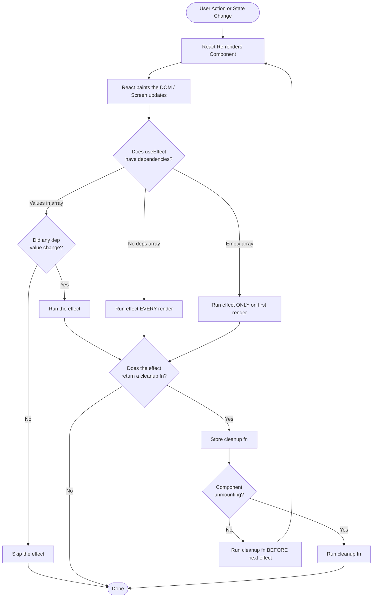
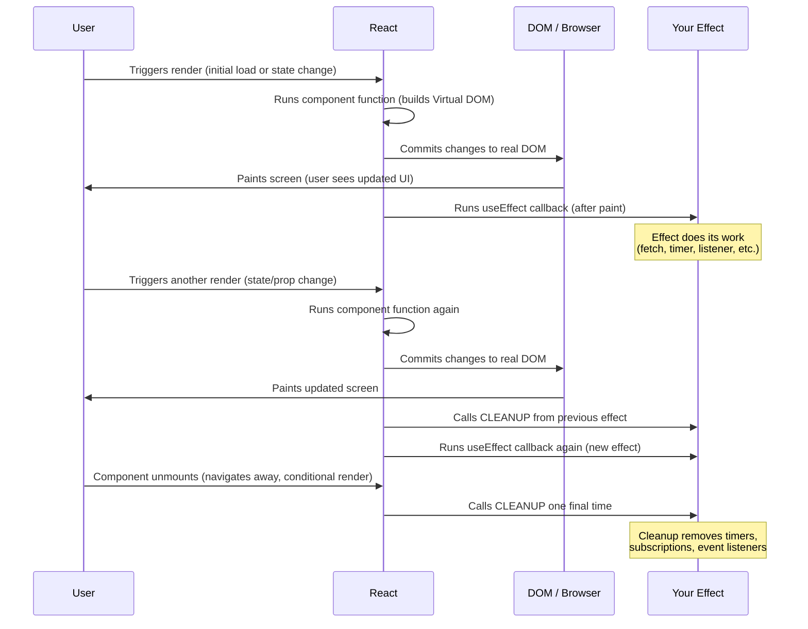
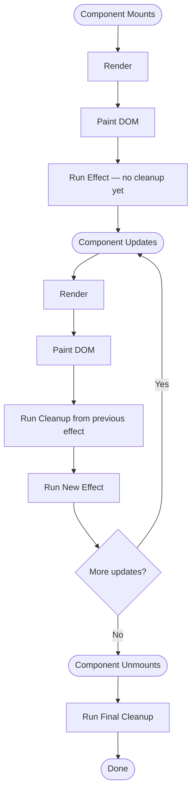

# 🪝 useEffect — The Complete Beginner's Guide

> **Who is this for?** Anyone who has learned `useState` and wants to understand how React components can interact with the outside world — APIs, timers, the browser, subscriptions, and more.

---

## Table of Contents

1. [🎯 What is useEffect?](#-what-is-useeffect)
2. [🧠 Mental Model](#-mental-model)
3. [📖 Syntax](#-syntax)
4. [⚙️ How It Works Under The Hood](#️-how-it-works-under-the-hood)
5. [✅ When To Use useEffect](#-when-to-use-useeffect)
6. [❌ Common Mistakes & Anti-patterns](#-common-mistakes--anti-patterns)
7. [🔄 Execution / Lifecycle Flow](#-execution--lifecycle-flow)
8. [💡 Example 1 — The Basics](#-example-1--the-basics)
9. [💡 Example 2 — Real World Use Case](#-example-2--real-world-use-case)
10. [💡 Example 3 — Advanced Pattern](#-example-3--advanced-pattern)
11. [🧪 Mini Quiz](#-mini-quiz)
12. [🔗 Related Hooks](#-related-hooks)
13. [📚 Further Reading](#-further-reading)

---

## 🎯 What is useEffect?

### Plain English, No Jargon

Imagine you just moved into a new apartment (**your component rendered**). You need to:

- 📦 Plug in your refrigerator (start a timer or subscription)
- 📡 Connect to the internet (fetch data from an API)
- 🔔 Set up smoke detectors (add event listeners)

And when you eventually move out (**your component unmounts**), you:

- 🔌 Unplug the appliances (clear timers)
- 📡 Cancel your internet contract (cancel subscriptions)
- 🔇 Remove smoke detectors (remove event listeners)

**`useEffect` is the hook that handles all of this.** It lets your component run code *after* React has painted the screen — and optionally clean everything up when the component is done.

### Formal (But Still Simple) Definition

`useEffect` is a React hook that lets you synchronize your component with an **external system**. That could be:

- A REST API
- A WebSocket
- The browser's `document` or `window`
- A timer (`setInterval` / `setTimeout`)
- An analytics tracker
- A third-party library (like Google Maps, D3, etc.)

> **Key insight:** React components are *pure* by design — given the same props and state, they always render the same UI. But the real world is messy. `useEffect` is the escape hatch that lets you reach out into that messy world *without* breaking React's rules.

### The Golden Rule

> **`useEffect` runs AFTER the component renders.** Not before. Not during. AFTER.

This is different from class-based React where you had `componentDidMount`, `componentDidUpdate`, and `componentWillUnmount`. `useEffect` replaces all three in one API.

---

## 🧠 Mental Model

Think of `useEffect` as a **side-effect supervisor** that sits outside the render cycle:



### Key Concepts from the Diagram

| Concept | Meaning |
|---|---|
| **Effect** | The function you pass to `useEffect` |
| **Dependency Array** | The second argument — controls *when* the effect re-runs |
| **Cleanup Function** | An optional function returned by the effect — runs before the component unmounts OR before the next effect fires |

---

## 📖 Syntax

```jsx
useEffect(effectFunction, dependencyArray);
```

### Full Annotated Syntax

```jsx
useEffect(
  () => {
    // 👈 This is your "effect" — the side-effect code
    // It runs AFTER the render

    doSomeSideEffect();

    // 👇 Optionally return a cleanup function
    return () => {
      cleanUpTheSideEffect();
    };
  },
  [dep1, dep2] // 👈 Dependency array — controls when this effect re-runs
);
```

### Parameter Reference Table

| Parameter | Type | Required | Description |
|---|---|---|---|
| `effectFunction` | `() => void \| (() => void)` | ✅ Yes | The function containing your side-effect code. Can optionally return a cleanup function. |
| `dependencyArray` | `Array<any>` | ❌ No | An array of values. The effect re-runs whenever any value in this array changes between renders. |

### Dependency Array Variants

| Syntax | Meaning | Runs When |
|---|---|---|
| `useEffect(fn)` | No array — **omitted** | After **every** render |
| `useEffect(fn, [])` | Empty array | Only after the **first** render (mount) |
| `useEffect(fn, [a, b])` | With values | After mount, and after any render where `a` or `b` changed |

---

## ⚙️ How It Works Under The Hood

You don't need to know React internals to use `useEffect`, but understanding the basics will save you from bugs.

### Step-by-step, what React does:

1. **You call `useEffect(fn, deps)`** inside your component function.

2. **React doesn't run `fn` immediately.** It just notes: *"After I finish painting the screen, I'll run this."*

3. **React renders your JSX** and updates the actual browser DOM.

4. **The browser paints** — the user sees the new UI on screen.

5. **React now runs your effect function `fn`.**

6. **If your effect returns a function** (the cleanup), React stores it.

7. **On the NEXT render**, before running the effect again, React first calls the stored cleanup function.

8. **When the component is removed** from the screen (unmounted), React calls the cleanup function one last time.

### Why does it run AFTER the paint?

Because React wants the user to see a responsive UI. If effects ran *before* the paint, a slow API call would delay the screen update and make the app feel laggy. By running effects asynchronously after the paint, the user always sees the UI first.

> **Exception:** `useLayoutEffect` runs *before* the paint (synchronously). Use it only when you need to measure the DOM. Stick to `useEffect` for everything else.

### React's Comparison Algorithm

When you have a dependency array `[count, name]`, React uses **`Object.is()`** to compare each value from the previous render to the current render.

- Primitive values (`number`, `string`, `boolean`): compared by **value** ✅
- Objects and Arrays: compared by **reference** ⚠️ (this is a common gotcha!)

```jsx
// This effect re-runs EVERY render because {} !== {} (new object each time)
useEffect(() => {
  console.log("This runs every time!");
}, [{}]); // ❌ BAD

// This effect only re-runs when `count` actually changes
useEffect(() => {
  console.log("Count changed to:", count);
}, [count]); // ✅ GOOD
```

---

## ✅ When To Use useEffect

Use `useEffect` when your component needs to interact with something **outside of React**:

- **📡 Fetching data from an API** — When a component mounts, load data from a server and store it in state.

- **⏱️ Setting up timers** — Start a `setInterval` or `setTimeout` and clean it up when the component unmounts.

- **🔔 Adding event listeners** — Listen to `window.resize`, `document.keydown`, or custom DOM events, and remove the listener on cleanup.

- **🔗 Subscribing to external data sources** — WebSockets, Firebase real-time listeners, Redux store subscriptions, etc.

- **📊 Tracking analytics** — Log page views or user interactions to an analytics service when a route changes.

- **🗺️ Integrating third-party libraries** — Initialize Google Maps, D3 charts, or other libraries that need a DOM node.

- **💾 Syncing with localStorage / sessionStorage** — Persist state changes to the browser's storage automatically.

---

## ❌ Common Mistakes & Anti-patterns

### Mistake 1: Missing Cleanup for Timers

**❌ BAD — Memory leak!**

```jsx
function Timer() {
  const [seconds, setSeconds] = useState(0);

  useEffect(() => {
    // This interval is NEVER cleared!
    // Even after the component unmounts, it keeps running.
    setInterval(() => {
      setSeconds(s => s + 1);
    }, 1000);
  }, []); // No cleanup returned

  return <p>Seconds: {seconds}</p>;
}
```

**✅ GOOD — Cleanup included**

```jsx
function Timer() {
  const [seconds, setSeconds] = useState(0);

  useEffect(() => {
    const intervalId = setInterval(() => { // Store the interval ID
      setSeconds(s => s + 1);             // Update state each second
    }, 1000);

    return () => clearInterval(intervalId); // ✅ Clear it on cleanup!
  }, []);

  return <p>Seconds: {seconds}</p>;
}
```

> **Why it matters:** Without cleanup, the interval keeps firing even after the component is gone, causing memory leaks and "can't perform a state update on an unmounted component" warnings.

---

### Mistake 2: Infinite Loop from Missing Dependencies

**❌ BAD — Causes infinite render loop**

```jsx
function UserProfile() {
  const [user, setUser] = useState(null);
  const [config, setConfig] = useState({ theme: "dark" });

  useEffect(() => {
    // This effect updates `config`, which is in the dep array,
    // which triggers the effect again — infinite loop!
    setConfig({ ...config, lastSeen: Date.now() });
  }, [config]); // `config` changes → effect runs → config changes → loop!
}
```

**✅ GOOD — Use functional update or restructure state**

```jsx
function UserProfile() {
  const [lastSeen, setLastSeen] = useState(null);

  useEffect(() => {
    // Only update `lastSeen`, not the entire config
    setLastSeen(Date.now()); // ✅ No loop
  }, []); // Runs once on mount
}
```

---

### Mistake 3: Async Function Directly as the Effect

**❌ BAD — Syntax error (sort of)**

```jsx
useEffect(async () => {       // ❌ async functions return Promises
  const data = await fetchData(); // React expects void or a cleanup fn
  setData(data);                  // A Promise is NOT a cleanup function!
}, []);
```

**✅ GOOD — Define async function inside the effect**

```jsx
useEffect(() => {               // The outer function is NOT async
  const fetchData = async () => { // Define async inside
    const data = await getUser();
    setData(data);
  };

  fetchData(); // Call it

  // You can still return a cleanup function here if needed
}, []);
```

---

### Mistake 4: Stale Closure — Using Outdated State

**❌ BAD — `count` is always 0 inside the timer**

```jsx
function Counter() {
  const [count, setCount] = useState(0);

  useEffect(() => {
    const id = setInterval(() => {
      setCount(count + 1); // ❌ `count` is captured as 0 (stale closure!)
    }, 1000);
    return () => clearInterval(id);
  }, []); // Empty array means count is NEVER updated inside
}
```

**✅ GOOD — Use functional update form**

```jsx
function Counter() {
  const [count, setCount] = useState(0);

  useEffect(() => {
    const id = setInterval(() => {
      setCount(prev => prev + 1); // ✅ `prev` is always the latest value
    }, 1000);
    return () => clearInterval(id);
  }, []); // Empty array is now safe
}
```

---

### Mistake 5: Forgetting Dependencies (eslint-plugin-react-hooks catches this)

**❌ BAD — `userId` is used but not listed**

```jsx
useEffect(() => {
  fetchUser(userId); // `userId` is used here...
}, []); // ...but not listed! Effect won't re-run when userId changes
```

**✅ GOOD — All used values in the dependency array**

```jsx
useEffect(() => {
  fetchUser(userId); // `userId` is used...
}, [userId]); // ...and listed! Effect re-runs when userId changes ✅
```

> **Pro tip:** Install `eslint-plugin-react-hooks` and enable the `react-hooks/exhaustive-deps` rule. It will catch missing dependencies automatically.

---

### Mistake 6: Effects That Belong in Event Handlers

**❌ BAD — Fetching when it should be an event response**

```jsx
function Form() {
  const [submitted, setSubmitted] = useState(false);

  // ❌ This is awkward. The fetch is a RESPONSE to a user action.
  useEffect(() => {
    if (submitted) {
      submitFormToAPI();
    }
  }, [submitted]);

  return <button onClick={() => setSubmitted(true)}>Submit</button>;
}
```

**✅ GOOD — Put it in the event handler directly**

```jsx
function Form() {
  const handleSubmit = async () => { // ✅ Direct response to user action
    await submitFormToAPI();
  };

  return <button onClick={handleSubmit}>Submit</button>;
}
```

> **Rule of thumb:** If the code runs *because the user did something*, put it in an event handler. If it runs *because a value changed or the component appeared*, put it in `useEffect`.

---

## 🔄 Execution / Lifecycle Flow



### Lifecycle Phases at a Glance



---

## 💡 Example 1 — The Basics

**What you'll see:** A counter that logs to the console every time it changes, with a live timer that shows elapsed seconds.

```jsx
// File: example1-basics/App.jsx

import React, { useState, useEffect } from "react"; // Import React hooks

function App() {                                 // Define the main component
  const [count, setCount] = useState(0);         // State: the click counter, starts at 0
  const [seconds, setSeconds] = useState(0);     // State: elapsed seconds, starts at 0

  // ---- Effect 1: Log count changes ----
  useEffect(() => {                              // Run an effect that depends on `count`
    console.log("Count changed to:", count);     // Log the new value to the browser console
    document.title = `Count: ${count}`;          // Also update the browser tab title
  }, [count]);                                   // Only re-run when `count` changes

  // ---- Effect 2: Run a timer ----
  useEffect(() => {                              // Run an effect once on mount
    const intervalId = setInterval(() => {       // Start a 1-second interval
      setSeconds(prev => prev + 1);              // Increment seconds (functional update = no stale closure)
    }, 1000);                                    // Interval fires every 1000ms (1 second)

    return () => clearInterval(intervalId);      // Cleanup: stop the interval when component unmounts
  }, []);                                        // Empty array: only runs on mount

  return (                                       // JSX to render on screen
    <div style={{ fontFamily: "sans-serif", padding: "2rem" }}> {/* Wrapper div */}
      <h1>useEffect Basics</h1>                  {/* Page heading */}

      <section>                                  {/* Counter section */}
        <h2>Click Counter</h2>                   {/* Section heading */}
        <p>You clicked {count} times.</p>        {/* Show current count */}
        <button onClick={() => setCount(c => c + 1)}> {/* Button increments count */}
          Click me ➕
        </button>
        <button onClick={() => setCount(0)} style={{ marginLeft: "1rem" }}> {/* Reset button */}
          Reset
        </button>
      </section>

      <section style={{ marginTop: "2rem" }}>    {/* Timer section */}
        <h2>Elapsed Time</h2>                    {/* Section heading */}
        <p>⏱️ {seconds} second(s) since mount</p> {/* Show elapsed seconds */}
      </section>

      <section style={{ marginTop: "2rem", color: "#555" }}> {/* Info section */}
        <small>Open the browser console to see Effect 1 logs!</small> {/* Hint */}
      </section>
    </div>
  );
}

export default App;                              // Export for use in index.jsx
```

**What you'll see in the browser:**
- An "useEffect Basics" heading
- A counter that increments when you click the button
- The browser tab title updates to `Count: N`
- A live timer that counts seconds since the component mounted
- Console logs every time the count changes

---

## 💡 Example 2 — Real World Use Case

**Scenario:** A GitHub user profile card that fetches data from the GitHub API when a username changes.

```jsx
// File: example2-realworld/App.jsx

import React, { useState, useEffect } from "react"; // Import hooks from React

function App() {
  const [username, setUsername] = useState("facebook"); // State: the GitHub username to look up
  const [profile, setProfile] = useState(null);         // State: the fetched profile data
  const [loading, setLoading] = useState(false);        // State: true while fetching
  const [error, setError] = useState(null);             // State: error message if fetch fails

  useEffect(() => {                                     // Effect: fetch when username changes
    if (!username.trim()) return;                       // Skip if username is empty

    let cancelled = false;                              // Flag to handle race conditions (cleanup)

    const fetchProfile = async () => {                  // Async function defined inside the effect
      setLoading(true);                                 // Show loading indicator
      setError(null);                                   // Clear any previous error
      setProfile(null);                                 // Clear previous profile

      try {                                             // Try to fetch the data
        const response = await fetch(                  // Make the API request
          `https://api.github.com/users/${username}`   // GitHub public API URL
        );

        if (!response.ok) {                            // If HTTP status is not 2xx
          throw new Error(`User not found (${response.status})`); // Throw a descriptive error
        }

        const data = await response.json();            // Parse the JSON response body

        if (!cancelled) {                              // Only update state if still mounted
          setProfile(data);                            // Store the profile data in state
        }
      } catch (err) {                                  // Catch any network or parsing errors
        if (!cancelled) {                              // Only update state if still mounted
          setError(err.message);                       // Store the error message in state
        }
      } finally {                                      // Always runs (success or error)
        if (!cancelled) {                              // Only update state if still mounted
          setLoading(false);                           // Hide loading indicator
        }
      }
    };

    fetchProfile();                                    // Call the async function

    return () => {                                     // Cleanup function
      cancelled = true;                                // Mark as cancelled to prevent stale updates
    };
  }, [username]);                                      // Re-run whenever `username` changes

  return (                                             // Start rendering JSX
    <div style={{ fontFamily: "sans-serif", maxWidth: "500px", margin: "2rem auto" }}>
      <h1>GitHub Profile Finder</h1>                   {/* Page title */}

      <input                                           /* Username input field */
        type="text"                                    /* Text input */
        value={username}                               /* Controlled: value from state */
        onChange={e => setUsername(e.target.value)}    /* Update state on each keystroke */
        placeholder="Enter GitHub username"            /* Placeholder text */
        style={{ width: "100%", padding: "0.5rem", fontSize: "1rem" }} /* Styling */
      />

      {loading && <p>⏳ Loading profile…</p>}          {/* Show loading text while fetching */}
      {error && <p style={{ color: "red" }}>❌ {error}</p>} {/* Show error in red */}

      {profile && (                                    /* Only render if we have data */
        <div style={{ border: "1px solid #ddd", borderRadius: "8px", padding: "1rem", marginTop: "1rem" }}>
          
          <h2>{profile.name || profile.login}</h2>    {/* Full name, or login if name is null */}
          <p>{profile.bio || "No bio available."}</p>  {/* Bio, or fallback text */}
          <p>📦 Public repos: {profile.public_repos}</p> {/* Number of public repos */}
          <p>👥 Followers: {profile.followers}</p>    {/* Follower count */}
          <a href={profile.html_url} target="_blank" rel="noreferrer"> {/* Link to GitHub page */}
            View on GitHub →
          </a>
        </div>
      )}
    </div>
  );
}

export default App;                                    // Export the component
```

**What you'll see:** A GitHub username input that fetches and displays a live profile card whenever you change the value.

---

## 💡 Example 3 — Advanced Pattern

**Scenario:** A custom `useWindowSize` hook and a `useDebounce` pattern — composing multiple effects together.

```jsx
// File: example3-advanced/App.jsx

import React, { useState, useEffect, useRef } from "react"; // Import hooks including useRef

// ============================================================
// Custom Hook 1: useWindowSize
// Tracks the browser window's width and height
// ============================================================
function useWindowSize() {                               // Define a custom hook (function starting with "use")
  const [size, setSize] = useState({                    // State: start with current window size
    width: window.innerWidth,                           // Initial width from browser
    height: window.innerHeight,                         // Initial height from browser
  });

  useEffect(() => {                                     // Effect to listen to resize events
    const handleResize = () => {                        // Handler runs on every resize
      setSize({                                         // Update state with new dimensions
        width: window.innerWidth,                       // New width
        height: window.innerHeight,                     // New height
      });
    };

    window.addEventListener("resize", handleResize);   // Add the resize listener

    return () => {                                      // Cleanup function
      window.removeEventListener("resize", handleResize); // Remove listener to prevent leaks
    };
  }, []);                                               // Only add listener once (on mount)

  return size;                                          // Return the current size object
}

// ============================================================
// Custom Hook 2: useDebounce
// Delays updating a value until the user has stopped typing
// ============================================================
function useDebounce(value, delayMs) {                  // Takes a value and delay in milliseconds
  const [debouncedValue, setDebouncedValue] = useState(value); // State: the delayed value

  useEffect(() => {                                     // Effect: set a timer on every value change
    const timerId = setTimeout(() => {                  // Start a timer
      setDebouncedValue(value);                         // Update debounced value after delay
    }, delayMs);                                        // Wait `delayMs` milliseconds

    return () => clearTimeout(timerId);                 // Cleanup: cancel timer if value changes again
  }, [value, delayMs]);                                 // Re-run when value or delay changes

  return debouncedValue;                                // Return the debounced value
}

// ============================================================
// Custom Hook 3: usePrevious
// Remembers the previous value of anything using a ref
// ============================================================
function usePrevious(value) {                           // Takes any value
  const ref = useRef(undefined);                        // useRef persists across renders without causing re-renders

  useEffect(() => {                                     // After every render...
    ref.current = value;                                // Store the latest value in the ref
  });                                                   // No dependency array: runs after every render

  return ref.current;                                   // Return the value from the PREVIOUS render
}

// ============================================================
// Main App Component — uses all three custom hooks
// ============================================================
function App() {
  const [searchTerm, setSearchTerm] = useState("");    // State: what the user is typing
  const { width, height } = useWindowSize();           // Destructure width + height from custom hook
  const debouncedSearch = useDebounce(searchTerm, 500); // Only update debouncedSearch after 500ms of silence
  const previousSearch = usePrevious(debouncedSearch); // Track the previous debounced value

  const [results, setResults] = useState([]);          // State: mock search results
  const [searching, setSearching] = useState(false);   // State: true while "searching"

  // Effect: run a mock search whenever the debounced term changes
  useEffect(() => {                                     // Effect: fires when debouncedSearch changes
    if (!debouncedSearch) {                             // If the search term is empty
      setResults([]);                                   // Clear results
      return;                                           // Exit early
    }

    setSearching(true);                                 // Show searching indicator

    // Simulate an API call with a 400ms delay
    const timer = setTimeout(() => {                   // Pretend to fetch from server
      const mockResults = [                            // Mock data (in real app: fetch from API)
        `${debouncedSearch} - result 1`,               // Build fake result strings
        `${debouncedSearch} - result 2`,               // Second fake result
        `${debouncedSearch} - result 3`,               // Third fake result
      ];
      setResults(mockResults);                         // Update results state
      setSearching(false);                             // Hide searching indicator
    }, 400);                                           // Simulate 400ms network latency

    return () => clearTimeout(timer);                  // Cleanup: cancel if search changes again
  }, [debouncedSearch]);                               // Only re-run when debouncedSearch changes

  return (                                             // Render JSX
    <div style={{ fontFamily: "sans-serif", padding: "2rem", maxWidth: "600px", margin: "0 auto" }}>
      <h1>Advanced useEffect Patterns</h1>             {/* Page heading */}

      {/* ---- Section 1: Window Size ---- */}
      <section style={{ marginBottom: "2rem", padding: "1rem", background: "#f0f4ff", borderRadius: "8px" }}>
        <h2>🪟 Window Size Tracker</h2>               {/* Section heading */}
        <p>Resize the browser window to see this update live:</p> {/* Instruction */}
        <code style={{ fontSize: "1.2rem" }}>         {/* Code display */}
          {width} × {height} px                        {/* Show current dimensions */}
        </code>
      </section>

      {/* ---- Section 2: Debounced Search ---- */}
      <section style={{ padding: "1rem", background: "#fff4e6", borderRadius: "8px" }}>
        <h2>🔍 Debounced Search</h2>                  {/* Section heading */}
        <p>Typing triggers the search only after you pause for 500ms:</p> {/* Explanation */}

        <input                                         /* Search input */
          type="text"                                  /* Text input type */
          value={searchTerm}                           /* Controlled value */
          onChange={e => setSearchTerm(e.target.value)} /* Update state on change */
          placeholder="Type to search…"               /* Placeholder */
          style={{ width: "100%", padding: "0.5rem", fontSize: "1rem", marginBottom: "0.5rem" }} /* Styles */
        />

        <p style={{ color: "#888" }}>                 {/* Show what React sees internally */}
          <strong>Live input:</strong> "{searchTerm}"  {/* Raw input value */}
          <br />
          <strong>Debounced:</strong> "{debouncedSearch}" {/* Debounced value (delayed) */}
          <br />
          <strong>Previous search:</strong> "{previousSearch || "—"}" {/* Value from last render */}
        </p>

        {searching && <p>⏳ Searching…</p>}            {/* Loading indicator */}

        {results.length > 0 && (                      /* Only show if there are results */
          <ul>                                         /* Unordered list of results */
            {results.map((r, i) => (                  /* Map each result to a list item */
              <li key={i}>{r}</li>                    /* List item with unique key */
            ))}
          </ul>
        )}
      </section>
    </div>
  );
}

export default App;                                    // Export the component
```

**What you'll see:** A live window-size display that updates as you resize, plus a search box that only triggers results after you pause typing (debounce).

---

## 🧪 Mini Quiz

Test your understanding! Click to reveal the answers.

---

**Question 1:** What does an empty dependency array `[]` tell React?

<details>
<summary>👁️ Show Answer</summary>

An empty dependency array `[]` tells React: **"Run this effect only once — after the very first render (mount)."** The effect will NOT re-run on any subsequent renders, no matter what state or prop changes. This is equivalent to `componentDidMount` in class components.

```jsx
useEffect(() => {
  console.log("I only run once!");
}, []); // ← empty array = run once
```

</details>

---

**Question 2:** A component has this code. What's wrong with it?

```jsx
useEffect(async () => {
  const data = await fetch('/api/users').then(r => r.json());
  setUsers(data);
}, []);
```

<details>
<summary>👁️ Show Answer</summary>

**The problem:** `async` functions always return a **Promise**. React expects the effect function to either return `undefined` (nothing) or a **cleanup function**. When you pass an `async` function, React receives a Promise as the "cleanup", which it ignores — but this can mask bugs and cause React warnings.

**The fix:**

```jsx
useEffect(() => {
  // Define async function INSIDE the effect
  const fetchUsers = async () => {
    const data = await fetch('/api/users').then(r => r.json());
    setUsers(data);
  };

  fetchUsers(); // Call it normally
}, []);
```

</details>

---

**Question 3:** Why might this code cause a problem, and how would you fix it?

```jsx
const [user, setUser] = useState({ name: "Alice" });

useEffect(() => {
  console.log("User changed!");
}, [user]);
```

<details>
<summary>👁️ Show Answer</summary>

**The problem:** React compares dependencies using `Object.is()`. Each time the component re-renders, `user` is a **new object in memory** even if the data inside it is identical. So `Object.is(prevUser, newUser)` returns `false` on every render, and the effect fires every single time.

**The fix — depend on the specific property you care about:**

```jsx
useEffect(() => {
  console.log("User name changed!", user.name);
}, [user.name]); // ✅ Primitive string comparison — works correctly
```

Or, if you genuinely need the whole object, make sure the object reference is stable (e.g., via `useMemo` or by lifting it outside the component).

</details>

---

## 🔗 Related Hooks

| Hook | Relationship to `useEffect` |
|---|---|
| `useState` | Almost always used together — effects usually respond to state changes and update state with fetched data |
| `useRef` | Use `useRef` inside effects to store mutable values (like interval IDs or previous values) without causing re-renders |
| `useCallback` | Wrap functions in `useCallback` before including them in a dependency array to prevent infinite loops |
| `useMemo` | Memoize expensive values to keep them referentially stable as dependencies |
| `useLayoutEffect` | Same API as `useEffect`, but fires synchronously *before* the browser paints. Use for DOM measurements only |
| `useReducer` | Often paired with `useEffect` for complex async state machines (loading/error/success states) |
| `useContext` | Access global context values inside effects (e.g., auth state for API requests) |

---

## 📚 Further Reading

### Official Documentation

- 📖 [React Docs: useEffect](https://react.dev/reference/react/useEffect) — The official reference with every option explained
- 📖 [React Docs: Synchronizing with Effects](https://react.dev/learn/synchronizing-with-effects) — The conceptual guide (highly recommended!)
- 📖 [React Docs: You Might Not Need an Effect](https://react.dev/learn/you-might-not-need-an-effect) — When NOT to use `useEffect`

### Community Resources

- 🌐 [A Complete Guide to useEffect](https://overreacted.io/a-complete-guide-to-useeffect/) — Dan Abramov's legendary deep-dive (long but worth every minute)
- 🌐 [useEffect Explained](https://www.joshwcomeau.com/react/the-perils-of-rehydration/) — Josh W. Comeau's visual explanations
- 🌐 [react-hooks/exhaustive-deps ESLint rule](https://github.com/facebook/react/tree/main/packages/eslint-plugin-react-hooks) — The linter rule that catches missing dependencies automatically

---

*Happy learning! 🚀 Remember: `useEffect` is powerful, but the best effect is often no effect at all. Always ask yourself: "Can I compute this during render instead?"*
