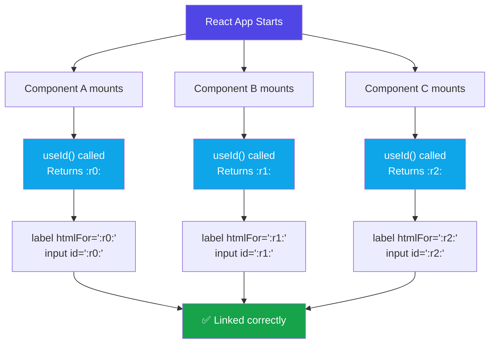

# 🪪 React `useId` Hook — Complete Beginner's Guide

> **Who is this for?** Anyone who is new to React or just discovered the `useId` hook and wants a thorough, plain-English walkthrough from zero to confident.

---

## Table of Contents

1. [🎯 What is useId?](#-what-is-useid)
2. [🧠 Mental Model](#-mental-model)
3. [📖 Syntax](#-syntax)
4. [⚙️ How It Works Under The Hood](#️-how-it-works-under-the-hood)
5. [✅ When To Use useId](#-when-to-use-useid)
6. [❌ Common Mistakes & Anti-patterns](#-common-mistakes--anti-patterns)
7. [🔄 Execution / Lifecycle Flow](#-execution--lifecycle-flow)
8. [💡 Example 1 — The Basics](#-example-1--the-basics)
9. [💡 Example 2 — Real World Use Case](#-example-2--real-world-use-case)
10. [💡 Example 3 — Advanced Pattern](#-example-3--advanced-pattern)
11. [🧪 Mini Quiz](#-mini-quiz)
12. [🔗 Related Hooks](#-related-hooks)
13. [📚 Further Reading](#-further-reading)

---

## 🎯 What is useId?

`useId` is a React hook that **generates a unique, stable ID string** for use inside a component.

### Plain English Explanation

Imagine you work at a large hospital. Every time a new patient walks in, the front desk assigns them a unique patient ID — like `P-00142`. This ID never changes for that patient during their visit, and no two patients ever share the same ID. The ID is used everywhere: on their wristband, their chart, their lab orders. Without it, nurses and doctors would have no reliable way to link documents to the right person.

`useId` does exactly the same thing for your React components. Every time a component renders, React gives it a unique ID. That ID:
- **Never changes** between renders (it is *stable*)
- **Is unique** even if the same component appears multiple times on a page
- **Works correctly** even during server-side rendering (SSR), where generating IDs manually can cause mismatches

### Why Do We Need This?

In HTML, form elements (`<input>`, `<textarea>`, `<select>`) must be linked to their `<label>` elements using matching `id` and `htmlFor` attributes. Example:

```html
<label for="email">Email</label>
<input id="email" type="email" />
```

This is critical for **accessibility** — screen readers read the label aloud when the user focuses the input. But if you have the same form component used twice on the page, you now have two inputs both with `id="email"`. That's invalid HTML and breaks accessibility.

`useId` solves this by guaranteeing each component instance gets its own unique ID.

---

## 🧠 Mental Model

Think of `useId` as a **ticket dispenser** at a deli counter. Each customer who walks up gets a new, unique ticket number. No two customers have the same number, and the number stays the same as long as that customer is at the counter.



### Key Insight

- Each component call to `useId()` produces a **different** ID
- Calling `useId()` multiple times inside the **same** component also produces different IDs each time
- The ID is **deterministic** — React can predict it on the server and the client, so they always match (no hydration mismatch)

---

## 📖 Syntax

```jsx
import { useId } from 'react';

function MyComponent() {
  const id = useId();
  // id is something like ":r0:" or ":r1:" etc.
  return (
    <div>
      <label htmlFor={id}>Name</label>
      <input id={id} type="text" />
    </div>
  );
}
```

### API Reference Table

| Parameter | Type | Required | Description |
|-----------|------|----------|-------------|
| *(none)*  | —    | —        | `useId` takes no arguments |

### Return Value Table

| Return Value | Type   | Description |
|--------------|--------|-------------|
| `id`         | string | A unique, stable string like `":r0:"`. Guaranteed to be unique per component instance. |

### Rules of Hooks (apply here too)

| Rule | Explanation |
|------|-------------|
| Must be called at the **top level** | Don't call `useId` inside loops, conditions, or nested functions |
| Must be called inside a **React function component** or custom hook | Cannot be called in class components or plain JS functions |
| Cannot be used as a **CSS selector** key | The `:` characters in the ID make it unsafe as a CSS selector without escaping |

---

## ⚙️ How It Works Under The Hood

### The Problem It Solves

Before `useId` (React 18), developers would do things like:

```jsx
// BAD — global counter, breaks SSR
let counter = 0;
function TextField() {
  const id = `field-${counter++}`; // different on server vs client!
  return <input id={id} />;
}
```

This causes a **hydration mismatch** in SSR apps. The server renders the page with `id="field-0"`, but by the time the client runs, some other component might have incremented the counter, so the client tries to hydrate with `id="field-3"`. React throws an error.

### How React Generates the ID

1. **React maintains an internal "fiber tree"** — a data structure that represents every component in your app as a node (called a "fiber").
2. When you call `useId()`, React looks at **where this component sits in the fiber tree** (its position, depth, and index).
3. It encodes that position into a string using a base-32 encoding scheme, wrapped in colons: `:r0:`, `:r1:`, etc.
4. Because the **tree structure is the same on server and client**, the ID is the same on both sides. No mismatch. ✅

### Why Colons?

The colons (`:`) are intentional. They make the ID look unusual so it's unlikely to conflict with any ID a developer would manually write. It also makes it easy to spot in DevTools.

### Stability

Once a component mounts, its `useId` value **never changes**, even across re-renders. It is completely stable. This is different from something like `Math.random()`, which gives a new value every render.

### Multiple IDs in One Component

If you need several IDs inside one component, you have two options:

**Option A** — Call `useId` multiple times:
```jsx
const nameId = useId();
const emailId = useId();
```

**Option B** — Derive multiple IDs from one base ID:
```jsx
const baseId = useId();
const nameId = `${baseId}-name`;
const emailId = `${baseId}-email`;
```

Option B is preferred because it uses only one hook call and creates a clear naming relationship.

---

## ✅ When To Use `useId`

Use `useId` in these situations:

- **Linking `<label>` to `<input>`**: The most common use case. Every accessible form input needs a label that references the input's `id`.

- **Linking `<label>` to `<textarea>` or `<select>`**: Same rule applies — any interactive form element should be labelled.

- **ARIA attributes that reference other elements**: For example, `aria-describedby`, `aria-labelledby`, `aria-controls`, and `aria-owns` all reference IDs of other elements. `useId` ensures those IDs are unique.

- **Associating error messages with inputs**: A common pattern is `<input aria-describedby={errorId} />` and `<p id={errorId}>Error text</p>`. Both must share the same ID.

- **SVG `<defs>` references**: SVG elements like `<clipPath>`, `<linearGradient>`, and `<mask>` are defined in `<defs>` and referenced by ID elsewhere. If the same SVG component is used twice, the IDs would clash without `useId`.

- **Reusable component libraries**: When building a design system or component library, your `TextField`, `Checkbox`, `Select`, etc. must all be safe to use multiple times on a page.

- **Accordion / disclosure widgets**: An accordion uses `aria-controls` on the button and `id` on the panel. Both must match, and multiple accordions on a page must each have unique IDs.

---

## ❌ Common Mistakes & Anti-patterns

### Mistake 1: Using `useId` as a list key

**❌ BAD:**
```jsx
function TodoList({ todos }) {
  const id = useId();
  return (
    <ul>
      {todos.map((todo) => (
        // WRONG: Don't use useId as a key for list items
        <li key={`${id}-${todo.text}`}>{todo.text}</li>
      ))}
    </ul>
  );
}
```

**✅ GOOD:**
```jsx
function TodoList({ todos }) {
  return (
    <ul>
      {todos.map((todo) => (
        // Use a stable, data-derived key (like todo.id from your database)
        <li key={todo.id}>{todo.text}</li>
      ))}
    </ul>
  );
}
```

**Why?** `useId` is meant for DOM attribute IDs (for accessibility), not for React list reconciliation keys. Keys should come from your data (database IDs, UUIDs, etc.).

---

### Mistake 2: Generating IDs with `Math.random()` or `Date.now()`

**❌ BAD:**
```jsx
function EmailField() {
  // WRONG: Changes every render, breaks SSR, causes hydration errors
  const id = `email-${Math.random()}`;
  return (
    <>
      <label htmlFor={id}>Email</label>
      <input id={id} type="email" />
    </>
  );
}
```

**✅ GOOD:**
```jsx
import { useId } from 'react';

function EmailField() {
  // CORRECT: Stable across renders, safe for SSR
  const id = useId();
  return (
    <>
      <label htmlFor={id}>Email</label>
      <input id={id} type="email" />
    </>
  );
}
```

**Why?** `Math.random()` produces a new value every render, breaking the label/input link. It also differs between server and client, causing hydration mismatches in Next.js / Remix apps.

---

### Mistake 3: Using `useId` as a CSS selector

**❌ BAD:**
```jsx
function MyComponent() {
  const id = useId();
  // WRONG: The colons in ":r0:" break CSS selector syntax
  const styles = document.querySelector(`#${id}`); // This fails!
  return <div id={id} />;
}
```

**✅ GOOD:**
```jsx
import { useId, useRef } from 'react';

function MyComponent() {
  const id = useId();
  const ref = useRef(null); // Use a ref to access the DOM element directly
  return <div id={id} ref={ref} />;
}
```

**Why?** The `:` character in the ID (e.g., `:r0:`) is a special character in CSS selectors. `document.querySelector('#:r0:')` will throw. Use `ref` to access DOM elements directly instead.

---

### Mistake 4: Calling `useId` inside a condition or loop

**❌ BAD:**
```jsx
function FormField({ showLabel }) {
  if (showLabel) {
    const id = useId(); // WRONG: Hooks cannot be called conditionally!
    return <label htmlFor={id}>Name</label>;
  }
  return null;
}
```

**✅ GOOD:**
```jsx
function FormField({ showLabel }) {
  const id = useId(); // CORRECT: Always call at top level
  if (!showLabel) return null;
  return <label htmlFor={id}>Name</label>;
}
```

**Why?** React requires hooks to always be called in the same order every render. Conditional hook calls break this rule and cause runtime errors.

---

### Mistake 5: Assuming the ID format is fixed

**❌ BAD:**
```jsx
function MyComponent() {
  const id = useId();
  // WRONG: Don't rely on the specific format ":r0:" — it's an implementation detail!
  const number = id.replace(/:/g, '').replace('r', '');
  return <div>{number}</div>;
}
```

**✅ GOOD:**
```jsx
function MyComponent() {
  const id = useId();
  // CORRECT: Just use the ID as an opaque string — treat it as a black box
  return (
    <>
      <label htmlFor={id}>Name</label>
      <input id={id} />
    </>
  );
}
```

**Why?** The format of the generated ID (`:r0:`) is an internal implementation detail of React. It could change in future versions. Treat the ID as an opaque, unique string.

---

## 🔄 Execution / Lifecycle Flow

This diagram shows exactly **when** `useId` runs during a component's lifecycle:

```mermaid
sequenceDiagram
    participant Browser
    participant React
    participant Component
    participant DOM

    Browser->>React: Page loads / Component first needed
    React->>Component: Begin rendering (mount phase)
    Component->>React: useId() called
    React-->>Component: Returns ":r0:" (stable unique ID)
    Component->>React: Returns JSX with id=":r0:" and htmlFor=":r0:"
    React->>DOM: Commits: creates <label for=":r0:"> and <input id=":r0:">
    DOM-->>Browser: Page displays with linked label & input

    Note over React,Component: User interacts — state changes

    Browser->>React: Re-render triggered (e.g. setState)
    React->>Component: Re-render begins
    Component->>React: useId() called again
    React-->>Component: Returns ":r0:" again (SAME ID — stable!)
    Component->>React: Returns JSX (unchanged IDs)
    React->>DOM: Minimal DOM updates (IDs don't change)

    Note over React,Component: Component unmounts

    React->>DOM: Removes component from DOM
    Note over React: ID ":r0:" is freed internally
```



### Key Takeaway from the Diagram

- `useId` is called **every render**, just like other hooks
- But it **returns the same value** every time (stability)
- The ID is determined during the **render phase**, not the commit phase
- It works identically on the server (SSR) and client

---

## 💡 Example 1 — The Basics

A simple form with a labeled input. This is the most common use case for `useId`.

```jsx
// Import React and the useId hook from the 'react' package
import { useId } from 'react';

// Define a reusable TextField component that accepts a label prop
function TextField({ label }) {
  // Call useId() to get a unique, stable ID for this component instance
  const id = useId(); // e.g., ":r0:" for first instance, ":r1:" for second, etc.

  // Return the JSX for a labeled input field
  return (
    // Wrapper div for layout — groups the label and input together visually
    <div style={{ marginBottom: '12px' }}>
      {/* The label's htmlFor must match the input's id exactly */}
      {/* This is what links them for screen readers and click-to-focus behavior */}
      <label
        htmlFor={id}                        // Links this label to the input below
        style={{ display: 'block', marginBottom: '4px', fontWeight: 'bold' }} // Basic styling
      >
        {label} {/* Renders the label text passed in as a prop */}
      </label>

      {/* The input's id must match the label's htmlFor */}
      <input
        id={id}             // Unique ID — matches the label above
        type="text"         // Plain text input field
        style={{            // Inline styles for a clean look
          border: '1px solid #ccc',   // Light gray border
          borderRadius: '4px',        // Slightly rounded corners
          padding: '8px 12px',        // Comfortable padding inside the input
          fontSize: '16px',           // Readable font size
          width: '250px',             // Fixed width for consistency
        }}
      />
    </div>
  );
}

// Define the main App component
function App() {
  // This is the top-level component that renders all our form fields
  return (
    // Outer container with some padding and a max width
    <div style={{ padding: '32px', maxWidth: '400px', fontFamily: 'sans-serif' }}>
      {/* Page heading */}
      <h1 style={{ marginBottom: '24px' }}>useId — Basic Example</h1>

      {/* Explanation text for the user */}
      <p style={{ marginBottom: '24px', color: '#555' }}>
        Each field below has a unique ID linking its label to its input.
        {/* This is what makes forms accessible */}
        Try clicking the label text — the cursor jumps to the correct input!
      </p>

      {/* Render the first TextField — it will get id ":r0:" (or similar) */}
      <TextField label="First Name" />

      {/* Render the second TextField — it will get a DIFFERENT id ":r1:" */}
      {/* This is the key benefit: same component, different IDs automatically */}
      <TextField label="Last Name" />

      {/* Render the third TextField — it gets its own unique id ":r2:" */}
      <TextField label="Email Address" />

      {/* Info box explaining what useId is doing */}
      <div style={{
        marginTop: '24px',           // Space above the info box
        padding: '16px',             // Inner spacing
        backgroundColor: '#f0f9ff', // Light blue background
        border: '1px solid #bae6fd', // Blue border
        borderRadius: '8px',         // Rounded corners
      }}>
        {/* Info box heading */}
        <strong>💡 What's happening:</strong>
        {/* Explanation of the hook behavior */}
        <p style={{ margin: '8px 0 0 0', fontSize: '14px' }}>
          Each {'<TextField>'} gets a unique ID from useId().
          Open DevTools → Inspector to see the id attributes on each input!
        </p>
      </div>
    </div>
  );
}

// Export App as the default export so it can be imported in index.jsx
export default App;
```

### 🖥️ What You'll See in the Browser

```
useId — Basic Example

Each field below has a unique ID linking its label to its input.
Try clicking the label text — the cursor jumps to the correct input!

First Name
[ __________________ ]

Last Name
[ __________________ ]

Email Address
[ __________________ ]

💡 What's happening:
Each <TextField> gets a unique ID from useId().
Open DevTools → Inspector to see the id attributes on each input!
```

When you inspect the DOM in DevTools, you'll see:
```html
<label for=":r0:">First Name</label>
<input id=":r0:" type="text" />

<label for=":r1:">Last Name</label>
<input id=":r1:" type="text" />

<label for=":r2:">Email Address</label>
<input id=":r2:" type="text" />
```

---

## 💡 Example 2 — Real World Use Case

A registration form with validation and ARIA accessibility attributes. This shows how `useId` integrates with real forms.

```jsx
// Import React, useState for form state, and useId for unique IDs
import { useState, useId } from 'react';

// FormField is a reusable, fully accessible form field component
// Props:
//   label   — the text to show above the input
//   type    — input type (text, email, password, etc.)
//   value   — controlled value from parent state
//   onChange — handler called when the user types
//   error   — optional error message string to display
function FormField({ label, type, value, onChange, error }) {
  // Generate the base ID for this field instance
  const id = useId(); // Unique per instance, e.g. ":r3:"

  // Derive a second ID for the error message element
  // We suffix with "-error" to create a related but distinct ID
  const errorId = `${id}-error`; // e.g. ":r3:-error"

  // Return the accessible form field markup
  return (
    // Field wrapper — groups label, input, and error message
    <div style={{ marginBottom: '20px' }}>

      {/* Label element — clicking it focuses the input (accessibility feature) */}
      <label
        htmlFor={id}   // Must match the input's id below
        style={{
          display: 'block',      // Label on its own line
          marginBottom: '6px',   // Space between label and input
          fontWeight: '600',     // Slightly bold for readability
          fontSize: '14px',      // Compact label size
          color: error ? '#dc2626' : '#374151', // Red if error, dark gray otherwise
        }}
      >
        {label} {/* The label text, e.g. "Email Address" */}
      </label>

      {/* The input element — the core interactive control */}
      <input
        id={id}                 // Unique ID — matches the label's htmlFor above
        type={type}             // Input type passed from parent (text, email, etc.)
        value={value}           // Controlled value — React manages this
        onChange={onChange}     // Notify parent when user types
        aria-invalid={!!error}  // Tells screen readers this field has an error
        // aria-describedby links this input to its error message
        // Screen readers will read the error aloud when the user focuses the input
        aria-describedby={error ? errorId : undefined}
        style={{
          display: 'block',              // Input takes its own line
          width: '100%',                 // Full width of the container
          padding: '10px 14px',          // Comfortable inner spacing
          fontSize: '15px',              // Readable text size
          border: `2px solid ${error ? '#dc2626' : '#d1d5db'}`, // Red border on error
          borderRadius: '6px',           // Rounded corners
          outline: 'none',               // Remove browser default outline
          boxSizing: 'border-box',       // Padding included in width calculation
          backgroundColor: error ? '#fef2f2' : '#fff', // Light red background on error
          transition: 'border-color 0.2s', // Smooth color transition
        }}
      />

      {/* Conditionally render the error message if there is an error */}
      {error && (
        <p
          id={errorId}  // This ID is referenced by aria-describedby on the input above
          role="alert"  // Tells screen readers to announce this immediately
          style={{
            margin: '6px 0 0 0',  // Small top margin only
            fontSize: '13px',     // Slightly smaller than body text
            color: '#dc2626',     // Red color to signal an error
          }}
        >
          ⚠️ {error} {/* Show the error message text */}
        </p>
      )}
    </div>
  );
}

// RegistrationForm is the main form component
// It manages state for all fields and validates on submit
function RegistrationForm() {
  // State for each form field value
  const [name, setName] = useState('');       // User's full name
  const [email, setEmail] = useState('');     // User's email address
  const [password, setPassword] = useState(''); // User's password

  // State for validation errors — an object keyed by field name
  const [errors, setErrors] = useState({}); // e.g. { email: "Invalid email" }

  // State to track whether the form was submitted successfully
  const [submitted, setSubmitted] = useState(false); // true after successful submit

  // validate checks all fields and returns an errors object
  // If a field is invalid, it gets an entry in the errors object
  const validate = () => {
    const newErrors = {}; // Start with an empty errors object

    // Check that name is not empty after trimming whitespace
    if (!name.trim()) newErrors.name = 'Full name is required.';

    // Check that email contains a basic "@" and "." structure
    if (!email.includes('@') || !email.includes('.')) {
      newErrors.email = 'Please enter a valid email address.';
    }

    // Check that password is at least 8 characters long
    if (password.length < 8) {
      newErrors.password = 'Password must be at least 8 characters.';
    }

    return newErrors; // Return the populated (or empty) errors object
  };

  // handleSubmit runs when the user clicks the Submit button
  const handleSubmit = (e) => {
    e.preventDefault(); // Prevent the browser from reloading the page

    const validationErrors = validate(); // Run validation
    setErrors(validationErrors);         // Update error state to trigger re-render

    // If the errors object is empty, all fields passed validation
    if (Object.keys(validationErrors).length === 0) {
      setSubmitted(true); // Mark the form as successfully submitted
    }
  };

  // If the form was submitted successfully, show a success message
  if (submitted) {
    return (
      <div style={{
        padding: '32px',          // Generous inner spacing
        textAlign: 'center',      // Center the text
        fontFamily: 'sans-serif', // Clean font
      }}>
        {/* Big success emoji for positive feedback */}
        <div style={{ fontSize: '64px' }}>✅</div>
        <h2 style={{ color: '#16a34a' }}>Registration Successful!</h2>
        <p>Welcome, {name}! Check your inbox at {email}.</p>
      </div>
    );
  }

  // Render the registration form
  return (
    // Form container with centered layout
    <div style={{
      padding: '32px',           // Outer padding
      maxWidth: '420px',         // Limit width for readability
      margin: '0 auto',          // Center horizontally
      fontFamily: 'sans-serif',  // Sans-serif for clean appearance
    }}>
      {/* Form title */}
      <h2 style={{ marginBottom: '8px' }}>Create Account</h2>

      {/* Subtitle */}
      <p style={{ marginBottom: '28px', color: '#6b7280' }}>
        Fill in the fields below to register. All fields are required.
      </p>

      {/* The HTML form element — onSubmit fires handleSubmit when the form submits */}
      <form onSubmit={handleSubmit} noValidate>
        {/* Full name field — passes error from state if present */}
        <FormField
          label="Full Name"          // Label text shown to user
          type="text"                // Plain text input
          value={name}               // Controlled value from state
          onChange={(e) => setName(e.target.value)} // Update state on change
          error={errors.name}        // Show error if validation failed for this field
        />

        {/* Email field */}
        <FormField
          label="Email Address"
          type="email"               // Email input — mobile keyboards show @ key
          value={email}
          onChange={(e) => setEmail(e.target.value)}
          error={errors.email}
        />

        {/* Password field */}
        <FormField
          label="Password"
          type="password"            // Password input — text is hidden with dots
          value={password}
          onChange={(e) => setPassword(e.target.value)}
          error={errors.password}
        />

        {/* Submit button */}
        <button
          type="submit"   // Submitting the form triggers the form's onSubmit handler
          style={{
            width: '100%',              // Full width button
            padding: '12px',            // Comfortable height
            backgroundColor: '#4f46e5', // Indigo background
            color: '#fff',              // White text
            border: 'none',             // No border
            borderRadius: '6px',        // Rounded
            fontSize: '16px',           // Readable
            fontWeight: '600',          // Bold text
            cursor: 'pointer',          // Hand cursor on hover
          }}
        >
          Create Account
        </button>
      </form>
    </div>
  );
}

// App wraps the RegistrationForm in a full-page layout
function App() {
  return (
    // Full-page wrapper with light gray background
    <div style={{ minHeight: '100vh', backgroundColor: '#f9fafb', paddingTop: '48px' }}>
      {/* White card container for the form */}
      <div style={{
        backgroundColor: '#fff',      // White card background
        maxWidth: '420px',            // Same as form max width
        margin: '0 auto',             // Center it
        borderRadius: '12px',         // Nicely rounded card
        boxShadow: '0 4px 24px rgba(0,0,0,0.08)', // Soft shadow for depth
      }}>
        {/* Render the registration form */}
        <RegistrationForm />
      </div>
    </div>
  );
}

// Export App as the default export
export default App;
```

### 🖥️ What You'll See in the Browser

A clean registration form with:
- Full Name, Email Address, Password fields
- Red error messages below invalid fields (with ⚠️ icon)
- Error messages linked via `aria-describedby` for screen reader support
- A success screen with ✅ after valid submission

---

## 💡 Example 3 — Advanced Pattern

Using `useId` with an accordion component and multiple ARIA attributes. This demonstrates advanced accessibility patterns.

```jsx
// Import React, useState for open/close state, and useId for unique IDs
import { useState, useId } from 'react';

// AccordionItem represents a single expandable panel
// Props:
//   title   — the clickable heading text
//   children — the content shown when expanded
//   defaultOpen — whether this panel starts expanded (default: false)
function AccordionItem({ title, children, defaultOpen = false }) {
  // Track whether this panel is open (expanded) or closed (collapsed)
  const [isOpen, setIsOpen] = useState(defaultOpen); // Start expanded if defaultOpen

  // Generate a unique base ID for this accordion item instance
  const id = useId(); // e.g. ":r4:"

  // Derive IDs for the button and panel from the base ID
  // This creates a clear, related naming scheme
  const buttonId = `${id}-button`; // e.g. ":r4:-button" — identifies the toggle button
  const panelId  = `${id}-panel`;  // e.g. ":r4:-panel"  — identifies the content panel

  // Toggle the open/closed state when the button is clicked
  const toggle = () => setIsOpen((prev) => !prev); // Flip the boolean

  // Render the accordion item
  return (
    // Wrapper div for the entire accordion item
    <div style={{
      border: '1px solid #e5e7eb',  // Light border around each item
      borderRadius: '8px',          // Rounded corners
      marginBottom: '8px',          // Space between items
      overflow: 'hidden',           // Clip content to rounded corners
    }}>
      {/* The header button — toggles the panel open or closed */}
      <button
        id={buttonId}            // Unique ID for this button
        aria-expanded={isOpen}   // Tells screen readers whether the panel is open
        aria-controls={panelId}  // References the panel this button controls
        onClick={toggle}         // Toggle the panel on click
        style={{
          display: 'flex',                   // Flex layout for title + icon
          justifyContent: 'space-between',   // Push title left, icon right
          alignItems: 'center',              // Vertically center both
          width: '100%',                     // Full width button
          padding: '16px 20px',              // Comfortable padding
          backgroundColor: isOpen ? '#eff6ff' : '#fff', // Blue tint when open
          border: 'none',                    // Remove default button border
          cursor: 'pointer',                 // Hand cursor
          fontSize: '16px',                  // Readable size
          fontWeight: '600',                 // Bold title
          color: '#1e3a5f',                  // Dark blue text
          textAlign: 'left',                 // Left-align text
          transition: 'background-color 0.2s', // Smooth color transition
        }}
      >
        {/* The title text shown in the accordion header */}
        {title}

        {/* The chevron icon — rotates to indicate open/closed state */}
        <span
          aria-hidden="true" // This icon is decorative — screen readers ignore it
          style={{
            display: 'inline-block',         // Needed for transform to work
            transform: isOpen               // Rotate 180° when open
              ? 'rotate(180deg)'
              : 'rotate(0deg)',
            transition: 'transform 0.3s',   // Smooth rotation animation
            fontSize: '18px',               // Large enough to see clearly
          }}
        >
          ▼ {/* Down arrow character */}
        </span>
      </button>

      {/* The collapsible panel — only shown when isOpen is true */}
      <div
        id={panelId}                      // Referenced by aria-controls on the button
        role="region"                     // Marks this as a landmark region
        aria-labelledby={buttonId}        // Names this region using the button's text
        hidden={!isOpen}                  // Native HTML hidden attribute — collapses element
        style={{
          padding: isOpen ? '16px 20px' : '0', // Add padding only when visible
          borderTop: '1px solid #e5e7eb',       // Separator line between header and content
          backgroundColor: '#fafafa',           // Very light gray background for content
          fontSize: '15px',                     // Readable content text size
          lineHeight: '1.6',                    // Comfortable line spacing
          color: '#374151',                     // Dark gray text color
        }}
      >
        {/* Render the children (content) passed into this component */}
        {children}
      </div>
    </div>
  );
}

// Accordion wraps multiple AccordionItem components
// It could manage "only one open at a time" logic, but here it's independent items
function Accordion({ items }) {
  // Map over the items array and render an AccordionItem for each
  return (
    // Container div for all accordion items
    <div>
      {items.map((item, index) => (
        // Each item gets its own AccordionItem component
        // key uses the index — acceptable here since items don't reorder
        <AccordionItem
          key={index}                // React list key
          title={item.title}         // Pass the title string
          defaultOpen={index === 0}  // Open the first item by default
        >
          {/* Render the content as a paragraph */}
          {item.content}
        </AccordionItem>
      ))}
    </div>
  );
}

// App renders the full page with a FAQ accordion as an example
function App() {
  // Define the FAQ data as an array of objects
  const faqItems = [
    {
      title: 'What is React?', // Question shown in the header
      content: `React is a JavaScript library for building user interfaces. 
                It was created by Facebook and is maintained by Meta and the open-source community. 
                React lets you build reusable UI components and manage application state efficiently.`,
    },
    {
      title: 'What is a React Hook?', // Second FAQ question
      content: `Hooks are special functions that let you "hook into" React features like state and lifecycle 
                from function components. They were introduced in React 16.8. Examples include useState, 
                useEffect, useRef, and useId.`,
    },
    {
      title: 'Why use useId?', // Third FAQ question
      content: `useId generates a unique, stable ID for each component instance. This is essential for 
                accessibility: form inputs must be linked to their labels via matching id and htmlFor 
                attributes, and ARIA attributes like aria-describedby and aria-controls require IDs 
                that are unique across the whole page.`,
    },
    {
      title: 'Is useId safe for Server-Side Rendering?', // Fourth FAQ question
      content: `Yes! That's one of its key advantages. useId generates IDs deterministically based on 
                the component's position in the React tree, so the server and client always produce the 
                same ID. This prevents the "hydration mismatch" errors you'd get with Math.random() or 
                other random ID generators.`,
    },
  ];

  // Render the full page
  return (
    // Full-page wrapper
    <div style={{
      padding: '48px 24px',       // Top/bottom and side padding
      maxWidth: '720px',          // Comfortable reading width
      margin: '0 auto',           // Center on page
      fontFamily: 'system-ui, sans-serif', // Native system font stack
    }}>
      {/* Page heading */}
      <h1 style={{ marginBottom: '8px', color: '#1e3a5f' }}>
        useId — Advanced Pattern
      </h1>

      {/* Page subtitle */}
      <p style={{ marginBottom: '32px', color: '#6b7280', fontSize: '15px' }}>
        This accordion uses useId to generate matching aria-controls and aria-labelledby 
        IDs for each panel. Try it with a screen reader!
      </p>

      {/* Render the Accordion component with our FAQ data */}
      <Accordion items={faqItems} />

      {/* Footer note */}
      <p style={{
        marginTop: '32px',   // Space above the footer
        fontSize: '13px',    // Small text
        color: '#9ca3af',    // Light gray
      }}>
        Open DevTools → Accessibility panel to see how aria-controls and 
        aria-labelledby link each button to its panel.
      </p>
    </div>
  );
}

// Export App as the default export
export default App;
```

### 🖥️ What You'll See in the Browser

An FAQ accordion where:
- Clicking a question expands/collapses its answer
- First item is open by default
- The ▼ arrow rotates smoothly on toggle
- In DevTools Accessibility panel, you can see the ARIA attributes referencing each other by ID

---

## 🧪 Mini Quiz

Test your understanding! Click the arrow to reveal each answer.

---

**Question 1:** You have a `<PasswordField>` component used twice on the same page. Without `useId`, both would have `id="password"`. What accessibility problem does this cause?

<details>
<summary>👉 Click to reveal the answer</summary>

When two elements share the same `id`, the browser's behavior becomes unpredictable. Screen readers may link the label to the wrong input, or only find the first element with that ID. Clicking either label may always focus only the first input. HTML requires all `id` values on a page to be unique. `useId` fixes this by ensuring each `<PasswordField>` instance gets a distinct ID automatically.

</details>

---

**Question 2:** Can you use `useId` to generate React list keys (the `key` prop)? Why or why not?

<details>
<summary>👉 Click to reveal the answer</summary>

**No.** `useId` is designed for DOM attribute IDs (for accessibility linking), not for React's reconciliation system. List keys should be stable identifiers from your data — like a database row ID or a UUID. Using `useId`-derived keys would work in some cases but misuses the hook and could lead to confusing bugs if the component hierarchy changes. Always use data-driven keys for lists.

</details>

---

**Question 3:** You call `useId()` once at the top of a component and need three related IDs (for a label, an input, and an error message). What is the recommended approach?

<details>
<summary>👉 Click to reveal the answer</summary>

Derive all three IDs from a single `useId()` call using string concatenation:

```jsx
const id = useId();
const labelId = `${id}-label`;
const inputId = `${id}-input`;
const errorId  = `${id}-error`;
```

This is preferred over calling `useId()` three separate times. It uses one hook call, the IDs are clearly related by name, and it's easy to understand at a glance how they relate to each other.

</details>

---

## 🔗 Related Hooks

| Hook | Relationship to `useId` |
|------|------------------------|
| `useState` | Often used **alongside** `useId` — manage field values and errors while `useId` handles the accessibility IDs |
| `useRef` | Alternative for DOM access — use `ref` to directly grab a DOM node instead of CSS-selecting by ID (since `useId` IDs contain `:` which breaks CSS selectors) |
| `useContext` | Not directly related, but a custom `FormContext` might provide form-level IDs, which could complement `useId` for complex forms |
| `useMemo` | Rarely needed with `useId` since the ID is already stable, but could be used to memoize derived ID strings if many are computed at once |
| `useEffect` | Sometimes used after `useId` to integrate with third-party libraries that need a DOM element's ID on mount |

### Custom Hook Pattern

You can build a custom hook that wraps `useId` for your design system:

```jsx
// A reusable hook for accessible form fields
function useFieldIds(prefix = '') {
  const id = useId();                                // Get the unique base
  return {
    fieldId:    `${id}${prefix}-field`,              // For the input
    labelId:    `${id}${prefix}-label`,              // For the label
    errorId:    `${id}${prefix}-error`,              // For the error message
    hintId:     `${id}${prefix}-hint`,               // For hint/helper text
  };
}
```

---

## 📚 Further Reading

### Official Documentation
- [**React Docs: useId**](https://react.dev/reference/react/useId) — The official React reference. Concise and authoritative.
- [**React 18 Release Notes**](https://react.dev/blog/2022/03/29/react-v18) — The blog post announcing React 18, where `useId` was introduced.

### Community Articles
- [**"Understanding useId in React 18"** — Kent C. Dodds' blog](https://kentcdodds.com) — Kent's explanations are always beginner-friendly and go deep on the why.
- [**WebAIM: Creating Accessible Forms**](https://webaim.org/techniques/forms/) — Essential reading on why label/input association matters for accessibility. Directly motivates `useId`.
- [**MDN: Using the aria-describedby attribute**](https://developer.mozilla.org/en-US/docs/Web/Accessibility/ARIA/Attributes/aria-describedby) — Deep dive into the ARIA attribute that pairs most commonly with `useId`.

### Video Resources
- Search YouTube for **"React useId hook tutorial"** — several excellent walkthroughs from creators like Fireship, Web Dev Simplified, and Jack Herrington.

---

*This README was written as part of the React Hooks Learning Module series. See the `cheatsheet.md` for a quick reference card.*
