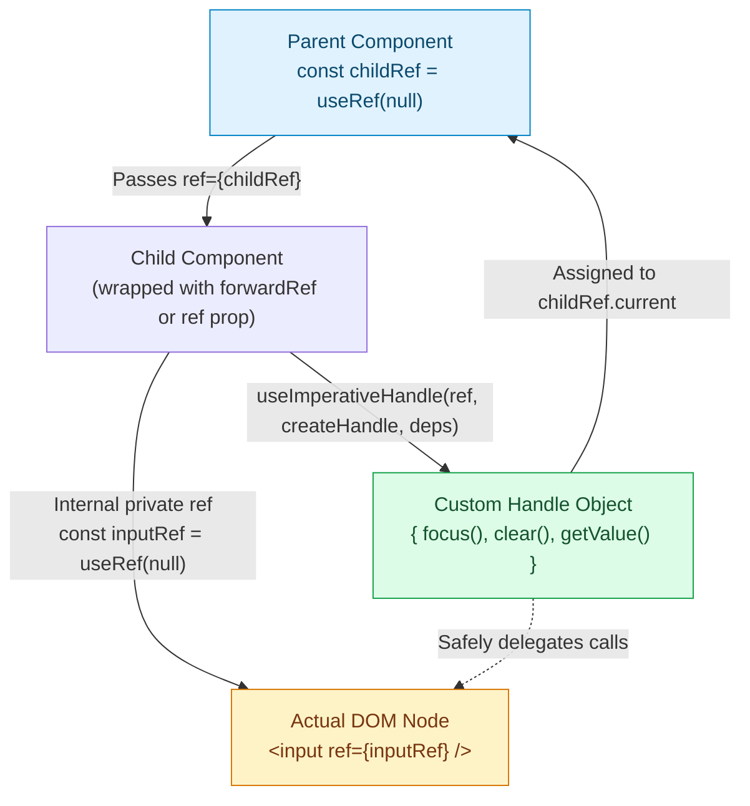

# `useImperativeHandle` — The Complete Beginner's Guide

Welcome! If you've ever wondered *"How can a parent component trigger an action inside a child component without exposing the child's entire DOM element?"*, you're in the right place.

---

## 🎯 What is `useImperativeHandle`?

**`useImperativeHandle`** is a React hook that lets a child component **customize the exact value (usually an object of methods)** that a parent component receives when the parent attaches a `ref` to it.

Normally, when a parent passes a `ref` down to a child component, the parent gets direct access to the raw DOM node inside the child (like an `<input>` or `<div>`). That's like handing someone the master key to your entire house when all they needed was to ring the doorbell.

### 🏠 The Hotel Front Desk Analogy

Think of a **hotel front desk**:
- Inside the hotel, there are staff rooms, housekeeping schedules, security systems, and private offices (the child component's internal state and DOM nodes).
- As a guest (the **parent component**), you don't get to walk into the back office and press buttons on the hotel's computer yourself.
- Instead, the hotel gives you a **concierge menu** with specific actions you can request: `checkIn()`, `requestTowels()`, or `callTaxi()`.

`useImperativeHandle` is that **concierge menu**. The child component decides *exactly* which methods or properties the parent is allowed to call through the `ref`, keeping everything else private and safe.

### 📖 Quick Jargon Buster
- **Ref (`useRef`)**: A special React object (`{ current: ... }`) that holds a mutable value or a reference to a DOM element across renders without causing re-renders when it changes.
- **Imperative vs. Declarative**:
  - *Declarative* (normal React): *"Here is the state `isOpen={true}`, render the modal."*
  - *Imperative* (commands): *"Hey modal, `.open()` yourself right now!"* or *"Hey input, `.focus()` yourself!"*
- **`forwardRef`**: A React helper function (required in React 18 and earlier; optional in React 19+ where `ref` is a regular prop) that allows a component to receive a `ref` from its parent.

---

## 🧠 Mental Model

Here is how `useImperativeHandle` sits between the Parent and the Child's internal DOM nodes:



Notice the key separation:
1. The **Parent** only sees the **Custom Handle Object** (`{ focus, clear, getValue }`).
2. The **Child** keeps `inputRef` completely private.
3. The Parent **cannot** accidentally do `childRef.current.remove()` or `childRef.current.style.display = 'none'` because `childRef.current` is not the DOM node—it's your custom API!

---

## 📖 Syntax

```jsx
import { useImperativeHandle } from 'react';

useImperativeHandle(ref, createHandle, dependencies?);
```

| Parameter | Type | Required | Description | Default |
| :--- | :--- | :--- | :--- | :--- |
| `ref` | `RefObject \| RefCallback` | Yes | The `ref` passed from the parent component (via `forwardRef` in React ≤18, or directly as a prop in React 19+). | None |
| `createHandle` | `() => Object` | Yes | A function that takes no arguments and returns the custom handle object (the methods/values you want to expose to the parent). | None |
| `dependencies` | `Array<any>` | No | A list of reactive values referenced inside `createHandle`. If omitted, `createHandle` re-runs after every render. If `[]`, it runs only on mount. | `undefined` (re-runs every render) |

---

## ⚙️ How It Works Under The Hood

Understanding what React does behind the scenes makes `useImperativeHandle` much less mysterious:

1. **Same Timing as `useLayoutEffect`**: Internally, `useImperativeHandle` is scheduled very similarly to `useLayoutEffect`. After React renders your component and updates the DOM, but **before the browser paints the screen**, React executes your `createHandle()` function.
2. **Assigning `ref.current`**: React takes the object returned by `createHandle()` and assigns it directly to `ref.current` (or passes it to a callback ref if the parent used a function ref).
3. **Dependency Checking**:
   - If you pass a `dependencies` array (e.g., `[value, onReset]`), React compares each item using `Object.is()` on subsequent renders. If nothing changed, React keeps the existing handle object.
   - If you **omit** the `dependencies` array, React re-runs `createHandle()` after *every single render* and updates `ref.current`.
4. **Cleanup on Unmount**: When the child component unmounts (is removed from the screen), React automatically sets `ref.current = null` so the parent isn't left holding a stale reference to a dead component.

---

## ✅ When To Use `useImperativeHandle`

Use `useImperativeHandle` sparingly—React's declarative props should always be your first choice! Reach for it when you genuinely need **imperative actions**:

1. **Focusing or Selecting Text in Custom Inputs**: Exposing `.focus()` or `.selectAll()` on a custom-styled input wrapper without leaking the underlying `<input>` DOM node.
2. **Controlling Media Playback**: Exposing `.play()`, `.pause()`, `.seek(seconds)`, or `.mute()` on a custom video/audio player component.
3. **Triggering Imperative Animations or Canvas Drawings**: Exposing `.shake()`, `.confetti()`, or `.resetCanvas()` on a component that manages an animation library or `<canvas>`.
4. **Scrolling to Specific Elements**: Exposing `.scrollToTop()`, `.scrollToBottom()`, or `.scrollToItem(id)` on a virtualized list or chat message container.
5. **Form Field Reset & Validation Methods**: Exposing `.validate()` or `.reset()` on complex, self-contained form widgets or rich-text editors.
6. **Opening/Closing Modals or Drawers Imperatively**: Exposing `.open()` and `.close()` when a parent wants to trigger a dialog without managing `isOpen` state itself.

---

## ❌ Common Mistakes & Anti-patterns

### Mistake 1: Using `useImperativeHandle` Instead of Normal Props

If something can be expressed declaratively with props (like `isOpen`, `value`, or `disabled`), don't use `useImperativeHandle`.

**❌ BAD:**
```jsx
// Over-engineering simple visibility with a ref
function AlertBox({ ref }) {
  const [visible, setVisible] = useState(false);
  useImperativeHandle(ref, () => ({
    show: () => setVisible(true),
    hide: () => setVisible(false),
  }));
  return visible ? <div className="alert">Saved!</div> : null;
}
```

**✅ GOOD:**
```jsx
// Simple, predictable, declarative React props
function AlertBox({ isVisible, message }) {
  if (!isVisible) return null;
  return <div className="alert">{message}</div>;
}
```
*Why?* Declarative props are easier to read, test, and debug. Save `useImperativeHandle` for actions that cannot easily be represented as state/props (like `.focus()`, `.scrollIntoView()`, or `.play()`).

---

### Mistake 2: Forgetting to Forward the `ref` (in React 18 and earlier)

If you try to read `ref` in a component without wrapping it in `forwardRef` (in React ≤18), `ref` will be `undefined`!

**❌ BAD:**
```jsx
// In React 18, `ref` is NOT passed in `props`!
function CustomInput(props) {
  const inputRef = useRef(null);
  useImperativeHandle(props.ref, () => ({ // props.ref is undefined!
    focus: () => inputRef.current.focus(),
  }));
  return <input ref={inputRef} />;
}
```

**✅ GOOD:**
```jsx
import { forwardRef, useImperativeHandle, useRef } from 'react';

// Wrap with forwardRef so `ref` arrives as the second argument
const CustomInput = forwardRef(function CustomInput(props, ref) {
  const inputRef = useRef(null);
  useImperativeHandle(ref, () => ({
    focus: () => inputRef.current.focus(),
  }), []);
  return <input ref={inputRef} />;
});
```
*(Note: In **React 19+**, `ref` IS passed as a regular prop, so `function CustomInput({ ref })` works directly without `forwardRef`!)*

---

### Mistake 3: Exposing the Entire Raw DOM Node

Returning `inputRef.current` directly defeats the entire purpose of `useImperativeHandle`.

**❌ BAD:**
```jsx
useImperativeHandle(ref, () => inputRef.current); // Leaks the entire DOM node!
```

**✅ GOOD:**
```jsx
useImperativeHandle(ref, () => ({
  focus: () => inputRef.current?.focus(),
  clear: () => {
    if (inputRef.current) inputRef.current.value = '';
  },
}), []);
```
*Why?* Returning a small object of specific methods protects your child component's internals. You can refactor the child's HTML structure later without breaking the parent.

---

### Mistake 4: Stale Closures Due to Missing Dependencies

If your handle method reads state or props, and you pass an empty `[]` dependency array, that method will read outdated values!

**❌ BAD:**
```jsx
function Counter({ ref }) {
  const [count, setCount] = useState(0);

  useImperativeHandle(ref, () => ({
    getCount: () => count, // Always returns 0 because `[]` never updates!
  }), []); // <-- Bug: `count` is missing from dependencies!

  return <button onClick={() => setCount(c => c + 1)}>{count}</button>;
}
```

**✅ GOOD:**
```jsx
function Counter({ ref }) {
  const [count, setCount] = useState(0);

  useImperativeHandle(ref, () => ({
    getCount: () => count, // Always returns the latest `count`!
  }), [count]); // <-- `count` is included in dependencies

  return <button onClick={() => setCount(c => c + 1)}>{count}</button>;
}
```

---

## 🔄 Execution / Lifecycle Flow

This sequence diagram shows *when* `useImperativeHandle` runs compared to rendering, DOM updates, and `useEffect`:

```mermaid
sequenceDiagram
    participant P as Parent Component
    participant R as React Engine
    participant C as Child Component
    participant DOM as Browser DOM

    P->>R: Renders <Child ref={childRef} />
    R->>C: Calls Child(props, ref)
    C-->>R: Returns JSX (<input ref={inputRef} />)
    R->>DOM: Commits JSX & sets inputRef.current = <input>
    Note over R,DOM: Before browser paints the screen
    R->>C: Runs useImperativeHandle createHandle()
    C-->>R: Returns { focus, clear }
    R->>P: Sets childRef.current = { focus, clear }
    Note over DOM: Browser paints screen
    R->>C: Runs useEffect callbacks
    P->>C: User clicks button -> calls childRef.current.focus()
    C->>DOM: Calls inputRef.current.focus()
```



---

## 💡 Example 1 — The Basics

Here is the simplest possible example: a parent component with buttons that **focus** and **clear** a custom child input component.

```jsx
import { forwardRef, useImperativeHandle, useRef } from 'react'; // Import React hooks and forwardRef

// Wrap the child component with forwardRef so it can receive a ref from its parent
const FancyInput = forwardRef(function FancyInput(props, ref) { // Accept props and ref as arguments
  const internalInputRef = useRef(null); // Create a private ref for the actual <input> DOM node

  // Customize what the parent sees when it accesses ref.current
  useImperativeHandle( // Call useImperativeHandle to define the exposed methods
    ref, // Pass the parent's ref as the first argument
    () => ({ // Second argument: factory function returning the custom handle object
      focusInput: () => { // Expose a method named focusInput
        internalInputRef.current?.focus(); // Safely focus the private <input> DOM element
      }, // End of focusInput method
      clearInput: () => { // Expose a method named clearInput
        if (internalInputRef.current) { // Check that the DOM element exists
          internalInputRef.current.value = ''; // Clear the text inside the input
        } // End of null check
      }, // End of clearInput method
    }), // End of returned handle object
    [] // Empty dependency array: create this handle once on mount
  ); // End of useImperativeHandle

  return ( // Return the JSX for FancyInput
    <input // Render a standard HTML input element
      ref={internalInputRef} // Attach our private ref to the DOM input
      type="text" // Set input type to text
      placeholder={props.placeholder} // Use the placeholder passed from the parent
      style={{ padding: '8px', fontSize: '16px', borderRadius: '6px' }} // Add basic styling
    /> // End of input element
  ); // End of return statement
}); // End of FancyInput component

export default function App() { // Export the main App component
  const fancyInputRef = useRef(null); // Create a ref to hold FancyInput's custom handle

  return ( // Return the UI for App
    <div style={{ fontFamily: 'sans-serif', padding: '24px' }}> {/* Main container */}
      <h2>useImperativeHandle Basics</h2> {/* Section heading */}
      <FancyInput ref={fancyInputRef} placeholder="Type something..." /> {/* Render child with ref */}
      <div style={{ marginTop: '12px', display: 'flex', gap: '8px' }}> {/* Button row */}
        <button onClick={() => fancyInputRef.current?.focusInput()}> {/* Call exposed focusInput */}
          Focus Input {/* Button label */}
        </button> {/* End of Focus button */}
        <button onClick={() => fancyInputRef.current?.clearInput()}> {/* Call exposed clearInput */}
          Clear Input {/* Button label */}
        </button> {/* End of Clear button */}
      </div> {/* End of button row */}
    </div> // End of main container
  ); // End of return statement
} // End of App component
```

### 👀 What You Will See in the Browser
- A heading **"useImperativeHandle Basics"**.
- A text input box with the placeholder `"Type something..."`.
- Two buttons underneath: **"Focus Input"** and **"Clear Input"**.
- Clicking **Focus Input** puts your cursor right inside the input box.
- Typing text and clicking **Clear Input** erases the text—even though the parent has zero direct access to the `<input>` DOM node!

---

## 💡 Example 2 — Real World Use Case

In real applications, you often build a **scrollable chat box or log viewer** where the parent needs to trigger `.scrollToBottom()` or `.scrollToTop()` when new messages arrive or when the user clicks a button.

```jsx
import { forwardRef, useImperativeHandle, useRef, useState } from 'react'; // Import React hooks and forwardRef

// Child component: a scrollable message list with custom scroll controls
const ChatLog = forwardRef(function ChatLog({ messages }, ref) { // Receive messages prop and ref
  const listRef = useRef(null); // Private ref pointing to the scrollable <div> container

  useImperativeHandle( // Expose only scroll-related actions to the parent
    ref, // Parent's ref
    () => ({ // Factory returning the public API
      scrollToBottom: () => { // Method to smoothly scroll to the newest message
        if (listRef.current) { // Ensure the scrollable container is mounted
          listRef.current.scrollTo({ // Call native DOM scrollTo
            top: listRef.current.scrollHeight, // Scroll to the very bottom
            behavior: 'smooth', // Animate the scroll smoothly
          }); // End of scrollTo options
        } // End of null check
      }, // End of scrollToBottom
      scrollToTop: () => { // Method to smoothly scroll back to the oldest message
        if (listRef.current) { // Ensure the scrollable container is mounted
          listRef.current.scrollTo({ // Call native DOM scrollTo
            top: 0, // Scroll to the very top
            behavior: 'smooth', // Animate the scroll smoothly
          }); // End of scrollTo options
        } // End of null check
      }, // End of scrollToTop
    }), // End of handle object
    [] // No reactive dependencies needed since listRef is stable
  ); // End of useImperativeHandle

  return ( // Return the scrollable list JSX
    <div // Scrollable container element
      ref={listRef} // Attach private ref
      style={{ // Inline styles for a fixed-height scrollable box
        height: '180px', // Fixed height so overflow happens
        overflowY: 'auto', // Enable vertical scrolling
        border: '1px solid #cbd5e1', // Light gray border
        borderRadius: '8px', // Rounded corners
        padding: '12px', // Inner spacing
        backgroundColor: '#f8fafc', // Subtle background color
      }} // End of style object
    > {/* End of div opening tag */}
      {messages.map((msg, index) => ( // Loop over each message string
        <div key={index} style={{ padding: '6px 0', borderBottom: '1px solid #e2e8f0' }}> {/* Message row */}
          {msg} {/* Render the message text */}
        </div> // End of message row
      ))} {/* End of map */}
    </div> // End of scrollable container
  ); // End of return
}); // End of ChatLog component

export default function App() { // Main App component
  const chatRef = useRef(null); // Ref to control the ChatLog component
  const [messages, setMessages] = useState([ // Initial list of chat messages
    'Welcome to the chat!', // Message 1
    'System initialized.', // Message 2
    'Waiting for new events...', // Message 3
  ]); // End of useState

  const addMessage = () => { // Handler to append a new message
    setMessages((prev) => [ // Update messages array immutably
      ...prev, // Keep existing messages
      `New event #${prev.length + 1} at ${new Date().toLocaleTimeString()}`, // Add timestamped message
    ]); // End of setMessages
  }; // End of addMessage

  return ( // Render the parent UI
    <div style={{ fontFamily: 'sans-serif', maxWidth: '420px', padding: '24px' }}> {/* Page wrapper */}
      <h2>Live Activity Log</h2> {/* Title */}
      <ChatLog ref={chatRef} messages={messages} /> {/* Render ChatLog with ref */}
      <div style={{ marginTop: '12px', display: 'flex', gap: '8px', flexWrap: 'wrap' }}> {/* Controls */}
        <button onClick={addMessage}>Add Event</button> {/* Add a new log entry */}
        <button onClick={() => chatRef.current?.scrollToBottom()}>Jump to Bottom</button> {/* Imperative scroll down */}
        <button onClick={() => chatRef.current?.scrollToTop()}>Jump to Top</button> {/* Imperative scroll up */}
      </div> {/* End of controls */}
    </div> // End of page wrapper
  ); // End of return
} // End of App
```

---

## 💡 Example 3 — Advanced Pattern

In this advanced example, we compose `useImperativeHandle` with **`useState`**, **`useRef`**, and **`useEffect`** to build a **Stopwatch Widget** that exposes `.start()`, `.stop()`, `.reset()`, and `.getElapsedSeconds()` to a parent dashboard—while keeping the timer interval completely encapsulated inside the child.

```jsx
import { forwardRef, useEffect, useImperativeHandle, useRef, useState } from 'react'; // Import all needed hooks

// Child component: a self-contained Stopwatch with an imperative control API
const Stopwatch = forwardRef(function Stopwatch({ label }, ref) { // Accept label prop and ref
  const [seconds, setSeconds] = useState(0); // Track elapsed seconds in state
  const [isRunning, setIsRunning] = useState(false); // Track whether timer is active
  const intervalRef = useRef(null); // Private ref to store the setInterval ID

  useEffect(() => { // Manage the timer side effect whenever isRunning changes
    if (isRunning) { // If the stopwatch is running
      intervalRef.current = setInterval(() => { // Start a 1-second interval
        setSeconds((s) => s + 1); // Increment seconds safely using functional update
      }, 1000); // Run every 1000ms (1 second)
    } // End of if (isRunning)
    return () => { // Cleanup function runs when isRunning changes or component unmounts
      if (intervalRef.current) clearInterval(intervalRef.current); // Clear active interval
    }; // End of cleanup
  }, [isRunning]); // Re-run effect only when isRunning changes

  // Expose imperative controls and a live getter to the parent
  useImperativeHandle( // Define custom handle for parent
    ref, // Parent's ref
    () => ({ // Factory function
      start: () => setIsRunning(true), // Start the stopwatch
      stop: () => setIsRunning(false), // Pause the stopwatch
      reset: () => { // Stop and reset seconds back to 0
        setIsRunning(false); // Pause timer
        setSeconds(0); // Reset counter
      }, // End of reset
      getElapsedSeconds: () => seconds, // Return current seconds (depends on `seconds`!)
    }), // End of handle object
    [seconds] // Re-create handle when `seconds` changes so getElapsedSeconds never goes stale
  ); // End of useImperativeHandle

  return ( // Render the Stopwatch card
    <div style={{ padding: '16px', border: '1px solid #94a3b8', borderRadius: '8px' }}> {/* Card */}
      <strong>{label}:</strong> <span>{seconds}s</span> {/* Display label and elapsed time */}
      <span style={{ marginLeft: '8px', color: isRunning ? 'green' : 'gray' }}> {/* Status badge */}
        ({isRunning ? 'Running' : 'Paused'}) {/* Show current status */}
      </span> {/* End of status badge */}
    </div> // End of card
  ); // End of return
}); // End of Stopwatch

export default function App() { // Parent dashboard controlling the Stopwatch
  const stopwatchRef = useRef(null); // Ref to hold Stopwatch's imperative API
  const [snapshot, setSnapshot] = useState(null); // Store a captured time snapshot in parent

  const handleCapture = () => { // Read elapsed time imperatively from child
    const current = stopwatchRef.current?.getElapsedSeconds(); // Call exposed getter method
    setSnapshot(current); // Save snapshot in parent state
  }; // End of handleCapture

  return ( // Render dashboard UI
    <div style={{ fontFamily: 'sans-serif', maxWidth: '400px', padding: '24px' }}> {/* Container */}
      <h2>Imperative Stopwatch Controller</h2> {/* Heading */}
      <Stopwatch ref={stopwatchRef} label="Task Timer" /> {/* Child Stopwatch */}
      <div style={{ marginTop: '12px', display: 'flex', gap: '8px', flexWrap: 'wrap' }}> {/* Buttons */}
        <button onClick={() => stopwatchRef.current?.start()}>Start</button> {/* Start timer */}
        <button onClick={() => stopwatchRef.current?.stop()}>Stop</button> {/* Pause timer */}
        <button onClick={() => stopwatchRef.current?.reset()}>Reset</button> {/* Reset timer */}
        <button onClick={handleCapture}>Capture Snapshot</button> {/* Read current seconds */}
      </div> {/* End of buttons */}
      {snapshot !== null && ( // Conditionally show captured snapshot
        <p style={{ marginTop: '12px' }}>Captured time: <strong>{snapshot}s</strong></p> // Snapshot text
      )} {/* End of conditional render */}
    </div> // End of container
  ); // End of return
} // End of App
```

---

## 🧪 Mini Quiz

Test your understanding! Click each question to reveal the answer.

<details>
<summary><strong>1. Why should you prefer `useImperativeHandle` over exposing a raw DOM ref?</strong></summary>

Because exposing a raw DOM ref gives the parent unrestricted access to mutate the child's internal DOM (e.g., changing styles, removing nodes, or reading internal structure). `useImperativeHandle` lets you expose a clean, minimal API (like `{ focus, reset }`) so the child stays encapsulated and safe to refactor.

</details>

<details>
<summary><strong>2. What happens if you forget to include a state variable in the `dependencies` array of `useImperativeHandle`?</strong></summary>

If you pass an empty `[]` dependency array while a method inside `createHandle` reads a state variable (like `count`), that method will capture the initial value in a **stale closure** and always return the old value. Either include the state variable in `[count]` or omit the dependency array if it's cheap to recreate.

</details>

<details>
<summary><strong>3. Should you use `useImperativeHandle` to toggle a modal's `isOpen` state?</strong></summary>

Usually **no**! Visibility is best handled declaratively with props (e.g., `<Modal isOpen={isOpen} onClose={...} />`). Reserve `useImperativeHandle` for imperative actions that cannot be cleanly expressed as props, such as `.focus()`, `.scrollToBottom()`, or `.play()`.

</details>

---

## 🔗 Related Hooks

- **[`useRef`](https://react.dev/reference/react/useRef)**: The foundation for `useImperativeHandle`. Parents create a `ref` with `useRef`, and children also use `useRef` internally to hold private DOM references.
- **[`useLayoutEffect`](https://react.dev/reference/react/useLayoutEffect)**: Shares the same execution timing—running synchronously after DOM mutations but before browser paint.
- **[`useCallback`](https://react.dev/reference/react/useCallback)**: Often paired with `useImperativeHandle` or used inside `createHandle` to memoize exposed methods.
- **[`useEffect`](https://react.dev/reference/react/useEffect)**: Runs *after* paint (and after `useImperativeHandle`), meaning `ref.current` is already populated with your custom handle when `useEffect` runs in the parent!

---

## 📚 Further Reading

- [Official React Docs — `useImperativeHandle`](https://react.dev/reference/react/useImperativeHandle)
- [Official React Docs — Manipulating the DOM with Refs](https://react.dev/learn/manipulating-the-dom-with-refs)
- [Official React Docs — `forwardRef` (and React 19 `ref` as a prop)](https://react.dev/reference/react/forwardRef)
- [Kent C. Dodds — When to use `useImperativeHandle`](https://epicreact.dev/)
