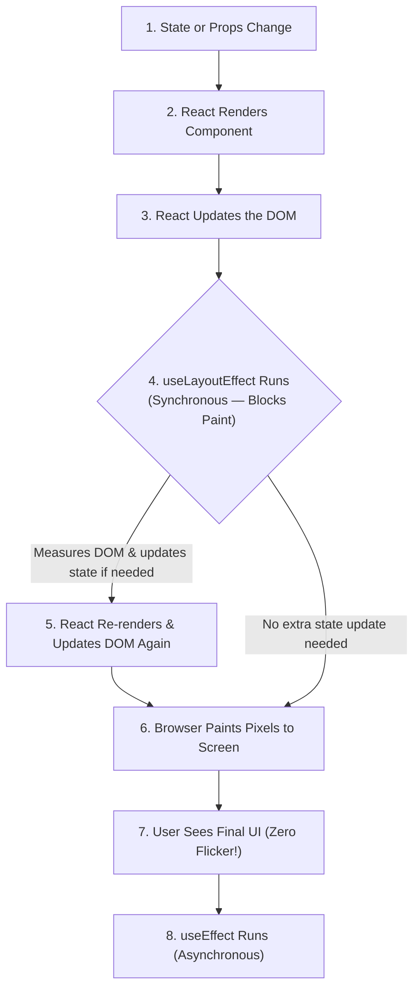
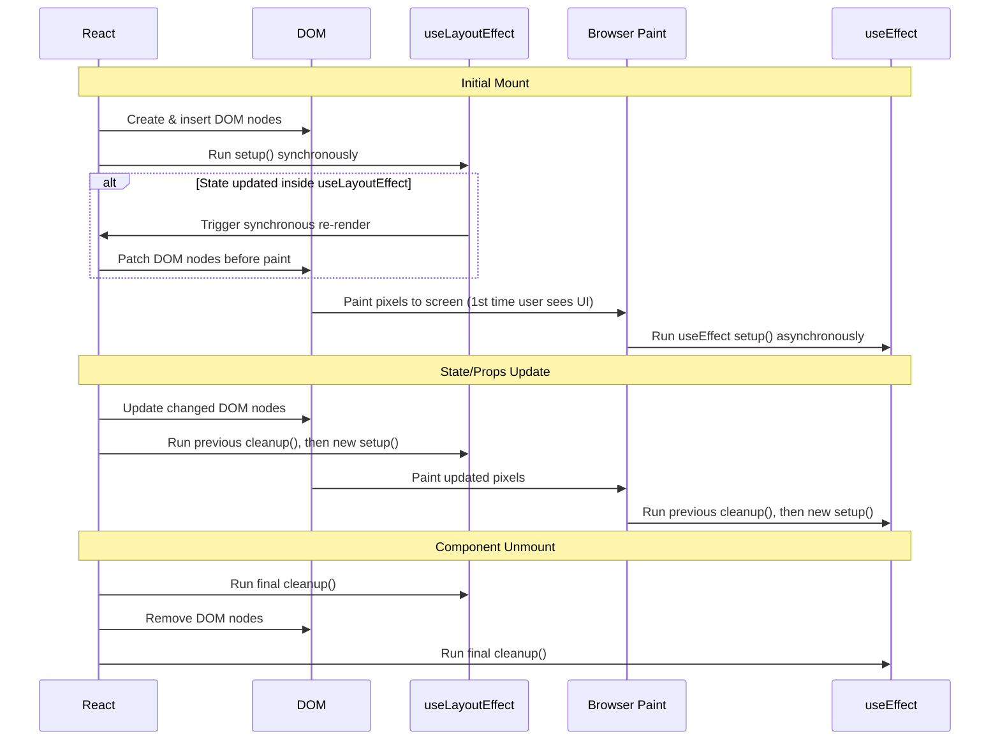

# `useLayoutEffect` — Measuring & Adjusting Before the User Sees Anything

Welcome! If you have ever used `useEffect` and noticed your UI **flicker** or **jump** for a split second right after rendering, `useLayoutEffect` is the exact tool React gives you to fix that.

---

### 🎯 What is `useLayoutEffect`?

In plain English, **`useLayoutEffect` is a React hook that lets you read or adjust the layout of the page *after* React updates the DOM, but *before* the browser actually paints pixels onto the screen.**

#### 🏠 The Analogy: Hanging a Picture Frame Before Guests Arrive

Imagine you are hosting a dinner party:

- **`useEffect`** is like hanging a picture frame on the wall, letting your guests walk into the living room, and *then* noticing it is crooked and straightening it while everyone is watching. Your guests saw it crooked for a moment!
- **`useLayoutEffect`** is like hanging the picture frame, stepping back to measure it with a level, and straightening it **while the door is still closed**—before a single guest steps into the room. When they finally walk in, it looks perfect from the very first glance.

#### Quick Jargon Buster
- **DOM (Document Object Model):** The live tree of HTML elements (`<div>`, `<button>`, `<p>`) that the browser holds in memory for your page.
- **Render:** React calling your component function to figure out what the UI *should* look like.
- **Paint:** The browser taking the updated DOM and actually drawing pixels onto your monitor.
- **Synchronous:** Running immediately in order, pausing the next step (painting) until the current step finishes.

---

### 🧠 Mental Model

Think of `useLayoutEffect` as a **last-second checkpoint** between React updating the DOM and the browser showing it to the user:



Notice the key difference: **`useLayoutEffect` pauses the browser paint** so your user never sees an unmeasured or half-positioned UI.

---

### 📖 Syntax

```jsx
import { useLayoutEffect } from 'react';

useLayoutEffect(() => {
  // 1. Setup: Measure DOM or apply synchronous layout adjustments
  const rect = elementRef.current.getBoundingClientRect();

  return () => {
    // 2. Cleanup (optional): Runs before the next effect or on unmount
  };
}, [dependencies]);
```

| Parameter | Type | Required | Description | Default |
| :--- | :--- | :--- | :--- | :--- |
| `setup` | `() => (() => void) \| void` | Yes | Function containing your layout logic. It can optionally return a `cleanup` function that runs before the effect re-runs or when the component unmounts. | None |
| `dependencies` | `Array<any>` | No | List of reactive values (props, state, variables) referenced inside `setup`. React re-runs the effect whenever any dependency changes (`Object.is`). Omit to run after every render; pass `[]` to run only on mount. | `undefined` (runs after every render) |

---

### ⚙️ How It Works Under The Hood

When React updates your screen, it works in two main phases:

1. **The Render Phase (Pure calculation):**
   React calls your component function, runs your JSX, and compares the new virtual UI with the previous one to figure out what changed. Nothing is visible on screen yet.
2. **The Commit Phase (Applying changes):**
   React applies the calculated changes to the real browser DOM (for example, inserting a new `<div>` or changing text).
   - **Right here—before yielding back to the browser—React runs all `useLayoutEffect` cleanups and setup functions synchronously.**
   - If your `useLayoutEffect` calls `setState`, React immediately runs another render + commit **before** the browser gets a chance to paint!
3. **Browser Paint:**
   Once all `useLayoutEffect` hooks finish, the browser finally paints the pixels to the screen.
4. **Passive Effects (`useEffect`):**
   After the paint is complete and the user sees the screen, React runs `useEffect` callbacks asynchronously.

Because `useLayoutEffect` blocks painting, **it should be fast and used only when visual layout depends on DOM measurements.**

---

### ✅ When To Use `useLayoutEffect`

Use `useLayoutEffect` when your code needs to **read layout from the DOM** or **prevent a visual flash** before the user sees the frame:

- **Measuring element dimensions (`getBoundingClientRect`, `offsetWidth`, `scrollHeight`)** right after render to calculate another element's size or position.
- **Positioning tooltips, popovers, and dropdown menus** so they stay inside the viewport (e.g., flipping a tooltip from bottom to top if there is no room below).
- **Preventing flicker on conditional layout adjustments** when initial state cannot be known until the DOM exists.
- **Synchronizing scroll position** (such as keeping a chat window pinned to the bottom or restoring scroll offset) before the user sees the jump.
- **Integrating third-party DOM/chart/canvas libraries** that immediately read container dimensions upon initialization.
- **Starting FLIP animations** (First, Last, Invert, Play) where you measure an element's new position and apply a starting `transform` before the first frame paints.

---

### ❌ Common Mistakes & Anti-patterns

#### Mistake 1: Using `useLayoutEffect` for Data Fetching or API Calls

Data fetching is asynchronous and does not need to block the browser from painting. Blocking paint for non-layout work makes your app feel sluggish.

```jsx
// ❌ BAD: Using useLayoutEffect for network requests
useLayoutEffect(() => {
  fetch('/api/user')
    .then((res) => res.json())
    .then((data) => setUser(data));
}, []);
```

```jsx
// ✅ GOOD: Use useEffect for data fetching, subscriptions, and logging
useEffect(() => {
  let cancelled = false;
  fetch('/api/user')
    .then((res) => res.json())
    .then((data) => {
      if (!cancelled) setUser(data);
    });
  return () => {
    cancelled = true;
  };
}, []);
```

#### Mistake 2: Running Expensive Computations Inside `useLayoutEffect`

Since `useLayoutEffect` blocks the browser from painting, heavy loops freeze the UI.

```jsx
// ❌ BAD: Blocking paint with heavy CPU work
useLayoutEffect(() => {
  const sorted = hugeArray.slice().sort(expensiveComparator);
  setItems(sorted);
}, [hugeArray]);
```

```jsx
// ✅ GOOD: Compute derived data during render with useMemo
const sortedItems = useMemo(() => {
  return hugeArray.slice().sort(expensiveComparator);
}, [hugeArray]);
```

#### Mistake 3: Using `useLayoutEffect` Directly in Server-Side Rendering (SSR)

On the server (Next.js, Remix), there is no browser DOM, so React logs a warning if `useLayoutEffect` is called during SSR.

```jsx
// ❌ BAD: Triggers React SSR warning on the server
useLayoutEffect(() => {
  setWidth(boxRef.current.offsetWidth);
}, []);
```

```jsx
// ✅ GOOD: Guard with typeof window !== 'undefined' (isomorphic pattern)
const useIsomorphicLayoutEffect =
  typeof window !== 'undefined' ? useLayoutEffect : useEffect;

useIsomorphicLayoutEffect(() => {
  setWidth(boxRef.current.offsetWidth);
}, []);
```

#### Mistake 4: Infinite Re-render Loops Without a Guard or Dependency Array

Updating state inside `useLayoutEffect` without checking if the value actually changed—or omitting dependencies—can lock the browser tab!

```jsx
// ❌ BAD: No dependency array + unconditional setState = infinite synchronous loop
useLayoutEffect(() => {
  setHeight(boxRef.current.offsetHeight);
});
```

```jsx
// ✅ GOOD: Include dependencies and only update state when the value changes
useLayoutEffect(() => {
  const nextHeight = boxRef.current.offsetHeight;
  setHeight((prev) => (prev === nextHeight ? prev : nextHeight));
}, [content]);
```

---

### 🔄 Execution / Lifecycle Flow

Here is the exact sequence of events during initial mount, updates, and unmount:



---

### 💡 Example 1 — The Basics

This simple example renders a resizable box with dynamic text and measures its exact pixel width and height **before** the browser paints, displaying the measurements with zero flicker.

**What you will see in the browser:**
A card with a button ("Add More Text" / "Reset Text"), a bordered box whose text grows when clicked, and a live readout showing the exact `width × height` in pixels measured synchronously by `useLayoutEffect`.

```jsx
import { useState, useRef, useLayoutEffect } from 'react'; // Import React hooks for state, DOM refs, and layout effects

export default function MeasureBoxBasics() { // Define and export the main component
  const [text, setText] = useState('Click the button to grow this box!'); // Store the dynamic text shown inside the box
  const [size, setSize] = useState({ width: 0, height: 0 }); // Store the measured width and height in pixels
  const boxRef = useRef(null); // Create a ref to attach directly to the DOM div element

  useLayoutEffect(() => { // Run synchronously after DOM update and before browser paint
    if (!boxRef.current) return; // Guard in case the DOM node is not mounted yet
    const rect = boxRef.current.getBoundingClientRect(); // Measure the element's exact rendered dimensions
    setSize({ // Update state with rounded pixel dimensions before paint
      width: Math.round(rect.width), // Round width to nearest whole pixel
      height: Math.round(rect.height), // Round height to nearest whole pixel
    }); // Finish state update object
  }, [text]); // Re-measure whenever the text content changes

  const handleGrow = () => { // Define click handler to append extra words
    setText((prev) => prev + ' More content makes the box taller and wider.'); // Append text to trigger re-render and re-measure
  }; // End handleGrow function

  const handleReset = () => { // Define click handler to restore initial text
    setText('Click the button to grow this box!'); // Reset text back to the original short string
  }; // End handleReset function

  return ( // Return the JSX to render
    <div style={{ fontFamily: 'sans-serif', padding: '24px', maxWidth: '520px' }}> {/* Main page container */}
      <h2>useLayoutEffect Basics: Measure a Box</h2> {/* Section heading */}
      <p> {/* Explanatory paragraph for the user */}
        Measured Size: <strong>{size.width}px × {size.height}px</strong> {/* Display live pixel dimensions */}
      </p> {/* Close paragraph */}
      <div style={{ display: 'flex', gap: '8px', marginBottom: '16px' }}> {/* Button row container */}
        <button onClick={handleGrow}>Add More Text</button> {/* Button to grow the box */}
        <button onClick={handleReset}>Reset Text</button> {/* Button to reset the box */}
      </div> {/* Close button row */}
      <div // Start the measured box element
        ref={boxRef} // Attach the ref so useLayoutEffect can measure this div
        style={{ // Apply visual styling to the measured box
          display: 'inline-block', // Allow box width and height to wrap its content
          padding: '16px', // Add inner spacing around text
          border: '2px solid #2563eb', // Draw a blue border so bounds are clearly visible
          borderRadius: '8px', // Round the corners slightly
          backgroundColor: '#eff6ff', // Use a soft blue background
        }} // End inline styles
      > {/* Close opening div tag */}
        {text} {/* Render the current text inside the box */}
      </div> {/* Close measured box div */}
    </div> // Close main container
  ); // End return statement
} // End MeasureBoxBasics component
```

---

### 💡 Example 2 — Real World Use Case

A classic real-world use of `useLayoutEffect` is **smart tooltip positioning**. When a user hovers or clicks a button near the top of the screen, a tooltip that defaults to appearing *above* the button would get clipped off-screen. By measuring the button and tooltip in `useLayoutEffect`, we can flip it *below* the button before the user ever sees it in the wrong spot.

```jsx
import { useState, useRef, useLayoutEffect } from 'react'; // Import hooks for state, DOM refs, and synchronous layout measurement

export default function SmartTooltipApp() { // Define and export the real-world tooltip demo component
  const [isOpen, setIsOpen] = useState(false); // Track whether the tooltip is currently visible
  const [placeNearTop, setPlaceNearTop] = useState(true); // Toggle button position to simulate edge-of-screen clipping
  const [coords, setCoords] = useState({ top: 0, left: 0, placement: 'top' }); // Store computed tooltip coordinates and placement
  const buttonRef = useRef(null); // Ref for the trigger button whose position we measure
  const tooltipRef = useRef(null); // Ref for the tooltip box whose height and width we measure

  useLayoutEffect(() => { // Measure button and tooltip before the browser paints the tooltip
    if (!isOpen || !buttonRef.current || !tooltipRef.current) return; // Skip calculation if tooltip is closed or refs are missing
    const btnRect = buttonRef.current.getBoundingClientRect(); // Get trigger button position relative to viewport
    const tipRect = tooltipRef.current.getBoundingClientRect(); // Get tooltip size before it becomes visible
    const gap = 8; // Define spacing in pixels between button and tooltip
    const fitsAbove = btnRect.top - tipRect.height - gap >= 0; // Check if there is enough room above the button
    const placement = fitsAbove ? 'top' : 'bottom'; // Choose 'top' if it fits, otherwise flip to 'bottom'
    const top = fitsAbove // Calculate vertical coordinate based on chosen placement
      ? btnRect.top - tipRect.height - gap // Position above the button
      : btnRect.bottom + gap; // Position below the button
    const left = btnRect.left + btnRect.width / 2 - tipRect.width / 2; // Center the tooltip horizontally over the button
    setCoords({ top, left, placement }); // Save final coordinates so React paints it in the exact right spot
  }, [isOpen, placeNearTop]); // Re-calculate whenever visibility or button position changes

  return ( // Return component UI
    <div style={{ fontFamily: 'sans-serif', padding: '20px', minHeight: '260px' }}> {/* Outer demo wrapper */}
      <div style={{ marginBottom: '12px' }}> {/* Controls bar */}
        <button onClick={() => setPlaceNearTop((prev) => !prev)}> {/* Toggle button location between top edge and lower area */}
          Move Target Button: {placeNearTop ? 'Near Top Edge' : 'Lower Down'} {/* Show current button placement mode */}
        </button> {/* Close toggle button */}
      </div> {/* Close controls bar */}
      <div style={{ marginTop: placeNearTop ? '4px' : '120px', textAlign: 'center' }}> {/* Position target button near top or lower */}
        <button // Trigger button for the smart tooltip
          ref={buttonRef} // Attach ref so useLayoutEffect can measure its screen coordinates
          onClick={() => setIsOpen((prev) => !prev)} // Toggle tooltip open or closed on click
          style={{ padding: '10px 16px', cursor: 'pointer' }} // Style the trigger button
        > {/* Close opening button tag */}
          {isOpen ? 'Hide Tooltip' : 'Show Smart Tooltip'} {/* Button label */}
        </button> {/* Close trigger button */}
      </div> {/* Close button wrapper */}
      {isOpen && ( // Conditionally render the tooltip when open
        <div // Tooltip container element
          ref={tooltipRef} // Attach ref so useLayoutEffect can measure tooltip dimensions
          role="tooltip" // Add accessibility role for screen readers
          style={{ // Apply fixed positioning using measured coordinates
            position: 'fixed', // Position relative to the viewport
            top: `${coords.top}px`, // Apply calculated vertical position
            left: `${coords.left}px`, // Apply calculated horizontal position
            padding: '8px 12px', // Add inner padding
            backgroundColor: '#1e293b', // Dark slate background for contrast
            color: '#ffffff', // White text color
            borderRadius: '6px', // Rounded tooltip corners
            fontSize: '14px', // Readable tooltip font size
            pointerEvents: 'none', // Prevent tooltip from blocking mouse clicks
          }} // End tooltip styles
        > {/* Close opening tooltip div */}
          Placed on: <strong>{coords.placement}</strong> (no flicker!) {/* Show whether tooltip flipped */}
        </div> // Close tooltip div
      )} {/* End conditional tooltip render */}
    </div> // Close outer wrapper
  ); // End return statement
} // End SmartTooltipApp component
```

---

### 💡 Example 3 — Advanced Pattern

In this advanced example, we build an **animated sliding tab indicator** that composes `useState`, `useRef`, `useEffect` (for window resize), and `useLayoutEffect` (with an SSR-safe `useIsomorphicLayoutEffect` pattern) to measure the active tab's exact offset and width before painting.

```jsx
import { useState, useRef, useLayoutEffect, useEffect } from 'react'; // Import React hooks for state, refs, layout, and resize events

const useIsomorphicLayoutEffect = typeof window !== 'undefined' ? useLayoutEffect : useEffect; // Use useLayoutEffect in browser and useEffect on server

const TABS = ['Overview', 'Architecture', 'Performance', 'API Reference']; // Define the list of navigation tab labels

export default function SlidingTabsApp() { // Define and export the sliding tabs component
  const [activeIndex, setActiveIndex] = useState(0); // Track which tab index is currently selected
  const [indicator, setIndicator] = useState({ left: 0, width: 0 }); // Store underline position and width in pixels
  const tabRefs = useRef([]); // Store an array of DOM refs, one per tab button

  const measureActiveTab = () => { // Helper function to measure the currently active tab button
    const activeButton = tabRefs.current[activeIndex]; // Look up the DOM node for the active tab
    if (!activeButton) return; // Exit safely if the ref is not yet attached
    setIndicator({ // Update indicator state to match the active button's geometry
      left: activeButton.offsetLeft, // Distance in pixels from the tab bar's left edge
      width: activeButton.offsetWidth, // Exact width in pixels of the active tab button
    }); // Finish updating indicator state
  }; // End measureActiveTab helper

  useIsomorphicLayoutEffect(() => { // Run synchronously after render and before browser paint
    measureActiveTab(); // Position the underline under the active tab before the frame paints
  }, [activeIndex]); // Re-measure whenever the user selects a different tab

  useEffect(() => { // Subscribe to browser window resize events after paint
    window.addEventListener('resize', measureActiveTab); // Re-measure tab geometry if viewport width changes
    return () => window.removeEventListener('resize', measureActiveTab); // Clean up event listener on unmount or re-run
  }, [activeIndex]); // Re-bind listener with latest activeIndex closure

  return ( // Return component JSX
    <div style={{ fontFamily: 'sans-serif', padding: '24px', maxWidth: '600px' }}> {/* Main container */}
      <h2>Sliding Tab Indicator</h2> {/* Component title */}
      <div // Tab bar wrapper with relative positioning for the underline
        role="tablist" // Accessibility role for a group of tabs
        style={{ position: 'relative', display: 'flex', gap: '8px', borderBottom: '2px solid #e2e8f0' }} // Flex row with bottom border
      > {/* Close tablist opening tag */}
        {TABS.map((label, index) => ( // Iterate over tab labels to render each button
          <button // Individual tab button
            key={label} // Unique key for React list reconciliation
            role="tab" // Accessibility role for a tab
            aria-selected={activeIndex === index} // Announce active state to screen readers
            ref={(el) => (tabRefs.current[index] = el)} // Store this button's DOM node in tabRefs array
            onClick={() => setActiveIndex(index)} // Switch active tab when clicked
            style={{ // Style tab button
              padding: '10px 14px', // Inner button padding
              border: 'none', // Remove default browser button border
              background: 'transparent', // Transparent background
              cursor: 'pointer', // Show pointer cursor on hover
              fontWeight: activeIndex === index ? '700' : '400', // Bold text for active tab
              color: activeIndex === index ? '#2563eb' : '#475569', // Highlight active tab text in blue
            }} // End button styles
          > {/* Close button opening tag */}
            {label} {/* Render tab label text */}
          </button> // Close tab button
        ))} {/* End map over TABS */}
        <span // Animated sliding underline indicator
          style={{ // Position and animate the underline bar
            position: 'absolute', // Position relative to the tablist container
            bottom: '-2px', // Align directly on top of the tablist bottom border
            left: `${indicator.left}px`, // Move horizontally to measured tab offset
            width: `${indicator.width}px`, // Match measured tab width
            height: '2px', // Thickness of the active underline
            backgroundColor: '#2563eb', // Blue underline color
            transition: 'left 220ms ease, width 220ms ease', // Smoothly animate position and width changes
          }} // End indicator styles
        /> {/* Close self-closing indicator span */}
      </div> {/* Close tablist container */}
      <p style={{ marginTop: '20px', color: '#334155' }}> {/* Content area below tabs */}
        Showing content for: <strong>{TABS[activeIndex]}</strong> {/* Display active tab name */}
      </p> {/* Close content paragraph */}
    </div> // Close main container
  ); // End return statement
} // End SlidingTabsApp component
```

---

### 🧪 Mini Quiz

Test your understanding! Click each question to reveal the answer.

<details>
<summary><strong>1. What is the main timing difference between <code>useEffect</code> and <code>useLayoutEffect</code>?</strong></summary>

`useLayoutEffect` runs **synchronously** right after React updates the DOM and **before** the browser paints pixels to the screen. `useEffect` runs **asynchronously** *after* the browser has already painted the screen.

</details>

<details>
<summary><strong>2. Why shouldn't you use <code>useLayoutEffect</code> for fetching data from an API?</strong></summary>

Because `useLayoutEffect` blocks the browser from painting until it finishes. Starting a network request does not require DOM measurements, and using `useLayoutEffect` for general side effects can hurt performance and delay when the user sees the page.

</details>

<details>
<summary><strong>3. What happens if you call <code>setState</code> inside <code>useLayoutEffect</code>?</strong></summary>

React immediately runs a synchronous re-render and updates the DOM **before** the browser paints. The user only ever sees the final result—never the intermediate state—which is why `useLayoutEffect` eliminates visual flicker.

</details>

---

### 🔗 Related Hooks

- **`useEffect`**: Your default choice for side effects (data fetching, timers, subscriptions) that do not need to block painting.
- **`useRef`**: Almost always paired with `useLayoutEffect` to hold a reference to a DOM element so you can measure it (`ref.current.getBoundingClientRect()`).
- **`useInsertionEffect`**: Runs even *earlier* than `useLayoutEffect` (before DOM mutations). Designed specifically for CSS-in-JS library authors injecting `<style>` tags.
- **`useState`**: Frequently updated inside `useLayoutEffect` to store measured dimensions or calculated coordinates before paint.

---

### 📚 Further Reading

- [React Official Docs: `useLayoutEffect`](https://react.dev/reference/react/useLayoutEffect)
- [React Official Docs: Synchronizing with Effects](https://react.dev/learn/synchronizing-with-effects)
- [Kent C. Dodds: `useEffect` vs `useLayoutEffect`](https://kentcdodds.com/blog/useeffect-vs-uselayouteffect)
- [Overreacted (Dan Abramov): A Complete Guide to `useEffect`](https://overreacted.io/a-complete-guide-to-useeffect/)
