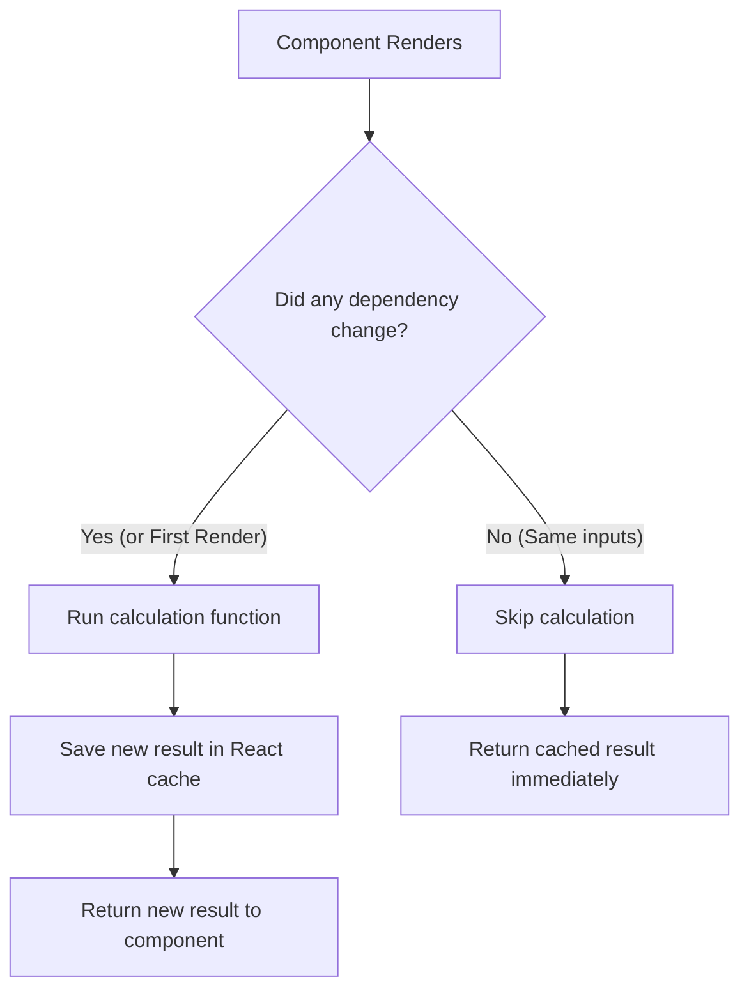
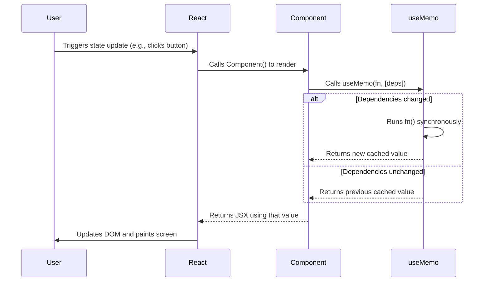

# `useMemo` — Remembering Expensive Answers in React

Welcome to the `useMemo` learning module! By the end of this guide, you will understand what `useMemo` does, why React needs it, when to reach for it (and when to skip it), and how to use it cleanly in real-world applications.

---

### 🎯 What is useMemo?

Imagine you are studying for a math exam. Someone asks you: *"What is 47 × 89?"* You grab a piece of scratch paper, work through the multiplication, and get **4,183**. You write `47 × 89 = 4,183` on a sticky note on your desk.

Two minutes later, the same person asks: *"What is 47 × 89?"* You don't redo the multiplication—you just glance at your sticky note and say **4,183** immediately! Only if they change the question to *"What is 48 × 89?"* do you grab your pencil and recalculate.

In React, **`useMemo` is that sticky note for your component's calculations**.

Every time a React component **re-renders** (which happens whenever its state or props change), React runs your component function from top to bottom. If your component performs a slow calculation—like filtering 10,000 products or computing complex statistics—it would normally redo that work on *every single render*, even when the inputs to that calculation haven't changed.

`useMemo` lets you **cache** (remember) the result of a calculation between re-renders. React only re-runs the calculation when one of its inputs (**dependencies**) actually changes.

> **Key Term — Memoization:** A fancy computer science word that simply means *"saving the result of an expensive function call so you can reuse it later when the same inputs appear again."*

---

### 🧠 Mental Model

Think of `useMemo` as a gatekeeper sitting in front of a heavy calculation. On every render, it checks whether any of the inputs changed compared to the previous render:



Notice two important things in this mental model:
1. **First render:** There is no cached value yet, so React always runs your function once and stores the result.
2. **Subsequent renders:** React compares each item in your dependency list using `Object.is` (essentially strict equality `===`). If all dependencies are identical, React skips the work and hands back the saved value.

---

### 📖 Syntax

```jsx
import { useMemo } from "react";

const cachedValue = useMemo(() => {
  return calculateSomethingExpensive(dep1, dep2);
}, [dep1, dep2]);
```

| Parameter | Type | Required | Description | Default |
| :--- | :--- | :--- | :--- | :--- |
| `calculateValue` | `() => any` | Yes | A **pure** function with no arguments that computes and returns the value you want to cache. | None |
| `dependencies` | `Array<any>` | Yes | The list of all reactive values (`props`, `state`, and local variables derived from them) read inside `calculateValue`. | None |

**Return Value:**
- On the **initial render**, `useMemo` calls `calculateValue()` and returns whatever it returns.
- On **subsequent renders**, `useMemo` returns the previously stored value if `dependencies` have not changed, or calls `calculateValue()` again and returns the fresh result if any dependency changed.

---

### ⚙️ How It Works Under The Hood

You might wonder: *"Where does React store that sticky note?"*

Behind the scenes, React keeps a hidden data structure for every component instance currently mounted on the screen (called a **Fiber node**). Each hook you call in your component (`useState`, `useEffect`, `useMemo`, etc.) gets a slot in an internal linked list attached to that Fiber node.

Here is what happens step by step:

1. **Hook Order Matters:** Because React stores hook data in an ordered list by call index (Slot 0, Slot 1, Slot 2...), hooks must always be called in the exact same order on every render. That is why you can never put `useMemo` inside an `if` statement or a loop.
2. **Mount Phase (First Render):**
   - React creates a new hook slot for `useMemo`.
   - It executes `calculateValue()`.
   - It stores a two-item tuple in that slot: `[result, dependencies]`.
   - It returns `result`.
3. **Update Phase (Re-render):**
   - React reads the existing `[prevResult, prevDeps]` tuple from the slot.
   - It loops through the new `dependencies` array and compares each item against `prevDeps[i]` using `Object.is(prevDeps[i], nextDeps[i])`.
   - If **every** dependency is equal, React returns `prevResult` without calling `calculateValue`.
   - If **any** dependency differs (or if the array length changed), React calls `calculateValue()`, saves `[newResult, newDeps]` in the slot, and returns `newResult`.

> **Important Note:** React treats `useMemo` as a **performance optimization**, not a permanent storage guarantee. In future React features (such as offscreen rendering), React may discard cached values to free memory and recompute them when needed. Your code should always still work correctly even if `useMemo` didn't exist—just slower.

---

### ✅ When To Use useMemo

Use `useMemo` intentionally when you have a clear reason. Here are the best use cases:

- **Expensive CPU calculations:** Mathematical computations, parsing large JSON/Markdown strings, or generating complex data structures that take noticeable time (typically >1ms).
- **Filtering, sorting, or transforming large lists:** When a component renders a table or catalog with hundreds or thousands of items and also has unrelated state (like a modal toggle or form input).
- **Stabilizing object or array props for `React.memo` children:** In JavaScript, `{ a: 1 } === { a: 1 }` is `false`. Wrapping an object prop in `useMemo` keeps its memory reference identical so a `React.memo` child skips re-rendering.
- **Stabilizing dependencies for `useEffect` or `useCallback`:** If an object or array is used inside a `useEffect` dependency array, memoizing it prevents the effect from firing on every single render.
- **Deriving expensive aggregations:** Computing totals, averages, grouped charts, or summary statistics from a large dataset.
- **Creating complex configuration objects once:** Building a chart configuration, map options, or theme object that depends on only a couple of settings.

---

### ❌ Common Mistakes & Anti-patterns

#### 1. Memoizing trivial calculations
Wrapping simple math or string concatenation in `useMemo` adds memory overhead and makes code harder to read without saving any real time.

```jsx
// ❌ BAD: `useMemo` costs more than simply adding two numbers
const fullName = useMemo(() => {
  return `${firstName} ${lastName}`;
}, [firstName, lastName]);
```

```jsx
// ✅ GOOD: Just compute trivial values directly during render
const fullName = `${firstName} ${lastName}`;
```

#### 2. Missing dependencies in the dependency array
Leaving out a variable that `calculateValue` reads causes **stale closures**—your UI displays outdated data.

```jsx
// ❌ BAD: `discount` is used inside the callback, but missing from [price]
const finalPrice = useMemo(() => {
  return price - price * discount;
}, [price]);
```

```jsx
// ✅ GOOD: Include every reactive value read inside the callback
const finalPrice = useMemo(() => {
  return price - price * discount;
}, [price, discount]);
```

#### 3. Mutating data or running side effects inside `useMemo`
`useMemo` runs *during* rendering. Never call `setState`, fetch data, or mutate existing arrays inside it.

```jsx
// ❌ BAD: Calling .sort() directly mutates the `items` prop, and console/fetch side effects don't belong here
const sorted = useMemo(() => {
  setLastSortedAt(Date.now()); // Triggers infinite re-render!
  return items.sort((a, b) => a.price - b.price); // Mutates original array!
}, [items]);
```

```jsx
// ✅ GOOD: Keep the callback pure and copy arrays before sorting
const sorted = useMemo(() => {
  return [...items].sort((a, b) => a.price - b.price);
}, [items]);
```

#### 4. Wrapping an object in `useMemo` when the child isn't memoized
If the child component is a normal component (not wrapped in `React.memo`), it will still re-render whenever the parent re-renders—making `useMemo` on the prop pointless.

```jsx
// ❌ BAD: `Chart` is not wrapped in `React.memo`, so it re-renders anyway
const options = useMemo(() => ({ color: "blue" }), []);
return <Chart options={options} />;
```

```jsx
// ✅ GOOD: Pair `useMemo` props with a `React.memo` child component
const MemoizedChart = React.memo(Chart);
const options = useMemo(() => ({ color: "blue" }), []);
return <MemoizedChart options={options} />;
```

---

### 🔄 Execution / Lifecycle Flow

Unlike `useEffect` (which runs *after* the browser paints the screen), **`useMemo` runs synchronously *during* the render phase**. React needs the return value immediately so it can finish building the JSX.



---

### 💡 Example 1 — The Basics

This example demonstrates a slow squaring function alongside an unrelated Dark Mode toggle. Toggling Dark Mode re-renders the component, but `useMemo` prevents `slowSquareNumber` from running again.

```jsx
/**
 * Example 1: The Basics of useMemo
 */
import React, { useState, useMemo } from "react"; // Import React, useState for state, and useMemo for memoization

function slowSquareNumber(num) { // Define a helper function that simulates heavy CPU work
  console.log("Running slowSquareNumber..."); // Log to the console whenever this function actually executes
  for (let i = 0; i < 100000000; i++) { // Run a large loop to simulate a slow computation
    // Intentionally empty loop to create a slight CPU delay
  } // End of the delay loop
  return num * num; // Return the squared value of the input number
} // End of slowSquareNumber

export default function App() { // Define and export the main App component
  const [number, setNumber] = useState(5); // Track the number we want to square, starting at 5
  const [darkMode, setDarkMode] = useState(false); // Track an unrelated UI state (light vs dark theme)

  const squaredNumber = useMemo(() => { // Call useMemo and pass a factory function
    return slowSquareNumber(number); // Compute and return the expensive squared value
  }, [number]); // Dependency array: only re-run when `number` changes, NOT when `darkMode` changes

  const themeStyles = { // Create a style object for the container
    backgroundColor: darkMode ? "#1e293b" : "#f8fafc", // Dark slate background in dark mode, light slate otherwise
    color: darkMode ? "#f8fafc" : "#0f172a", // Light text in dark mode, dark text otherwise
    padding: "24px", // Add inner spacing around the content
    borderRadius: "12px", // Round the corners of the container
    fontFamily: "sans-serif", // Use a clean sans-serif font
    maxWidth: "420px", // Limit the width for readability
    margin: "24px auto", // Center the card horizontally with top/bottom margin
    transition: "all 0.2s ease", // Smoothly animate theme color changes
  }; // End of themeStyles object

  return ( // Return the JSX to render in the browser
    <div style={themeStyles}> {/* Main themed container */}
      <h2>useMemo Basics: Expensive Calculation</h2> {/* Section heading */}
      <p> {/* Paragraph for the number input */}
        Number:{" "} {/* Label text with a trailing space */}
        <input // Numeric input element
          type="number" // Restrict input to numbers
          value={number} // Bind input value to `number` state
          onChange={(e) => setNumber(Number(e.target.value))} // Update `number` state when user types
          style={{ padding: "6px", width: "80px" }} // Style the input box
        /> {/* Close input element */}
      </p> {/* Close paragraph */}
      <p> {/* Paragraph displaying the memoized output */}
        Squared Result (Memoized): <strong>{squaredNumber}</strong> {/* Show the cached squared number */}
      </p> {/* Close paragraph */}
      <button // Button to toggle the unrelated theme state
        onClick={() => setDarkMode((prev) => !prev)} // Flip `darkMode` without changing `number`
        style={{ padding: "8px 14px", cursor: "pointer" }} // Add padding and pointer cursor to button
      > {/* Close opening button tag */}
        Toggle {darkMode ? "Light" : "Dark"} Mode {/* Dynamic button label */}
      </button> {/* Close button */}
      <p style={{ fontSize: "0.85rem", opacity: 0.8, marginTop: "12px" }}> {/* Helper hint text */}
        Open your browser console: toggling the theme re-renders the component, {/* First part of hint */}
        but <code>slowSquareNumber</code> does NOT re-run! {/* Second part of hint */}
      </p> {/* Close hint paragraph */}
    </div> // Close main container
  ); // End return statement
} // End App component
```

**What you will see in the browser:**
- A clean card with a number input initialized to `5`, displaying `Squared Result (Memoized): 25`.
- A button labeled **Toggle Dark Mode** that switches the card between a light background and a dark slate background instantaneously.
- In the browser developer console, `"Running slowSquareNumber..."` logs when you change the number, **not** when you toggle the theme.

---

### 💡 Example 2 — Real World Use Case

In real applications, you often filter, sort, and summarize lists of data while other UI elements (like a shopping cart badge) update independently.

```jsx
/**
 * Example 2: Real-World Use Case of useMemo
 */
import React, { useState, useMemo } from "react"; // Import React, useState, and useMemo

const PRODUCTS = [ // Define a constant array of product objects
  { id: 1, name: "Mechanical Keyboard", category: "Electronics", price: 120 }, // Product 1
  { id: 2, name: "Ergonomic Mouse", category: "Electronics", price: 65 }, // Product 2
  { id: 3, name: "Standing Desk Mat", category: "Office", price: 45 }, // Product 3
  { id: 4, name: "USB-C Monitor", category: "Electronics", price: 340 }, // Product 4
  { id: 5, name: "Notebook & Pen Set", category: "Office", price: 18 }, // Product 5
  { id: 6, name: "Noise-Canceling Headphones", category: "Electronics", price: 220 }, // Product 6
  { id: 7, name: "Desk Lamp", category: "Office", price: 55 }, // Product 7
]; // End of PRODUCTS array

export default function App() { // Define and export the main App component
  const [searchQuery, setSearchQuery] = useState(""); // Store the user's search text
  const [selectedCategory, setSelectedCategory] = useState("All"); // Store the selected category filter
  const [sortOrder, setSortOrder] = useState("asc"); // Store price sort direction ("asc" or "desc")
  const [cartCount, setCartCount] = useState(0); // Unrelated state: number of items in the cart

  const visibleProducts = useMemo(() => { // Compute visibleProducts only when filter/sort inputs change
    console.log("Filtering & sorting products..."); // Log to verify when recalculation happens

    const filtered = PRODUCTS.filter((product) => { // Filter the catalog array
      const matchesCategory = // Check if product matches the selected category
        selectedCategory === "All" || product.category === selectedCategory; // Match all or exact category
      const matchesSearch = product.name // Check if product name includes the search query
        .toLowerCase() // Convert product name to lowercase for case-insensitive matching
        .includes(searchQuery.toLowerCase().trim()); // Compare against trimmed lowercase search query
      return matchesCategory && matchesSearch; // Keep product only if both conditions are true
    }); // End filter callback

    return [...filtered].sort((a, b) => { // Sort a shallow copy so we never mutate `filtered`
      return sortOrder === "asc" ? a.price - b.price : b.price - a.price; // Sort ascending or descending by price
    }); // End sort callback
  }, [searchQuery, selectedCategory, sortOrder]); // Recompute only when search, category, or sortOrder changes

  const totalVisibleValue = useMemo(() => { // Derive total price from `visibleProducts`
    return visibleProducts.reduce((sum, item) => sum + item.price, 0); // Sum up prices of visible items
  }, [visibleProducts]); // Only recalculate when `visibleProducts` reference changes

  return ( // Return the component's JSX
    <div style={{ fontFamily: "sans-serif", maxWidth: "560px", margin: "24px auto" }}> {/* Main wrapper */}
      <header style={{ display: "flex", justifyContent: "space-between", alignItems: "center" }}> {/* Top bar */}
        <h2>Product Catalog</h2> {/* Page title */}
        <button onClick={() => setCartCount((c) => c + 1)}> {/* Button to simulate adding to cart */}
          Cart Items: {cartCount} (Click to +1) {/* Display current cart count */}
        </button> {/* Close cart button */}
      </header> {/* Close header */}

      <div style={{ display: "flex", gap: "8px", marginBottom: "16px", flexWrap: "wrap" }}> {/* Filter controls row */}
        <input // Search input field
          type="text" // Standard text input
          placeholder="Search products..." // Placeholder hint
          value={searchQuery} // Controlled input value
          onChange={(e) => setSearchQuery(e.target.value)} // Update searchQuery on typing
          style={{ flex: 1, padding: "8px" }} // Allow input to grow and add padding
        /> {/* Close search input */}

        <select // Category dropdown
          value={selectedCategory} // Controlled select value
          onChange={(e) => setSelectedCategory(e.target.value)} // Update selectedCategory on change
          style={{ padding: "8px" }} // Add padding
        > {/* Close opening select tag */}
          <option value="All">All Categories</option> {/* Option for all categories */}
          <option value="Electronics">Electronics</option> {/* Option for Electronics */}
          <option value="Office">Office</option> {/* Option for Office */}
        </select> {/* Close select */}

        <button // Toggle sort order button
          onClick={() => setSortOrder((prev) => (prev === "asc" ? "desc" : "asc"))} // Flip sort direction
          style={{ padding: "8px 12px" }} // Add padding
        > {/* Close opening button tag */}
          Price: {sortOrder === "asc" ? "Low → High" : "High → Low"} {/* Show current sort order */}
        </button> {/* Close sort button */}
      </div> {/* Close controls row */}

      <ul style={{ listStyle: "none", padding: 0 }}> {/* Unstyled list for products */}
        {visibleProducts.map((product) => ( // Map over memoized `visibleProducts`
          <li // List item for each product
            key={product.id} // Unique React key
            style={{ // Inline styling for product row
              display: "flex", // Flex layout for name and price
              justifyContent: "space-between", // Push name left and price right
              padding: "10px", // Inner spacing
              borderBottom: "1px solid #e2e8f0", // Subtle divider line
            }} // End style object
          > {/* Close opening li tag */}
            <span> {/* Wrapper for name and category */}
              <strong>{product.name}</strong>{" "} {/* Product name in bold */}
              <small style={{ color: "#64748b" }}>({product.category})</small> {/* Muted category label */}
            </span> {/* Close span */}
            <span>${product.price}</span> {/* Product price */}
          </li> // Close li
        ))} {/* End map */}
      </ul> {/* Close product list */}

      <p style={{ marginTop: "12px", fontWeight: "bold" }}> {/* Summary footer */}
        Showing {visibleProducts.length} items — Combined Value: ${totalVisibleValue} {/* Display count and total */}
      </p> {/* Close summary */}
    </div> // Close main wrapper
  ); // End return statement
} // End App component
```

---

### 💡 Example 3 — Advanced Pattern

Here we combine `useMemo`, `useCallback`, and `React.memo` to preserve **referential equality**. Even though the parent re-renders on every keystroke in the "Unrelated Notes" input, `ExpensiveChartSummary` does not re-render because both `chartConfig` and `handleReset` keep their exact memory references.

```jsx
/**
 * Example 3: Advanced Pattern — Referential Equality with React.memo & useCallback
 */
import React, { useState, useMemo, useCallback, memo } from "react"; // Import hooks and React.memo

const ExpensiveChartSummary = memo(function ExpensiveChartSummary({ config, onReset }) { // Memoized child component
  console.log("ExpensiveChartSummary rendered!"); // Log whenever this child actually re-renders

  return ( // Return child component UI
    <div // Card container for the summary
      style={{ // Inline styles
        border: "2px solid #3b82f6", // Blue border to highlight the memoized child
        borderRadius: "8px", // Rounded corners
        padding: "16px", // Inner padding
        marginTop: "16px", // Space above the card
        backgroundColor: "#eff6ff", // Light blue background
      }} // End style object
    > {/* Close opening div tag */}
      <h3 style={{ margin: "0 0 8px 0" }}>Memoized Child Summary</h3> {/* Child heading */}
      <p style={{ margin: "4px 0" }}> {/* Display multiplier from config object */}
        Multiplier: <strong>{config.multiplier}x</strong> {/* Show multiplier value */}
      </p> {/* Close paragraph */}
      <p style={{ margin: "4px 0" }}> {/* Display currency from config object */}
        Currency: <strong>{config.currency}</strong> {/* Show currency code */}
      </p> {/* Close paragraph */}
      <button onClick={onReset} style={{ marginTop: "8px", padding: "6px 12px" }}> {/* Reset button */}
        Reset Multiplier {/* Button label */}
      </button> {/* Close button */}
    </div> // Close card container
  ); // End return
}); // End React.memo wrapper

export default function App() { // Define and export the parent App component
  const [multiplier, setMultiplier] = useState(2); // State that DOES affect the child's config
  const [currency, setCurrency] = useState("USD"); // State that DOES affect the child's config
  const [notes, setNotes] = useState(""); // Unrelated parent state (typing here should NOT re-render child)

  const chartConfig = useMemo(() => { // Create a stable object reference
    return { // Return the configuration object
      multiplier, // Include current multiplier
      currency, // Include current currency
    }; // End config object
  }, [multiplier, currency]); // Only allocate a new object when `multiplier` or `currency` changes

  const handleReset = useCallback(() => { // Create a stable function reference
    setMultiplier(1); // Reset multiplier back to 1
  }, []); // Empty dependency array means `handleReset` never changes

  const sampleProjection = useMemo(() => { // Compute a projected value based on `chartConfig`
    const baseAmount = 100; // Base amount for projection
    return `${chartConfig.currency} ${baseAmount * chartConfig.multiplier}`; // Format projected string
  }, [chartConfig]); // Depends on `chartConfig`, which is itself memoized

  return ( // Return parent JSX
    <div style={{ fontFamily: "sans-serif", maxWidth: "480px", margin: "24px auto" }}> {/* Main wrapper */}
      <h2>useMemo + React.memo: Referential Stability</h2> {/* Heading */}

      <div style={{ marginBottom: "12px" }}> {/* Controls for multiplier and currency */}
        <button onClick={() => setMultiplier((m) => m + 1)} style={{ marginRight: "8px" }}> {/* Increment button */}
          Increase Multiplier ({multiplier}x) {/* Button text */}
        </button> {/* Close button */}
        <button onClick={() => setCurrency((c) => (c === "USD" ? "EUR" : "USD"))}> {/* Toggle currency */}
          Switch Currency ({currency}) {/* Button text */}
        </button> {/* Close button */}
      </div> {/* Close controls div */}

      <div style={{ marginBottom: "12px" }}> {/* Unrelated input section */}
        <label> {/* Label for notes input */}
          Unrelated Notes (does NOT re-render child):{" "} {/* Label text */}
          <input // Text input for notes
            type="text" // Text input type
            value={notes} // Controlled value
            onChange={(e) => setNotes(e.target.value)} // Update unrelated `notes` state
            placeholder="Type here and watch console..." // Helpful placeholder
            style={{ width: "100%", padding: "8px", marginTop: "4px", boxSizing: "border-box" }} // Full-width style
          /> {/* Close input */}
        </label> {/* Close label */}
      </div> {/* Close unrelated input div */}

      <p> {/* Display derived projection */}
        Projected Value: <strong>{sampleProjection}</strong> {/* Show memoized projection */}
      </p> {/* Close paragraph */}

      <ExpensiveChartSummary config={chartConfig} onReset={handleReset} /> {/* Render memoized child */}
    </div> // Close main wrapper
  ); // End return statement
} // End App component
```

---

### 🧪 Mini Quiz

Test your understanding! Try to answer before clicking to reveal the solution.

**1. When does `useMemo` execute its callback function?**
<details>
<summary>Show Answer</summary>

`useMemo` runs **synchronously during rendering**—on the initial mount, and on any subsequent render where at least one value in its dependency array has changed (compared via `Object.is`).

</details>

**2. You wrap an object prop `options = useMemo(() => ({ dark: true }), [])` and pass it to `<Sidebar options={options} />`. However, `Sidebar` still re-renders every time the parent re-renders. Why?**
<details>
<summary>Show Answer</summary>

Because `Sidebar` itself is not wrapped in `React.memo(Sidebar)`. In React, a parent re-rendering causes all non-memoized child components to re-render regardless of whether their props changed.

</details>

**3. Is it safe to run an API `fetch()` call or `setState()` inside `useMemo`?**
<details>
<summary>Show Answer</summary>

**No!** `useMemo` must be a **pure calculation** with no side effects. Side effects belong in event handlers or `useEffect`. Calling `setState` inside `useMemo` can also cause infinite render loops.

</details>

---

### 🔗 Related Hooks

- **`useCallback`:** Very closely related to `useMemo`. While `useMemo(() => fn, deps)` caches the *result* of calling a function, `useCallback(fn, deps)` caches the *function itself*. In fact, `useCallback(fn, deps)` is equivalent to `useMemo(() => fn, deps)`.
- **`useEffect`:** Runs side effects *after* rendering. Often paired with `useMemo` when an effect depends on a computed object or array so the effect doesn't re-run unnecessarily.
- **`useRef`:** Stores a mutable value across renders *without* triggering a re-render, whereas `useMemo` recomputes a derived value when dependencies change.
- **`React.memo` (HOC):** Not a hook, but a Higher-Order Component that memoizes an entire component's rendered output based on its props. Works hand-in-hand with `useMemo`.

---

### 📚 Further Reading

- [React Official Docs: `useMemo`](https://react.dev/reference/react/useMemo) — The authoritative reference with interactive sandboxes and deep dives.
- [React Official Docs: You Might Not Need an Effect](https://react.dev/learn/you-might-not-need-an-effect) — Explains why deriving state with `useMemo` (or plain variables) is better than `useEffect` + `useState`.
- [Kent C. Dodds: When to `useMemo` and `useCallback`](https://kentcdodds.com/blog/usememo-and-usecallback) — A classic, practical guide to avoiding premature optimization.
- [Josh W. Comeau: Understanding `useMemo` and `useCallback`](https://www.joshwcomeau.com/react/usememo-and-usecallback/) — Visual, beginner-friendly walkthrough of referential equality and memoization.
