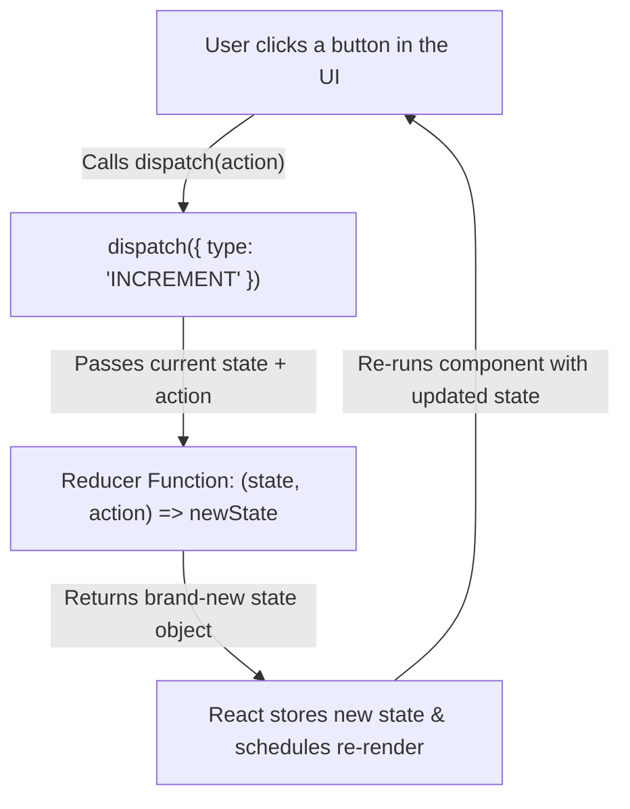

# `useReducer` — The Complete Beginner's Guide

Welcome! If you've already used `useState` to manage simple values like a toggle or a text input, `useReducer` is the natural next step when your component's state starts growing more complex.

---

### 🎯 What is `useReducer`?

Think of **`useState`** like a **sticky note on your fridge**: whenever something changes, you cross out the old note and write a brand-new value directly on it. That works great for one or two simple things, like `"Milk: 1"` or `"Door locked: true"`.

Now imagine you are running a **busy restaurant kitchen**. You don't want waiters walking into the kitchen and randomly changing ingredients on the stove! Instead:
1. A waiter writes down an **order ticket** (called an **action**), like `{ type: "ADD_PIZZA", size: "large" }`.
2. They hand that ticket to the **head chef** (called the **reducer**).
3. The head chef looks at the **current kitchen state** and the **order ticket**, follows a strict recipe book, and produces the **updated kitchen state**.

**`useReducer`** is that head chef + order ticket system for your React component.

Instead of scattering `setCount`, `setError`, `setLoading`, and `setItems` calls all over your event handlers, you:
- Keep **all state update rules in one pure function** (the **reducer**).
- Trigger updates by calling **`dispatch(action)`** — basically saying *"Hey React, this event just happened!"* rather than micromanaging *how* every piece of state should change.

> **Key Vocabulary (No Jargon Left Undefined):**
> - **State**: The current data your component remembers between renders (for example, `{ count: 0 }`).
> - **Action**: A plain JavaScript object describing *what happened* (usually has a `type` property, like `{ type: "INCREMENT" }`).
> - **Dispatch**: The function React gives you to send an action to your reducer (`dispatch({ type: "INCREMENT" })`).
> - **Reducer**: A pure function `(state, action) => newState` that takes the current state and an action, and returns the next state.

---

### 🧠 Mental Model

Here is how data flows in a component powered by `useReducer`:



Notice the **one-way loop**:
1. The UI **never** mutates state directly.
2. The UI only **dispatches** an action describing what the user did.
3. The **reducer** decides how state changes.
4. React **re-renders** the UI with the new state.

---

### 📖 Syntax

```jsx
import { useReducer } from "react";

const [state, dispatch] = useReducer(reducer, initialArg, init);
```

| Parameter | Type | Required | Description | Default |
| :--- | :--- | :--- | :--- | :--- |
| `reducer` | `(state, action) => newState` | Yes | A pure function that receives the current `state` and an `action`, and returns the next `state`. | None |
| `initialArg` | `any` | Yes | The initial state value (or the argument passed to `init` if `init` is provided). | None |
| `init` | `(initialArg) => initialState` | No | An optional initializer function that computes the initial state lazily on the first render. | `undefined` |

**Return Value:**
`useReducer` returns an array with exactly two items:
1. `state` — The current state value (on the first render, it equals `init(initialArg)` if `init` is provided, otherwise `initialArg`).
2. `dispatch` — A stable function you call with an `action` object to trigger a state update and re-render.

---

### ⚙️ How It Works Under The Hood

You might wonder: *how does React remember `state` between renders, and why does `dispatch` never change?*

1. **First Render (Mount):**
   - React creates an internal **hook slot** on the component's Fiber node (React's internal object representing your component).
   - If you passed a third argument `init`, React calls `init(initialArg)` **once** and stores the result in that hook slot. Otherwise, it stores `initialArg`.
   - React also creates a **queue** for pending actions and binds a `dispatch` function to that specific queue.
   - React returns `[state, dispatch]`.

2. **When You Call `dispatch(action)`:**
   - React does **not** immediately run your reducer right there on that line!
   - Instead, React places `action` into the hook's update queue and schedules a re-render.
   - Because `dispatch` is tied to the queue (not the current `state` value), its function reference stays **100% identical** across every render. That means you can safely pass `dispatch` to child components without causing unnecessary re-renders!

3. **During the Next Render:**
   - When React runs your component function again, `useReducer` loops through all queued actions in order:
     `nextState = reducer(currentState, action)`
   - If the final `nextState` is identical to the previous `state` (checked with `Object.is(nextState, prevState)`), React can skip re-rendering children and bail out.
   - Otherwise, React saves `nextState` in the hook slot and renders your JSX with the new state.

---

### ✅ When To Use `useReducer`

Use `useReducer` when:

1. **You have multiple related state values that change together** — For example, `isLoading`, `data`, and `error` for a network request, where starting a fetch sets `isLoading: true` and clears `error` at the same time.
2. **Next state depends on previous state in complex ways** — Such as shopping carts, undo/redo stacks, or multi-step wizards.
3. **You want to centralize state logic outside the component** — Moving the reducer function to its own file makes it easy to read and unit-test with plain JavaScript (no React rendering required!).
4. **Multiple event handlers modify the same state** — Instead of duplicating `setState` logic across `handleAdd`, `handleRemove`, and `handleClear`, each handler just dispatches a clear action name.
5. **You pass update callbacks deep down a component tree** — Passing one stable `dispatch` function (often via Context) is much cleaner than passing five separate `setSomething` callbacks.
6. **You want predictable, debuggable state transitions** — Every change is described by an explicit action like `{ type: "SUBMIT_FORM" }`, making it easy to log and trace bugs.

*(If you only have a single boolean toggle or a simple text input, `useState` is simpler and totally fine!)*

---

### ❌ Common Mistakes & Anti-patterns

#### Mistake 1: Mutating `state` directly inside the reducer

React compares the old state and new state by **reference** (`Object.is`). If you mutate `state` and return the same object, React thinks nothing changed and **won't re-render**!

```jsx
// ❌ BAD: Mutating state directly
function reducer(state, action) {
  switch (action.type) {
    case "ADD_ITEM":
      state.items.push(action.payload); // Mutates the existing array!
      return state; // Same object reference -> React may skip re-render!
    default:
      return state;
  }
}
```

```jsx
// ✅ GOOD: Returning a brand-new object and array
function reducer(state, action) {
  switch (action.type) {
    case "ADD_ITEM":
      return {
        ...state, // Copy existing state properties
        items: [...state.items, action.payload], // Create a new array with the new item
      };
    default:
      return state;
  }
}
```

#### Mistake 2: Running side effects (like `fetch` or `localStorage`) inside the reducer

Reducers must be **pure functions**: given the same `state` and `action`, they must always return the same result with zero side effects. React may even call your reducer twice in Strict Mode to help you catch impurities!

```jsx
// ❌ BAD: Side effect inside the reducer
function reducer(state, action) {
  switch (action.type) {
    case "SAVE_NAME":
      localStorage.setItem("name", action.payload); // Side effect!
      return { ...state, name: action.payload };
    default:
      return state;
  }
}
```

```jsx
// ✅ GOOD: Keep side effects in event handlers or useEffect
function reducer(state, action) {
  switch (action.type) {
    case "SAVE_NAME":
      return { ...state, name: action.payload }; // Pure state calculation only
    default:
      return state;
  }
}

// Inside your component:
function handleSave(newName) {
  localStorage.setItem("name", newName); // Side effect in event handler
  dispatch({ type: "SAVE_NAME", payload: newName }); // Pure dispatch
}
```

#### Mistake 3: Forgetting the `default` case (returning `undefined`)

If an unknown action is dispatched and your `switch` has no `default` branch, your reducer returns `undefined`, wiping out your entire state!

```jsx
// ❌ BAD: Missing default case
function reducer(state, action) {
  switch (action.type) {
    case "INCREMENT":
      return { count: state.count + 1 };
    // No default! Any typo like "INCREMNT" returns undefined!
  }
}
```

```jsx
// ✅ GOOD: Always handle unknown actions (return state or throw an error)
function reducer(state, action) {
  switch (action.type) {
    case "INCREMENT":
      return { count: state.count + 1 };
    default:
      throw new Error(`Unknown action type: ${action.type}`);
  }
}
```

#### Mistake 4: Reading `state` immediately after calling `dispatch`

Just like `useState`, `dispatch` schedules a future render—it does not update the `state` variable in the currently running function.

```jsx
// ❌ BAD: Expecting state to be updated on the very next line
function handleIncrement() {
  dispatch({ type: "INCREMENT" });
  console.log(state.count); // Still logs the OLD count!
}
```

```jsx
// ✅ GOOD: Compute or react to new state during render or in useEffect
function handleIncrement() {
  dispatch({ type: "INCREMENT" });
}
// Read `state.count` in your JSX or inside a `useEffect(() => { ... }, [state.count])`
```

---

### 🔄 Execution / Lifecycle Flow

```mermaid
sequenceDiagram
    participant User
    participant Component
    participant Dispatch as dispatch(action)
    participant Reducer as reducer(state, action)
    participant DOM as Browser DOM

    Note over Component: 1. Initial Mount
    Component->>Reducer: (Skipped unless init fn provided; uses initialArg)
    Component->>DOM: Renders UI with initial state

    Note over User,DOM: 2. User Interaction
    User->>Component: Clicks "+1" button
    Component->>Dispatch: Calls dispatch({ type: "INCREMENT" })
    Dispatch-->>Component: Queues action & schedules re-render

    Note over Component,DOM: 3. Re-render Phase
    Component->>Reducer: React calls reducer(currentState, { type: "INCREMENT" })
    Reducer-->>Component: Returns newState
    Component->>DOM: Updates DOM with newState
```

---

### 💡 Example 1 — The Basics

A simple counter with Increment, Decrement, Reset, and "+5" buttons. Every single line is commented so you can follow along step by step.

```jsx
import { useReducer } from "react"; // Import the useReducer hook from React

const initialState = { count: 0 }; // Define the starting state object with count set to 0

function counterReducer(state, action) { // Define the pure reducer function taking current state and an action
  switch (action.type) { // Inspect the action's type property to decide how to update state
    case "INCREMENT": // Handle the INCREMENT action
      return { count: state.count + 1 }; // Return a new state object with count increased by 1
    case "DECREMENT": // Handle the DECREMENT action
      return { count: state.count - 1 }; // Return a new state object with count decreased by 1
    case "ADD_AMOUNT": // Handle the ADD_AMOUNT action which carries a payload
      return { count: state.count + action.payload }; // Add the custom payload number to the current count
    case "RESET": // Handle the RESET action
      return initialState; // Return the original initialState object to reset count to 0
    default: // Fallback if an unrecognized action type is dispatched
      throw new Error(`Unhandled action type: ${action.type}`); // Throw a helpful error to catch typos early
  } // End of the switch statement
} // End of the counterReducer function

export default function App() { // Export the main App component as default
  const [state, dispatch] = useReducer(counterReducer, initialState); // Connect counterReducer and initialState, receiving state and dispatch

  return ( // Return the JSX UI to render on screen
    <div style={{ fontFamily: "sans-serif", padding: "2rem", maxWidth: "400px" }}> {/* Main container with simple spacing */}
      <h1>useReducer Counter</h1> {/* Heading for the counter app */}
      <p style={{ fontSize: "2rem", fontWeight: "bold" }}>Count: {state.count}</p> {/* Display the current count from state */}
      <div style={{ display: "flex", gap: "0.5rem", flexWrap: "wrap" }}> {/* Flex row to align action buttons nicely */}
        <button onClick={() => dispatch({ type: "DECREMENT" })}>-1</button> {/* Dispatch DECREMENT action when clicked */}
        <button onClick={() => dispatch({ type: "INCREMENT" })}>+1</button> {/* Dispatch INCREMENT action when clicked */}
        <button onClick={() => dispatch({ type: "ADD_AMOUNT", payload: 5 })}>+5</button> {/* Dispatch ADD_AMOUNT with payload 5 */}
        <button onClick={() => dispatch({ type: "RESET" })}>Reset</button> {/* Dispatch RESET action to return to 0 */}
      </div> {/* End of button container */}
    </div> // End of main container
  ); // End of return statement
} // End of App component
```

**What you will see in the browser:**
- A heading **"useReducer Counter"**
- A bold number showing **`Count: 0`**
- Four buttons: **`-1`**, **`+1`**, **`+5`**, and **`Reset`**. Clicking them immediately updates the displayed count!

---

### 💡 Example 2 — Real World Use Case

A **Shopping Cart** where you can add items, increment/decrement quantities, remove items, and clear the cart. Notice how cleanly all cart rules live inside `cartReducer`.

```jsx
import { useReducer } from "react"; // Import useReducer from React

const PRODUCTS = [ // Define a static catalog of products available to add
  { id: 1, name: "Mechanical Keyboard", price: 89 }, // Product 1 with id, name, and price
  { id: 2, name: "USB-C Hub", price: 35 }, // Product 2 with id, name, and price
  { id: 3, name: "Desk Mat", price: 24 }, // Product 3 with id, name, and price
]; // End of PRODUCTS array

const initialCartState = { items: [] }; // Initial cart state starts with an empty items array

function cartReducer(state, action) { // Reducer function managing all shopping cart transitions
  switch (action.type) { // Check which cart action was dispatched
    case "ADD_ITEM": { // Add a product or increase its quantity if already in cart
      const existing = state.items.find((item) => item.id === action.payload.id); // Look for an existing item with matching id
      if (existing) { // If the product is already in the cart
        return { // Return a new state object
          ...state, // Spread existing state properties
          items: state.items.map((item) => // Map over items to update only the matching one
            item.id === action.payload.id ? { ...item, qty: item.qty + 1 } : item // Increment qty by 1 for the match
          ), // End of map
        }; // End of returned state
      } // End of if (existing)
      return { // If the product is not yet in the cart
        ...state, // Spread existing state properties
        items: [...state.items, { ...action.payload, qty: 1 }], // Append the new product with qty initialized to 1
      }; // End of returned state
    } // End of ADD_ITEM case
    case "DECREMENT_ITEM": { // Decrease quantity by 1 or remove if quantity reaches 0
      return { // Return updated state
        ...state, // Spread existing state
        items: state.items // Start from current items
          .map((item) => (item.id === action.payload ? { ...item, qty: item.qty - 1 } : item)) // Subtract 1 from matching item's qty
          .filter((item) => item.qty > 0), // Remove any item whose quantity dropped to 0
      }; // End of returned state
    } // End of DECREMENT_ITEM case
    case "REMOVE_ITEM": { // Completely remove an item regardless of quantity
      return { // Return updated state
        ...state, // Spread existing state
        items: state.items.filter((item) => item.id !== action.payload), // Keep only items whose id does not match payload
      }; // End of returned state
    } // End of REMOVE_ITEM case
    case "CLEAR_CART": // Empty the entire cart
      return initialCartState; // Reset back to the initial empty cart state
    default: // Handle unknown action types
      throw new Error(`Unknown cart action: ${action.type}`); // Throw an error for debugging
  } // End of switch
} // End of cartReducer

export default function App() { // Export main App component
  const [state, dispatch] = useReducer(cartReducer, initialCartState); // Initialize useReducer with cartReducer and initialCartState
  const total = state.items.reduce((sum, item) => sum + item.price * item.qty, 0); // Derive total price from current cart items

  return ( // Render the store and cart UI
    <div style={{ fontFamily: "sans-serif", padding: "2rem", maxWidth: "560px" }}> {/* Outer layout wrapper */}
      <h1>Tech Store</h1> {/* Store title */}
      <h2>Products</h2> {/* Products section heading */}
      <div style={{ display: "flex", gap: "0.5rem", flexWrap: "wrap", marginBottom: "1.5rem" }}> {/* Product buttons container */}
        {PRODUCTS.map((product) => ( // Loop over each product in the catalog
          <button key={product.id} onClick={() => dispatch({ type: "ADD_ITEM", payload: product })}> {/* Dispatch ADD_ITEM on click */}
            + {product.name} (${product.price}) {/* Display product name and price on button */}
          </button> // End product button
        ))} {/* End PRODUCTS.map */}
      </div> {/* End product buttons container */}
      <h2>Your Cart ({state.items.length} unique)</h2> {/* Cart heading showing unique item count */}
      {state.items.length === 0 ? ( // Check if cart is empty
        <p>Your cart is empty. Add a product above!</p> // Show friendly empty state message
      ) : ( // Otherwise render the list of cart items
        <ul> {/* Unordered list for cart items */}
          {state.items.map((item) => ( // Loop over each item in the cart
            <li key={item.id} style={{ marginBottom: "0.5rem" }}> {/* List item keyed by product id */}
              <strong>{item.name}</strong> — ${item.price} x {item.qty} = ${item.price * item.qty}{" "} {/* Show name, price, qty, and line total */}
              <button onClick={() => dispatch({ type: "DECREMENT_ITEM", payload: item.id })}>-</button>{" "} {/* Decrease qty button */}
              <button onClick={() => dispatch({ type: "ADD_ITEM", payload: item })}>+</button>{" "} {/* Increase qty button */}
              <button onClick={() => dispatch({ type: "REMOVE_ITEM", payload: item.id })}>Remove</button> {/* Remove item button */}
            </li> // End list item
          ))} {/* End state.items.map */}
        </ul> // End unordered list
      )} {/* End empty/non-empty conditional */}
      <h3>Total: ${total}</h3> {/* Display calculated cart total */}
      {state.items.length > 0 && ( // Only show Clear Cart button when cart has items
        <button onClick={() => dispatch({ type: "CLEAR_CART" })}>Clear Cart</button> // Dispatch CLEAR_CART on click
      )} {/* End conditional Clear Cart button */}
    </div> // End outer layout wrapper
  ); // End return
} // End App component
```

---

### 💡 Example 3 — Advanced Pattern

Here we combine **`useReducer` + `useContext` + lazy initialization (`init`)** to build a **Task Board with Undo History** that persists to `localStorage`. Notice how `useReducer` handles complex undo/redo state transitions cleanly while `useEffect` syncs to `localStorage`.

```jsx
import { createContext, useContext, useEffect, useReducer, useState } from "react"; // Import hooks needed for reducer, context, effects, and input state

const STORAGE_KEY = "usereducer_tasks_v1"; // Key used to persist tasks in localStorage
const TaskContext = createContext(null); // Create a Context to share state and dispatch without prop drilling

function initTasks(storageKey) { // Lazy initializer function passed as 3rd argument to useReducer
  try { // Safely attempt to read from localStorage
    const saved = localStorage.getItem(storageKey); // Read serialized JSON string from localStorage
    const parsed = saved ? JSON.parse(saved) : []; // Parse saved tasks or default to an empty array
    return { tasks: parsed, history: [] }; // Return initial state with tasks and an empty undo history stack
  } catch { // Fallback if localStorage is unavailable or JSON is corrupted
    return { tasks: [], history: [] }; // Return safe empty default state
  } // End try/catch
} // End initTasks

function taskReducer(state, action) { // Reducer managing tasks plus an undo history stack
  switch (action.type) { // Branch on the dispatched action type
    case "ADD_TASK": { // Add a new task and push current tasks onto undo history
      const newTask = { id: Date.now(), text: action.payload, done: false }; // Build a new task object with unique timestamp id
      return { // Return updated state
        history: [...state.history, state.tasks], // Save snapshot of current tasks before mutating
        tasks: [...state.tasks, newTask], // Append new task to tasks array
      }; // End returned state
    } // End ADD_TASK
    case "TOGGLE_TASK": { // Toggle a task's done boolean and record history
      return { // Return updated state
        history: [...state.history, state.tasks], // Push previous tasks snapshot to history
        tasks: state.tasks.map((t) => (t.id === action.payload ? { ...t, done: !t.done } : t)), // Flip done flag on matching task
      }; // End returned state
    } // End TOGGLE_TASK
    case "UNDO": { // Restore the most recent snapshot from history
      if (state.history.length === 0) return state; // Do nothing if there is no history to undo
      const previousTasks = state.history[state.history.length - 1]; // Grab the last saved tasks snapshot
      return { // Return restored state
        tasks: previousTasks, // Restore tasks to the previous snapshot
        history: state.history.slice(0, -1), // Pop the last snapshot off the history stack
      }; // End returned state
    } // End UNDO
    default: // Guard against unknown action types
      throw new Error(`Unknown action: ${action.type}`); // Throw descriptive error
  } // End switch
} // End taskReducer

function TaskList() { // Child component that reads state and dispatch directly from Context
  const { state, dispatch } = useContext(TaskContext); // Consume state and dispatch from TaskContext
  return ( // Render the list of tasks
    <ul> {/* Task list container */}
      {state.tasks.map((task) => ( // Iterate over every task in state
        <li key={task.id} style={{ marginBottom: "0.4rem" }}> {/* List item keyed by task id */}
          <label style={{ textDecoration: task.done ? "line-through" : "none", cursor: "pointer" }}> {/* Strike through completed tasks */}
            <input type="checkbox" checked={task.done} onChange={() => dispatch({ type: "TOGGLE_TASK", payload: task.id })} />{" "} {/* Dispatch TOGGLE_TASK on change */}
            {task.text} {/* Display task text */}
          </label> {/* End label */}
        </li> // End list item
      ))} {/* End tasks.map */}
    </ul> // End task list
  ); // End return
} // End TaskList

export default function App() { // Export main App component
  const [state, dispatch] = useReducer(taskReducer, STORAGE_KEY, initTasks); // Use 3-arg useReducer with lazy initTasks
  const [text, setText] = useState(""); // Local useState just for the controlled text input

  useEffect(() => { // Sync tasks to localStorage whenever state.tasks changes
    localStorage.setItem(STORAGE_KEY, JSON.stringify(state.tasks)); // Persist serialized tasks array
  }, [state.tasks]); // Only re-run effect when state.tasks changes

  function handleSubmit(e) { // Handle form submission to add a task
    e.preventDefault(); // Prevent browser page reload on form submit
    if (!text.trim()) return; // Ignore empty or whitespace-only submissions
    dispatch({ type: "ADD_TASK", payload: text.trim() }); // Dispatch ADD_TASK with trimmed input text
    setText(""); // Clear the controlled input field
  } // End handleSubmit

  return ( // Render the task board wrapped in TaskContext.Provider
    <TaskContext.Provider value={{ state, dispatch }}> {/* Provide state and dispatch to all nested components */}
      <div style={{ fontFamily: "sans-serif", padding: "2rem", maxWidth: "480px" }}> {/* Main container */}
        <h1>Task Board (with Undo)</h1> {/* Heading */}
        <form onSubmit={handleSubmit} style={{ display: "flex", gap: "0.5rem", marginBottom: "1rem" }}> {/* Task creation form */}
          <input value={text} onChange={(e) => setText(e.target.value)} placeholder="New task..." /> {/* Controlled text input */}
          <button type="submit">Add</button> {/* Submit button */}
          <button type="button" disabled={state.history.length === 0} onClick={() => dispatch({ type: "UNDO" })}> {/* Undo button disabled when history is empty */}
            Undo ({state.history.length}) {/* Show how many undo steps are available */}
          </button> {/* End Undo button */}
        </form> {/* End form */}
        <TaskList /> {/* Render TaskList which reads from Context */}
      </div> {/* End main container */}
    </TaskContext.Provider> // End Context Provider
  ); // End return
} // End App component
```

---

### 🧪 Mini Quiz

Test your understanding! Click each question to reveal the answer.

1. **Why shouldn't you mutate `state` directly (e.g., `state.items.push(x)`) inside a reducer?**

<details>
<summary>Show Answer</summary>

React checks whether state changed using reference equality (`Object.is(prevState, nextState)`). If you mutate the existing object or array and return it, the reference is unchanged, so React may skip re-rendering your component. Always return a new object or array (using spread syntax `...`, `.map()`, `.filter()`, etc.).

</details>

2. **Does calling `dispatch(action)` immediately update the `state` variable on the very next line of your event handler?**

<details>
<summary>Show Answer</summary>

**No.** `dispatch` queues the action and schedules a re-render. The `state` variable in the currently executing function still holds the snapshot from the current render. The updated `state` is available on the next render.

</details>

3. **When is the optional third argument `init` in `useReducer(reducer, initialArg, init)` useful?**

<details>
<summary>Show Answer</summary>

When computing the initial state is expensive (like parsing a large `localStorage` entry or transforming big data). Passing an `init` function ensures React only computes it **once** during the initial mount, instead of re-running that computation on every single re-render.

</details>

---

### 🔗 Related Hooks

- **`useState`** — Built on top of `useReducer` under the hood! Use `useState` for simple, independent values (booleans, strings, numbers) and `useReducer` when state transitions become complex or interrelated.
- **`useContext`** — Frequently paired with `useReducer` (`Context + useReducer`) to share state and `dispatch` across deeply nested components without prop drilling.
- **`useCallback`** — Because `dispatch` has a guaranteed stable identity across renders, you often *don't* need `useCallback` for callbacks that only call `dispatch`—you can pass `dispatch` directly!
- **`useEffect`** — Used alongside `useReducer` to run side effects (like saving to `localStorage` or fetching data) in response to state changes, keeping the reducer itself 100% pure.

---

### 📚 Further Reading

- [React Official Docs: `useReducer`](https://react.dev/reference/react/useReducer) — Authoritative API reference, caveats, and troubleshooting.
- [React Official Docs: Extracting State Logic into a Reducer](https://react.dev/learn/extracting-state-logic-into-a-reducer) — Step-by-step guide on migrating from `useState` to `useReducer`.
- [React Official Docs: Scaling Up with Reducer and Context](https://react.dev/learn/scaling-up-with-reducer-and-context) — How to combine `useReducer` with `useContext` for app-wide state.
- [Kent C. Dodds: Should I useState or useReducer?](https://kentcdodds.com/blog/should-i-usestate-or-usereducer) — Practical decision framework from a well-known React educator.
