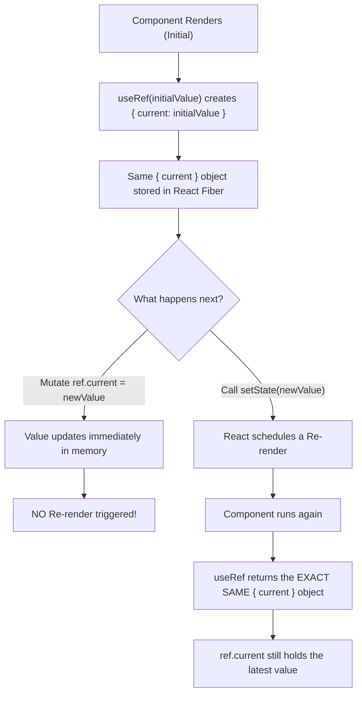

# `useRef` — The Complete Beginner's Guide

Welcome! If you've ever needed to grab a real DOM element (like focusing an `<input>` box) or store a value that **survives re-renders without triggering a new render**, `useRef` is the exact React hook you need.

---

### 🎯 What is useRef?

In plain English, **`useRef` is a hook that gives you a persistent, mutable "box" (an object with a `.current` property) that React remembers between renders — without ever causing a re-render when you change what's inside it.**

Think of it with this analogy:
- **`useState` is like a whiteboard on your kitchen wall.** Whenever you erase something and write a new value on it, everyone in the house (React) immediately notices and re-renders the room to show the updated whiteboard.
- **`useRef` is like a locked pocket notebook you keep in your jacket.** You can open it, scratch out a number, and write a new one whenever you want. React remembers what's in your notebook the next time the component renders, **but writing in the notebook does NOT make React re-render the screen.**

Because it doesn't trigger re-renders, `useRef` is also React's official "escape hatch" for holding onto **DOM elements** (the actual HTML nodes in the browser, like `<input>`, `<video>`, or `<canvas>`) so you can call browser methods like `.focus()`, `.play()`, or `.scrollIntoView()`.

> **Key Jargon Defined:**
> - **Mutable**: Can be changed directly in place (e.g., `myRef.current = 42`) without calling a setter function.
> - **Re-render**: When React calls your component function again to calculate updated UI.
> - **DOM (Document Object Model)**: The live tree of HTML elements that the browser creates and displays on screen.

---

### 🧠 Mental Model

Here is how `useRef` behaves across the life of a component compared to `useState`:



---

### 📖 Syntax

```jsx
import { useRef } from 'react';

function MyComponent() {
  const myRef = useRef(initialValue);

  // Read the value:
  console.log(myRef.current);

  // Update the value (does NOT trigger a re-render):
  myRef.current = newValue;

  // Or attach it to a JSX element to access the real DOM node:
  return <input ref={myRef} />;
}
```

| Parameter | Type | Required | Description | Default |
| :--- | :--- | :--- | :--- | :--- |
| `initialValue` | `any` | No | The value you want `ref.current` to start with on the very first render. Ignored on all future renders. | `undefined` |

**Return Value:**
`useRef` returns a plain JavaScript object with a single property: `{ current: initialValue }`.

---

### ⚙️ How It Works Under The Hood

1. **First Render (Mount):**
   When your component renders for the very first time, React creates a small plain object `{ current: initialValue }` and saves it on the component's internal **Fiber node** (React's internal bookkeeping record for that component instance).
2. **Subsequent Renders (Updates):**
   On every future render, React **ignores** whatever `initialValue` you pass to `useRef(...)` and simply hands you back the **exact same object reference** (`===` identical) from the Fiber node.
3. **Why Mutations Don't Re-render:**
   React only schedules a re-render when you call a state dispatcher (`setState` or `dispatch`). Mutating `ref.current = 123` is just changing a property on a plain JavaScript object—React isn't watching it, so no render happens.
4. **How `ref={myRef}` Attaches to DOM Elements:**
   During the commit phase (right after React updates the real browser DOM), React checks any JSX element with a `ref` prop. It sets `myRef.current` to that actual DOM node. When the element unmounts (is removed from the page), React sets `myRef.current` back to `null` so you don't leak memory.

---

### ✅ When To Use useRef

- **Managing focus, text selection, or media playback:** Calling `.focus()`, `.select()`, `.play()`, or `.pause()` on `<input>`, `<textarea>`, or `<video>` elements.
- **Storing timer or interval IDs:** Holding the return value of `setTimeout` or `setInterval` so you can call `clearTimeout` / `clearInterval` later without storing it in state.
- **Tracking previous values:** Remembering what a prop or state value was on the *previous* render (e.g., comparing `prevCount` to `count`).
- **Avoiding stale closures in async callbacks or event listeners:** Keeping a ref synced with the latest state/callback so a long-lived `setInterval` or WebSocket listener always reads fresh data.
- **Measuring DOM size or scroll position:** Reading `element.getBoundingClientRect()`, `scrollHeight`, or `scrollIntoView()` after render.
- **Integrating third-party non-React libraries:** Passing a DOM container ref to libraries like Chart.js, D3, Google Maps, or GSAP animations.

---

### ❌ Common Mistakes & Anti-patterns

#### Mistake 1: Reading or writing `ref.current` during rendering

React expects your component's render body to be a pure calculation. Reading or mutating `ref.current` directly during render makes your UI unpredictable (especially in React Strict Mode, which double-invokes renders in development).

**❌ BAD:**
```jsx
function Counter() {
  const renderCount = useRef(0);
  // BAD: Mutating ref.current directly during render!
  renderCount.current = renderCount.current + 1;
  // BAD: Reading ref.current in JSX during render!
  return <p>Rendered {renderCount.current} times</p>;
}
```

**✅ GOOD:**
```jsx
function Counter() {
  const renderCount = useRef(0);

  // GOOD: Update refs inside useEffect or event handlers
  useEffect(() => {
    renderCount.current += 1;
  });

  // If the user needs to SEE a value on screen, use useState instead!
  return <p>Check console or use state for visible counts.</p>;
}
```

---

#### Mistake 2: Using `useRef` when you actually need `useState`

If changing a value should update what the user sees on the screen, `useRef` is the wrong tool because changing `ref.current` will **not** re-render the UI.

**❌ BAD:**
```jsx
function NameBadge() {
  const nameRef = useRef("Alice");

  function handleChange() {
    nameRef.current = "Bob"; // UI still shows "Alice"!
  }

  return <button onClick={handleChange}>{nameRef.current}</button>;
}
```

**✅ GOOD:**
```jsx
function NameBadge() {
  const [name, setName] = useState("Alice");

  function handleChange() {
    setName("Bob"); // Triggers re-render, UI updates to "Bob"!
  }

  return <button onClick={handleChange}>{name}</button>;
}
```

---

#### Mistake 3: Assuming `ref.current` is available immediately before mount

On the first render, before React finishes creating the DOM elements, `inputRef.current` is `null`. Accessing `inputRef.current.focus()` directly in the component body will crash with `TypeError: Cannot read properties of null`.

**❌ BAD:**
```jsx
function AutoFocusInput() {
  const inputRef = useRef(null);
  inputRef.current.focus(); // CRASH! inputRef.current is null during render!
  return <input ref={inputRef} />;
}
```

**✅ GOOD:**
```jsx
function AutoFocusInput() {
  const inputRef = useRef(null);

  useEffect(() => {
    // Runs AFTER React has mounted the <input> into the DOM
    inputRef.current?.focus();
  }, []);

  return <input ref={inputRef} />;
}
```

---

#### Mistake 4: Passing `ref` directly to a custom component without accepting it as a prop (React < 19) or forgetting to forward it

In React 19+, `ref` can be passed as a regular prop to function components. In React 18 and earlier, passing `ref={myRef}` to `<CustomInput />` fails unless wrapped in `forwardRef`. Even in React 19, the child component must explicitly attach the `ref` prop to a real DOM node.

**❌ BAD:**
```jsx
function CustomInput() {
  return <input placeholder="Type here" />; // Ignores any ref passed to it!
}

function Form() {
  const inputRef = useRef(null);
  return <CustomInput ref={inputRef} />; // inputRef.current stays null!
}
```

**✅ GOOD:**
```jsx
function CustomInput({ ref }) {
  // Attach the received ref prop to the underlying DOM <input>
  return <input ref={ref} placeholder="Type here" />;
}

function Form() {
  const inputRef = useRef(null);
  return <CustomInput ref={inputRef} />;
}
```

---

### 🔄 Execution / Lifecycle Flow

This diagram shows **when** `ref.current` gets populated, read, and cleared relative to React's render and commit phases:

```mermaid
sequenceDiagram
    participant C as Component Function
    participant R as React Core
    participant DOM as Browser DOM

    Note over C,DOM: 1. Initial Mount
    C->>R: Call useRef(null)
    R-->>C: Returns { current: null }
    C-->>R: Returns JSX <input ref={inputRef} />
    R->>DOM: Creates <input> element
    R->>C: Sets inputRef.current = <input> DOM node
    Note over C: useEffect runs (inputRef.current is ready!)

    Note over C,DOM: 2. User Interaction / Re-render
    C->>C: Event handler mutates ref.current (NO re-render)
    R->>C: State change triggers re-render
    C->>R: Call useRef(null)
    R-->>C: Returns SAME { current } object

    Note over C,DOM: 3. Unmount
    R->>DOM: Removes <input> element
    R->>C: Resets inputRef.current = null
```



---

### 💡 Example 1 — The Basics

This example demonstrates the two core superpowers of `useRef`:
1. **Focusing a DOM element** (`<input>`) when a button is clicked.
2. **Counting silent clicks** in `ref.current` without re-rendering until you explicitly ask React to show it.

```jsx
import { useRef, useState } from 'react'; // Import useRef and useState from React

export default function FocusAndSilentCounter() { // Define and export the main component
  const inputRef = useRef(null); // Create a ref to hold the <input> DOM element (starts as null)
  const silentClicksRef = useRef(0); // Create a ref to count clicks without causing re-renders
  const [renderCount, setRenderCount] = useState(0); // State used only to force a re-render when we want

  const handleFocusClick = () => { // Event handler to focus the text box
    inputRef.current.focus(); // Access the real <input> DOM node and call its native .focus() method
  }; // End handleFocusClick

  const handleSilentClick = () => { // Event handler that updates the ref silently
    silentClicksRef.current += 1; // Increment .current directly (does NOT trigger a re-render!)
    console.log('Silent clicks so far:', silentClicksRef.current); // Log the updated value to the console
  }; // End handleSilentClick

  const handleForceRender = () => { // Event handler to trigger a screen refresh
    setRenderCount((prev) => prev + 1); // Updating state forces React to re-render the component
  }; // End handleForceRender

  return ( // Return the JSX to display in the browser
    <div style={{ fontFamily: 'sans-serif', padding: '20px' }}> {/* Container with basic styling */}
      <h2>useRef Basics</h2> {/* Heading */}
      <input ref={inputRef} type="text" placeholder="Click button to focus me" /> {/* Attach inputRef to this DOM node */}
      <button onClick={handleFocusClick}>Focus Input</button> {/* Button that focuses the input */}
      <hr /> {/* Horizontal divider */}
      <p>Silent clicks (updates on re-render): {silentClicksRef.current}</p> {/* Shows ref value from latest render */}
      <p>Screen refreshes (state): {renderCount}</p> {/* Shows how many times state triggered a render */}
      <button onClick={handleSilentClick}>Silent Click (+1 in Ref)</button> {/* Increments ref without re-render */}
      <button onClick={handleForceRender}>Refresh Screen (State)</button> {/* Forces re-render to reveal ref value */}
    </div> // End container
  ); // End return
} // End component
```

**What you will see in the browser:**
- An input box and a **"Focus Input"** button. Clicking the button immediately places the blinking text cursor inside the input box.
- A **"Silent Click (+1 in Ref)"** button. Clicking it 5 times does **not** change the number on screen (though the console logs 1, 2, 3, 4, 5).
- Clicking **"Refresh Screen (State)"** triggers a re-render, and suddenly the screen jumps to display `5` silent clicks!

---

### 💡 Example 2 — Real World Use Case

A **Stopwatch** is a classic real-world `useRef` use case. You need `useState` for the elapsed seconds (so the UI ticks on screen), and `useRef` to store the `setInterval` ID (so you can stop/reset the timer cleanly without triggering extra renders).

```jsx
import { useRef, useState } from 'react'; // Import useRef for interval ID and useState for elapsed time

export default function Stopwatch() { // Define and export the Stopwatch component
  const [elapsedMs, setElapsedMs] = useState(0); // State for elapsed milliseconds shown on screen
  const [isRunning, setIsRunning] = useState(false); // State to track whether the stopwatch is active
  const intervalRef = useRef(null); // Ref to store the interval ID so we can clear it later
  const startTimeRef = useRef(0); // Ref to store the timestamp when the timer started

  const handleStart = () => { // Handler to start or resume the stopwatch
    if (isRunning) return; // Guard: do nothing if already running
    setIsRunning(true); // Update UI state to show the stopwatch is running
    startTimeRef.current = Date.now() - elapsedMs; // Calculate adjusted start time to support resuming
    intervalRef.current = setInterval(() => { // Start a 50ms interval and save its ID in intervalRef
      setElapsedMs(Date.now() - startTimeRef.current); // Update elapsed time state every 50ms
    }, 50); // Run interval callback every 50 milliseconds
  }; // End handleStart

  const handleStop = () => { // Handler to pause the stopwatch
    clearInterval(intervalRef.current); // Stop the interval using the ID stored in intervalRef
    intervalRef.current = null; // Clear the ref so we know no interval is active
    setIsRunning(false); // Update UI state to show the stopwatch is paused
  }; // End handleStop

  const handleReset = () => { // Handler to stop and reset the stopwatch to 0
    clearInterval(intervalRef.current); // Stop any running interval
    intervalRef.current = null; // Clear the stored interval ID
    setIsRunning(false); // Mark stopwatch as stopped
    setElapsedMs(0); // Reset displayed time back to 0
  }; // End handleReset

  const seconds = (elapsedMs / 1000).toFixed(2); // Format milliseconds into seconds with 2 decimal places

  return ( // Return JSX UI
    <div style={{ fontFamily: 'sans-serif', padding: '20px' }}> {/* Outer container */}
      <h2>⏱️ Stopwatch</h2> {/* Title */}
      <p style={{ fontSize: '2rem', fontWeight: 'bold' }}>{seconds}s</p> {/* Live timer display */}
      <button onClick={handleStart} disabled={isRunning}>Start</button> {/* Start button, disabled while running */}
      <button onClick={handleStop} disabled={!isRunning}>Stop</button> {/* Stop button, disabled while stopped */}
      <button onClick={handleReset}>Reset</button> {/* Reset button */}
    </div> // End container
  ); // End return
} // End Stopwatch component
```

---

### 💡 Example 3 — Advanced Pattern

A common advanced pattern is **Tracking the Previous Value** of state across renders by combining `useRef` with `useEffect`. Because `useEffect` runs *after* the render commits to the screen, updating `prevValueRef.current` inside `useEffect` means during the *next* render, `prevValueRef.current` still holds the *previous* render's value!

```jsx
import { useEffect, useRef, useState } from 'react'; // Import useEffect, useRef, and useState

export default function PriceTracker() { // Define and export the PriceTracker component
  const [price, setPrice] = useState(100); // Current stock price stored in state
  const prevPriceRef = useRef(price); // Ref initialized with the starting price to track the previous value

  useEffect(() => { // Runs AFTER every render where 'price' has changed
    prevPriceRef.current = price; // Store the current price so it becomes the "previous" price next render
  }, [price]); // Dependency array: only update the ref when 'price' changes

  const prevPrice = prevPriceRef.current; // Read the previous price captured from the last render
  const diff = price - prevPrice; // Calculate the difference between current and previous price
  const trend = diff > 0 ? '📈 Up' : diff < 0 ? '📉 Down' : '➖ Unchanged'; // Determine visual trend label

  return ( // Return JSX UI
    <div style={{ fontFamily: 'sans-serif', padding: '20px' }}> {/* Container */}
      <h2>Stock Price Tracker</h2> {/* Heading */}
      <p>Current Price: <strong>${price}</strong></p> {/* Display current price */}
      <p>Previous Price: <strong>${prevPrice}</strong></p> {/* Display previous price from ref */}
      <p>Trend: {trend} ({diff >= 0 ? `+${diff}` : diff})</p> {/* Show trend and delta */}
      <button onClick={() => setPrice((p) => p + 10)}>+$10</button> {/* Button to increase price */}
      <button onClick={() => setPrice((p) => Math.max(0, p - 10))}>-$10</button> {/* Button to decrease price */}
    </div> // End container
  ); // End return
} // End PriceTracker component
```

---

### 🧪 Mini Quiz

Test your understanding! Click each question to reveal the answer.

<details>
<summary><strong>1. Does changing <code>myRef.current = "hello"</code> trigger a React re-render?</strong></summary>

**No.** Mutating `ref.current` changes the object property in memory immediately, but React does not track ref mutations and will **not** re-render the component. Use `useState` if you want the UI to update on screen.

</details>

<details>
<summary><strong>2. Why is <code>inputRef.current</code> equal to <code>null</code> if you log it directly inside the component body on the first render?</strong></summary>

Because on the first render, React hasn't created or attached the real DOM `<input>` element yet! React sets `inputRef.current` to the DOM node **after** the render finishes (during the commit phase), right before `useEffect` runs.

</details>

<details>
<summary><strong>3. When should you choose <code>useRef</code> over a regular <code>let myVar = 0</code> variable declared inside your component?</strong></summary>

A regular `let myVar = 0` inside your component resets back to `0` on **every** re-render. `useRef` persists its `.current` value across all re-renders for the entire lifetime of the component.

</details>

---

### 🔗 Related Hooks

- **`useState`**: Use `useState` when changing a value **should** trigger a re-render and update the UI. Use `useRef` when it **shouldn't**.
- **`useEffect`**: Frequently paired with `useRef` because `useEffect` runs after the DOM is committed—making it the safe place to read or interact with `domRef.current`.
- **`useImperativeHandle`**: Used alongside `ref` when a parent component needs to call custom methods (like `.reset()` or `.open()`) exposed by a child component, rather than accessing the raw DOM node directly.
- **`useCallback`**: Useful as a "callback ref" (`ref={(node) => ...}`) when you need to run code at the exact moment a DOM node mounts or unmounts.

---

### 📚 Further Reading

- [React Official Docs: `useRef`](https://react.dev/reference/react/useRef) — The official API reference, caveats, and examples.
- [React Official Docs: Referencing Values with Refs](https://react.dev/learn/referencing-values-with-refs) — Deep dive into when to use refs vs. state.
- [React Official Docs: Manipulating the DOM with Refs](https://react.dev/learn/manipulating-the-dom-with-refs) — Guide to focusing inputs, scrolling, and measuring DOM nodes.
- [Kent C. Dodds: Managing React State & Refs](https://kentcdodds.com/blog) — Community articles on React hooks mental models and avoiding stale closures.
