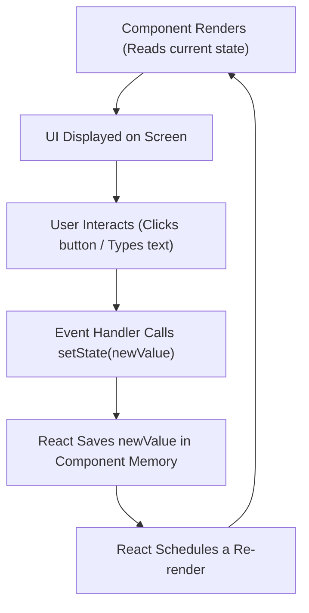

# `useState` — Remembering Data in React Components

> **TL;DR:** `useState` lets a React component remember information between renders (like a counter, form input, or toggle) and automatically updates the screen whenever that information changes.

---

### 🎯 What is useState?

Imagine you have a **sticky note on your fridge** that says *"Milk cartons left: 2"*. Every time you finish a carton, you cross out `2` and write `1`. When you look at the fridge later, you don't have to guess—the sticky note remembers the number for you!

In React, a **component** is just a JavaScript function that returns what should appear on the screen (called **JSX**, which looks like HTML). Normally, when a JavaScript function finishes running, all of its local variables disappear. If you put `let count = 0` inside a component, every time React re-runs that function to update the screen, `count` would reset back to `0`!

**`useState`** is React's sticky note. It is a built-in **Hook** (a special React function starting with `use`) that gives your component:

1. **A memory slot** that survives across renders (so your data isn't wiped out).
2. **A setter function** that updates that memory slot *and* tells React: *"Hey, this data changed—please re-render this component so the screen shows the new value!"*

Without `useState`, your UI would be completely static—buttons wouldn't change anything on screen, and typing into inputs wouldn't be remembered.

---

### 🧠 Mental Model

Think of `useState` as a loop between **State** (data), **UI** (what the user sees), and **Events** (user actions):



Every time `setState` is called with a different value, React:
- Stores the new value safely outside your component function.
- Calls your component function again from top to bottom.
- Compares the new JSX with the old JSX and updates **only** the parts of the real browser DOM that actually changed.

---

### 📖 Syntax

```jsx
import { useState } from "react";

function MyComponent() {
  const [state, setState] = useState(initialState);
  // ...
}
```

#### Parameters & Return Value

| Parameter / Return | Type | Required | Description | Default |
| :--- | :--- | :--- | :--- | :--- |
| `initialState` | `any` or `() => any` | No | The starting value for your state on the very first render. If you pass a function (initializer function), React calls it once on mount and uses its return value. | `undefined` |
| `state` *(returned `[0]`)* | `any` | N/A | The current value of the state during this render. On the first render, it equals `initialState`. | `undefined` (if omitted) |
| `setState` *(returned `[1]`)* | `(nextState) => void` | N/A | A function that updates `state` to `nextState` (or takes an updater function `prev => next`) and triggers a re-render. | N/A |

> **Why array destructuring `const [count, setCount]`?**
> `useState` returns an array with **exactly two items**: `[currentValue, setterFunction]`. Using array destructuring lets you name them whatever makes sense for your data—like `[isOpen, setIsOpen]` or `[email, setEmail]`.

---

### ⚙️ How It Works Under The Hood

Beginner developers often wonder: *"If my component is just a regular JavaScript function, how does `useState` remember values after the function finishes?"*

Here is the simplified story of what React does internally:

1. **A Fiber Node (Component Shelf):** For every component currently on the screen, React keeps an internal object in memory (often called a *Fiber*). On that object, React stores a list (linked list / array) of Hook cells for that component instance.
2. **Hook Call Order Matters:** When your component runs for the first time, React creates a new cell for each `useState` call in the exact order they are called:
   - 1st `useState` → Cell `#0`
   - 2nd `useState` → Cell `#1`
   - 3rd `useState` → Cell `#2`
3. **Subsequent Renders:** On the next render, React resets an internal pointer to `0` and walks through your component again. When it hits the 1st `useState`, it reads Cell `#0`; when it hits the 2nd `useState`, it reads Cell `#1`. That is why **Rules of Hooks** exist: you must never call `useState` inside `if` statements or loops, because changing the call order would mismatch the cells!
4. **Object.is Comparison:** When you call `setState(newValue)`, React compares `newValue` with the current stored value using `Object.is`. If they are identical, React bails out and skips re-rendering!
5. **Batching:** If you call multiple `setState` functions inside the same event handler (like `setName("Ada"); setAge(30);`), React **batches** them together into a single re-render for better performance.

---

### ✅ When To Use useState

Use `useState` whenever a value **changes over time** and **needs to update the UI** when it changes:

- **Counters & Numeric Trackers:** Shopping cart item quantities, likes/upvotes, pagination page numbers, or quiz scores.
- **Toggles & Visibility Flags:** Opening/closing a modal, expanding an accordion, showing/hiding a password, or toggling dark mode.
- **Form Inputs (Controlled Components):** Storing what a user is typing into `<input>`, `<textarea>`, or `<select>` elements.
- **UI Selection State:** Tracking which tab is currently active, which table row is selected, or which filter chip is clicked.
- **Loading & Error States:** Showing a spinner (`isLoading`) or an error banner (`errorMessage`) while waiting for an API request.
- **Small Lists or Objects:** Managing a dynamic list of to-dos, tags, or a multi-field user profile form.

*(Note: If a value can be calculated directly from existing props or state—like `fullName = firstName + " " + lastName`—don't put it in `useState`. Just compute it during render!)*

---

### ❌ Common Mistakes & Anti-patterns

#### 1. Mutating State Directly (Especially Arrays & Objects)

React checks if state changed by comparing references (`Object.is`). If you mutate an object or array in place, its reference stays the same, so React won't know it changed and **won't re-render**.

**BAD:**
```jsx
const [items, setItems] = useState(["Apple", "Banana"]);

function addOrange() {
  items.push("Orange"); // Mutates the existing array in place!
  setItems(items);      // Same array reference -> React skips re-render!
}
```

**GOOD:**
```jsx
const [items, setItems] = useState(["Apple", "Banana"]);

function addOrange() {
  // Create a brand new array with spread syntax so React sees a new reference
  setItems([...items, "Orange"]);
}
```

---

#### 2. Calling `setState` Multiple Times Without an Updater Function

`state` inside an event handler is a **snapshot** from the current render. Calling `setCount(count + 1)` three times in a row just sets it to `0 + 1` three times!

**BAD:**
```jsx
const [count, setCount] = useState(0);

function addThree() {
  setCount(count + 1); // 0 + 1 = 1
  setCount(count + 1); // 0 + 1 = 1
  setCount(count + 1); // 0 + 1 = 1 (Result is 1, not 3!)
}
```

**GOOD:**
```jsx
const [count, setCount] = useState(0);

function addThree() {
  // Pass an updater function (prev => prev + 1) to queue updates safely
  setCount((prev) => prev + 1); // 0 -> 1
  setCount((prev) => prev + 1); // 1 -> 2
  setCount((prev) => prev + 1); // 2 -> 3
}
```

---

#### 3. Reading State Immediately After Calling `setState`

Calling `setState` schedules a re-render for the *next* render; it does **not** change the `state` variable in the currently running function.

**BAD:**
```jsx
const [name, setName] = useState("Guest");

function handleLogin() {
  setName("Kunal");
  console.log(name); // Still logs "Guest"!
}
```

**GOOD:**
```jsx
const [name, setName] = useState("Guest");

function handleLogin() {
  const nextName = "Kunal";
  setName(nextName);
  console.log(nextName); // Logs "Kunal" because we use the local variable
}
```

---

#### 4. Calling `useState` Conditionally or Inside Loops

React relies on Hooks being called in the **exact same order** on every single render.

**BAD:**
```jsx
function Profile({ isLoggedIn }) {
  if (isLoggedIn) {
    const [bio, setBio] = useState(""); // Breaks Hook order if isLoggedIn changes!
  }
  return <div />;
}
```

**GOOD:**
```jsx
function Profile({ isLoggedIn }) {
  // Always call useState at the top level of your component
  const [bio, setBio] = useState("");

  if (!isLoggedIn) {
    return <p>Please log in.</p>;
  }
  return <p>{bio}</p>;
}
```

---

#### 5. Running Expensive Initializers on Every Render

If you write `useState(computeHeavyValue())`, JavaScript executes `computeHeavyValue()` on **every** render, even though React ignores the return value after the first render.

**BAD:**
```jsx
// parseHugeJson() runs on EVERY render, wasting CPU!
const [data, setData] = useState(parseHugeJson());
```

**GOOD:**
```jsx
// Pass a function reference: React calls it ONLY on the initial render!
const [data, setData] = useState(() => parseHugeJson());
```

---

### 🔄 Execution / Lifecycle Flow

Here is the exact timeline of when `useState` runs relative to component renders and user interactions:

```mermaid
sequenceDiagram
    participant User
    participant Browser as Browser DOM
    participant React as React Engine
    participant Comp as Your Component

    Note over React,Comp: 1. Initial Mount
    React->>Comp: Calls Component()
    Comp->>React: useState(initialValue)
    React-->>Comp: Returns [initialValue, setter]
    Comp-->>React: Returns initial JSX
    React->>Browser: Paints initial UI

    Note over User,Comp: 2. User Interaction
    User->>Browser: Clicks button
    Browser->>Comp: Triggers onClick handler
    Comp->>React: Calls setState(nextValue)
    Note right of React: State is queued;<br/>old variable unchanged in this turn

    Note over React,Comp: 3. Re-render
    React->>Comp: Calls Component() again
    Comp->>React: useState(initialValue)
    React-->>Comp: Ignores initialValue, returns [nextValue, setter]
    Comp-->>React: Returns updated JSX
    React->>Browser: Updates only changed DOM nodes
```

---

### 💡 Example 1 — The Basics

A simple interactive counter with increment, decrement, reset, and a step-size toggle.

```jsx
import { useState } from "react"; // Import the useState hook from the React library

export default function CounterBasics() { // Define and export our functional component
  const [count, setCount] = useState(0); // Create a state variable 'count' initialized to 0
  const [step, setStep] = useState(1); // Create a state variable 'step' initialized to 1

  function handleIncrement() { // Define a handler to increase the count
    setCount((prevCount) => prevCount + step); // Update count using the previous value plus step
  } // Close handleIncrement function

  function handleDecrement() { // Define a handler to decrease the count
    setCount((prevCount) => prevCount - step); // Update count using the previous value minus step
  } // Close handleDecrement function

  function handleReset() { // Define a handler to reset everything
    setCount(0); // Set count back to 0
    setStep(1); // Set step back to 1
  } // Close handleReset function

  return ( // Return the JSX that describes what appears on screen
    <div style={{ fontFamily: "sans-serif", padding: "24px", maxWidth: "360px" }}> {/* Container with clean spacing */}
      <h2>Simple Counter</h2> {/* Heading for the counter widget */}
      <p style={{ fontSize: "2rem", fontWeight: "bold" }}>Count: {count}</p> {/* Display current count */}
      <div style={{ display: "flex", gap: "8px", marginBottom: "16px" }}> {/* Row of action buttons */}
        <button onClick={handleDecrement}>- {step}</button> {/* Subtract step when clicked */}
        <button onClick={handleIncrement}>+ {step}</button> {/* Add step when clicked */}
        <button onClick={handleReset}>Reset</button> {/* Reset count and step when clicked */}
      </div> {/* Close button row */}
      <label> {/* Label wrapping the step selector */}
        Step size:{" "} {/* Text label with trailing space */}
        <select value={step} onChange={(e) => setStep(Number(e.target.value))}> {/* Controlled select for step */}
          <option value={1}>1</option> {/* Option for step of 1 */}
          <option value={5}>5</option> {/* Option for step of 5 */}
          <option value={10}>10</option> {/* Option for step of 10 */}
        </select> {/* Close select element */}
      </label> {/* Close label element */}
    </div> // Close main container div
  ); // Close return statement
} // Close CounterBasics component
```

**What you will see in the browser:**
- A heading **"Simple Counter"** and a large bold readout **`Count: 0`**.
- Three buttons: **`- 1`**, **`+ 1`**, and **`Reset`**.
- A dropdown labeled **Step size** (`1`, `5`, `10`). Changing the dropdown updates the button labels to `+ 5` / `- 5`, and clicking them updates the count immediately.

---

### 💡 Example 2 — Real World Use Case

A realistic **Feedback & Bug Report Form** with controlled inputs, validation feedback, character counting, and a submitted confirmation view.

```jsx
import { useState } from "react"; // Import useState from React

export default function FeedbackForm() { // Define and export the FeedbackForm component
  const [name, setName] = useState(""); // Store the user's name input
  const [category, setCategory] = useState("bug"); // Store selected feedback category
  const [message, setMessage] = useState(""); // Store the feedback message text
  const [error, setError] = useState(""); // Store validation error message if any
  const [submitted, setSubmitted] = useState(false); // Track whether form has been submitted

  const maxChars = 200; // Define maximum allowed characters for the message

  function handleSubmit(event) { // Handle form submission
    event.preventDefault(); // Prevent browser from refreshing the page
    if (!name.trim() || message.trim().length < 10) { // Check if name is empty or message is too short
      setError("Please enter your name and at least 10 characters of feedback."); // Show helpful error
      return; // Stop submission early
    } // Close validation check
    setError(""); // Clear any previous error message
    setSubmitted(true); // Mark the form as submitted
  } // Close handleSubmit

  function handleReset() { // Allow user to send another report
    setName(""); // Clear name field
    setCategory("bug"); // Reset category to default
    setMessage(""); // Clear message field
    setError(""); // Clear error state
    setSubmitted(false); // Show the form again
  } // Close handleReset

  if (submitted) { // If the form was submitted successfully
    return ( // Render a confirmation card instead of the form
      <div style={{ fontFamily: "sans-serif", padding: "24px", maxWidth: "420px" }}> {/* Wrapper div */}
        <h3>Thank you, {name}!</h3> {/* Personalized thank-you heading */}
        <p>Your <strong>{category}</strong> report has been received.</p> {/* Confirm category */}
        <button onClick={handleReset}>Submit Another</button> {/* Button to reset and start over */}
      </div> // Close confirmation wrapper
    ); // Close early return
  } // Close submitted check

  return ( // Render the feedback form
    <form onSubmit={handleSubmit} style={{ fontFamily: "sans-serif", padding: "24px", maxWidth: "420px" }}> {/* Form element */}
      <h2>Send Feedback</h2> {/* Form title */}
      {error && <p style={{ color: "crimson" }}>{error}</p>} {/* Conditionally render error banner */}
      <div style={{ marginBottom: "12px" }}> {/* Name field container */}
        <label>Name:<br /> {/* Label for name input */}
          <input value={name} onChange={(e) => setName(e.target.value)} placeholder="Jane Doe" /> {/* Controlled name input */}
        </label> {/* Close name label */}
      </div> {/* Close name container */}
      <div style={{ marginBottom: "12px" }}> {/* Category field container */}
        <label>Category:<br /> {/* Label for category select */}
          <select value={category} onChange={(e) => setCategory(e.target.value)}> {/* Controlled select */}
            <option value="bug">Bug Report</option> {/* Bug option */}
            <option value="feature">Feature Request</option> {/* Feature option */}
            <option value="other">Other</option> {/* Other option */}
          </select> {/* Close select */}
        </label> {/* Close category label */}
      </div> {/* Close category container */}
      <div style={{ marginBottom: "12px" }}> {/* Message field container */}
        <label>Message ({message.length}/{maxChars}):<br /> {/* Label with live character count */}
          <textarea value={message} maxLength={maxChars} onChange={(e) => setMessage(e.target.value)} rows={4} /> {/* Controlled textarea */}
        </label> {/* Close message label */}
      </div> {/* Close message container */}
      <button type="submit">Submit Feedback</button> {/* Submit button */}
    </form> // Close form
  ); // Close return
} // Close FeedbackForm component
```

---

### 💡 Example 3 — Advanced Pattern

An **Undoable Task Board** demonstrating lazy initialization (`useState(() => ...)`), immutable array updates, and a history stack for **Undo** functionality.

```jsx
import { useState } from "react"; // Import useState from React

const INITIAL_TASKS = [ // Define default starter tasks outside the component
  { id: 1, title: "Read useState docs", done: true }, // First starter task
  { id: 2, title: "Build a counter app", done: false }, // Second starter task
]; // Close INITIAL_TASKS array

export default function UndoableTodoList() { // Define and export UndoableTodoList component
  const [history, setHistory] = useState(() => [INITIAL_TASKS]); // Lazy-init history stack with initial tasks
  const [draft, setDraft] = useState(""); // Store text for the new task input

  const currentTasks = history[history.length - 1]; // Derive the latest task list from the top of history

  function commitTasks(nextTasks) { // Helper to push a new snapshot onto the history stack
    setHistory((prevHistory) => [...prevHistory, nextTasks]); // Append nextTasks immutably
  } // Close commitTasks

  function handleAddTask(e) { // Handle adding a new task
    e.preventDefault(); // Prevent page reload on form submit
    const trimmed = draft.trim(); // Remove extra whitespace from input
    if (!trimmed) return; // Ignore empty submissions
    const newTask = { id: Date.now(), title: trimmed, done: false }; // Create a new task object
    commitTasks([...currentTasks, newTask]); // Save new task list to history
    setDraft(""); // Clear the input box
  } // Close handleAddTask

  function handleToggle(taskId) { // Toggle a task's completed status
    const updated = currentTasks.map((task) => // Map over current tasks immutably
      task.id === taskId ? { ...task, done: !task.done } : task // Flip 'done' only for the matching task
    ); // Close map
    commitTasks(updated); // Push updated list to history
  } // Close handleToggle

  function handleUndo() { // Revert to the previous snapshot
    if (history.length <= 1) return; // Do nothing if already at the initial state
    setHistory((prevHistory) => prevHistory.slice(0, -1)); // Remove the last snapshot immutably
  } // Close handleUndo

  return ( // Render the component UI
    <div style={{ fontFamily: "sans-serif", padding: "24px", maxWidth: "420px" }}> {/* Main container */}
      <h2>Undoable Tasks</h2> {/* Title */}
      <form onSubmit={handleAddTask} style={{ display: "flex", gap: "8px", marginBottom: "12px" }}> {/* Add task form */}
        <input value={draft} onChange={(e) => setDraft(e.target.value)} placeholder="New task..." /> {/* Controlled input */}
        <button type="submit">Add</button> {/* Submit button */}
        <button type="button" onClick={handleUndo} disabled={history.length <= 1}>Undo</button> {/* Undo button */}
      </form> {/* Close form */}
      <ul style={{ listStyle: "none", padding: 0 }}> {/* Unstyled task list */}
        {currentTasks.map((task) => ( // Render each task item
          <li key={task.id} style={{ marginBottom: "6px" }}> {/* List item with unique key */}
            <label style={{ textDecoration: task.done ? "line-through" : "none", cursor: "pointer" }}> {/* Strikethrough if done */}
              <input type="checkbox" checked={task.done} onChange={() => handleToggle(task.id)} /> {/* Toggle checkbox */}
              {" "}{task.title} {/* Display task title */}
            </label> {/* Close label */}
          </li> // Close list item
        ))} {/* Close map */}
      </ul> {/* Close list */}
    </div> // Close main container
  ); // Close return
} // Close UndoableTodoList component
```

---

### 🧪 Mini Quiz

Test your understanding! Click each question to reveal the answer.

<details>
<summary><strong>1. Why shouldn't you use <code>items.push("new")</code> followed by <code>setItems(items)</code>?</strong></summary>

Because `push()` mutates the existing array in memory without changing its reference. React compares the old state and new state using `Object.is`—since both point to the exact same array reference, React assumes nothing changed and **skips the re-render**. Always create a new array, such as `setItems([...items, "new"])`.

</details>

<details>
<summary><strong>2. What will <code>count</code> be after clicking a button that runs <code>setCount(count + 1); setCount(count + 1);</code> when <code>count</code> is <code>0</code>?</strong></summary>

It will be **`1`**, not `2`. Inside a single render, `count` is a constant snapshot (`0`). Both calls evaluate `0 + 1`. To increment based on the latest queued state, use the updater function form: `setCount((prev) => prev + 1)`.

</details>

<details>
<summary><strong>3. When should you pass a function to <code>useState</code> like <code>useState(() =&gt; computeValue())</code>?</strong></summary>

When computing the initial state is **expensive** (for example, reading and parsing a large JSON string from `localStorage`). Passing a function (lazy initialization) tells React to run it **only once** on the first render instead of on every re-render.

</details>

---

### 🔗 Related Hooks

- **`useReducer`** — An alternative to `useState` when you have complex state logic with many sub-values or when the next state depends on the previous one in multiple ways (e.g., a shopping cart with add, remove, apply coupon, and clear actions).
- **`useRef`** — Stores a mutable value across renders *without* triggering a re-render when it changes (great for DOM element references or timer IDs).
- **`useEffect`** — Lets you synchronize your component with external systems (APIs, `localStorage`, timers) whenever specific `useState` values change.
- **`useContext`** — Lets you share `useState` values deeply across many components without passing props down manually through every level.

---

### 📚 Further Reading

- [React Official Docs: `useState` Reference](https://react.dev/reference/react/useState) — Complete API reference, troubleshooting, and interactive sandboxes.
- [React Official Docs: State: A Component's Memory](https://react.dev/learn/state-a-components-memory) — Deep dive into how React isolates and preserves state per component instance.
- [React Official Docs: Updating Objects and Arrays in State](https://react.dev/learn/updating-objects-in-state) — Essential patterns for immutable updates.
- [Overreacted (Dan Abramov): A Complete Guide to `useEffect` (State Snapshots)](https://overreacted.io/a-complete-guide-to-useeffect/) — Great mental model on why state values are snapshots per render.
