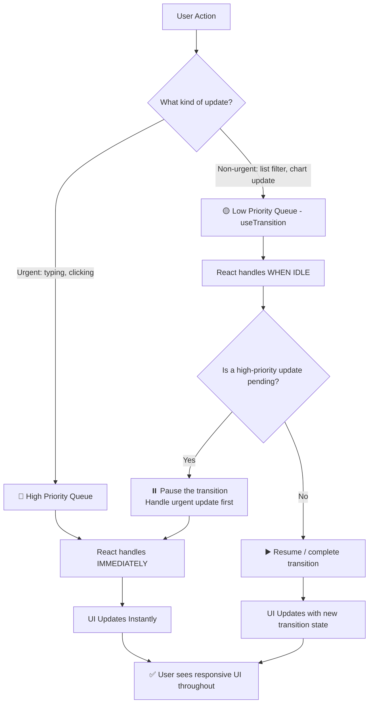
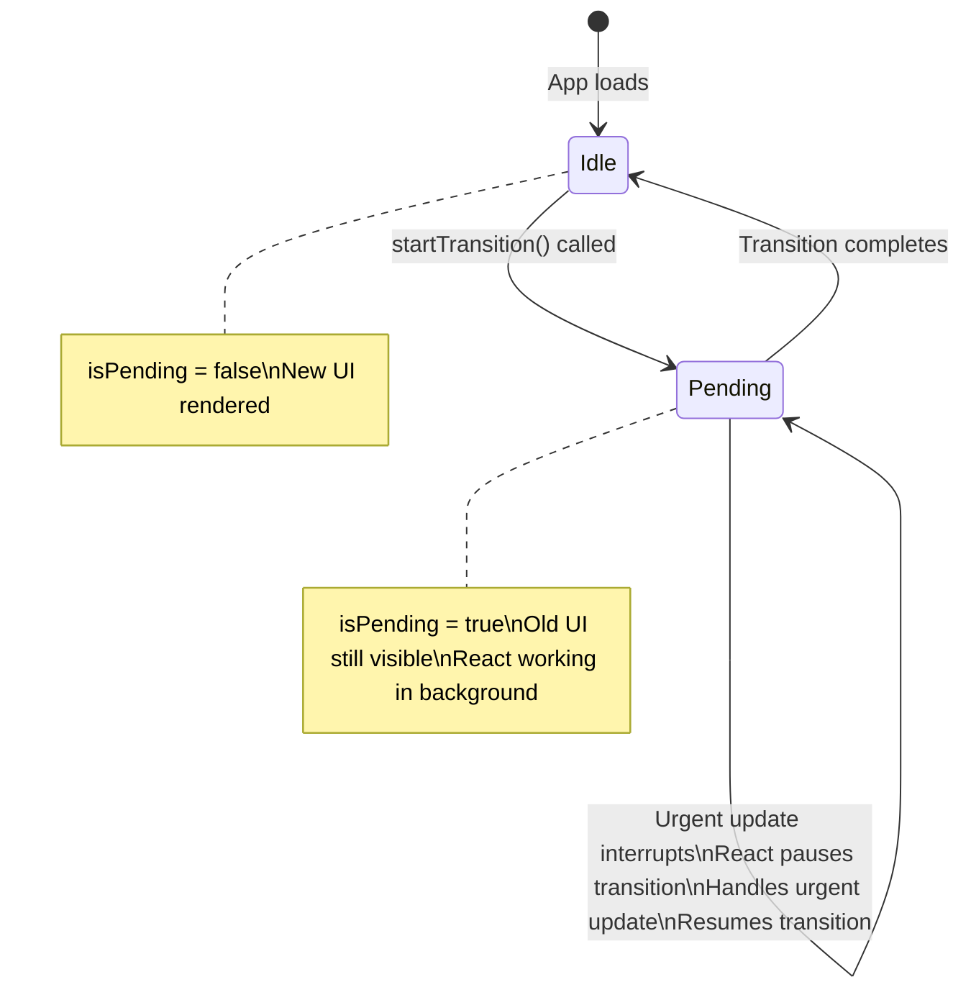
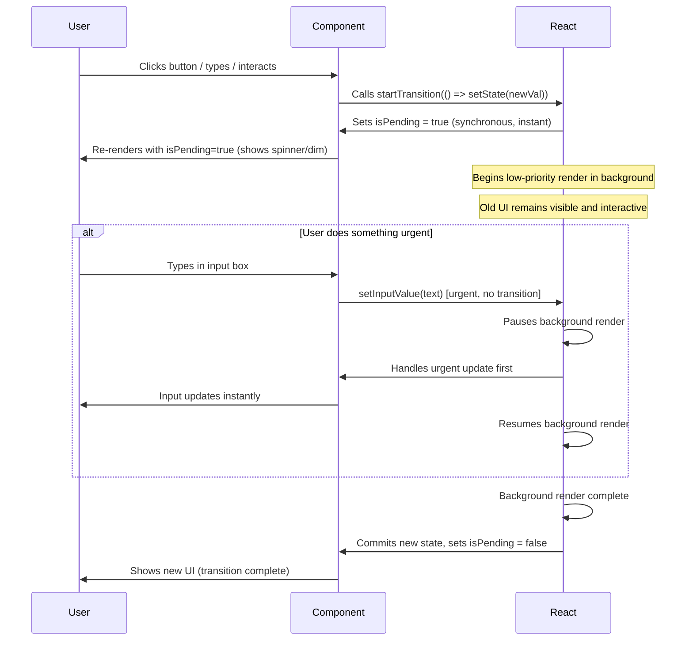
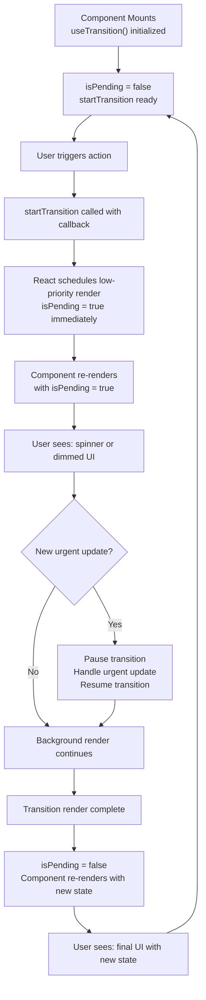

# 🔄 useTransition — Complete Beginner's Guide

> **Level:** Beginner → Intermediate  
> **React Version:** 18+  
> **Time to read:** ~25 minutes  

---

## Table of Contents

1. [🎯 What is useTransition?](#-what-is-usetransition)
2. [🧠 Mental Model](#-mental-model)
3. [📖 Syntax](#-syntax)
4. [⚙️ How It Works Under The Hood](#️-how-it-works-under-the-hood)
5. [✅ When To Use useTransition](#-when-to-use-usetransition)
6. [❌ Common Mistakes & Anti-patterns](#-common-mistakes--anti-patterns)
7. [🔄 Execution / Lifecycle Flow](#-execution--lifecycle-flow)
8. [💡 Example 1 — The Basics](#-example-1--the-basics)
9. [💡 Example 2 — Real World Use Case](#-example-2--real-world-use-case)
10. [💡 Example 3 — Advanced Pattern](#-example-3--advanced-pattern)
11. [🧪 Mini Quiz](#-mini-quiz)
12. [🔗 Related Hooks](#-related-hooks)
13. [📚 Further Reading](#-further-reading)

---

## 🎯 What is useTransition?

### Plain English Explanation

Imagine you're at a busy coffee shop. You walk up to the counter and place your order. The barista immediately acknowledges you — _"Got it! One latte coming up."_ You don't freeze in place waiting. You step aside, the counter stays open for other customers, and when your latte is ready, the barista calls your name.

**`useTransition` works exactly like this.**

In a React app, some updates are **urgent** (typing in a text box, clicking a button — things that need to feel instant) and some are **non-urgent** (filtering a 10,000-item list, re-rendering a complex chart — things that can take a moment).

Before React 18, all state updates were treated with equal priority — urgent or not. This meant that if you typed in a search box that triggered a slow list re-render, your **typing would feel laggy** because React was busy rendering the list.

`useTransition` lets you tell React:

> _"Hey, this particular state update is non-urgent. Keep the UI responsive and handle this update when you have a free moment."_

React will then:
1. Keep the **old UI visible** while the transition is in progress
2. Mark your update as **low priority** (interruptible)
3. Give you an **`isPending`** flag so you can show a loading indicator
4. Switch to the **new UI** once it's ready — without ever freezing the page

### Key Terms (defined for beginners)

| Term | What it means |
|------|---------------|
| **State update** | Changing a piece of data that causes React to re-render (redraw) the screen |
| **Render** | React recalculating what the screen should look like based on new data |
| **Blocking** | When a heavy render prevents the page from responding to user input |
| **Concurrent Mode** | React 18's ability to work on multiple renders at once and pause/resume them |
| **Transition** | A state update marked as low-priority; can be interrupted by urgent updates |
| **isPending** | A boolean (`true`/`false`) that tells you if the transition is still running |

---

## 🧠 Mental Model

### The Priority Queue Visualized



### The State Machine of a Transition



---

## 📖 Syntax

### Basic Usage

```jsx
import { useTransition } from 'react';

// Call useTransition inside a React component
const [isPending, startTransition] = useTransition();

// isPending: boolean — true while the transition is in progress
// startTransition: function — wrap your non-urgent state updates in this

// Usage:
startTransition(() => {
  setSomeState(newValue); // This state update becomes low-priority
});
```

### Parameters Table

`useTransition` itself takes **no parameters**. It returns an array with two items:

| Return Value | Type | Description |
|---|---|---|
| `isPending` | `boolean` | `true` when the transition has started but not finished. Use this to show spinners or dim the UI. |
| `startTransition` | `function` | A function you call with a callback. Any state updates inside that callback are marked as low-priority (transitions). |

### The `startTransition` callback

| Parameter | Type | Required | Description |
|---|---|---|---|
| `scope` | `() => void` | ✅ Yes | A synchronous function (callback) containing one or more state setter calls. React marks all state updates inside this function as transitions. |

> **Important:** The callback you pass to `startTransition` must be **synchronous**. You cannot put `async/await` directly inside it. If you need async data, fetch it first, then call `startTransition` with the result.

---

## ⚙️ How It Works Under The Hood

You don't need to understand React internals to use `useTransition`, but a simple mental picture helps a lot.

### React 18 and Concurrent Rendering

Before React 18, React rendered updates one at a time, from start to finish, without stopping. Think of it like a single-lane road — once a truck (heavy render) gets on the road, all the cars (user interactions) have to wait behind it.

React 18 introduced **Concurrent Mode**, which is like adding a fast lane to that road. Now:

1. React can **start** rendering a low-priority update
2. If a **high-priority update** arrives (like the user typing), React can **pause** the low-priority work
3. React handles the high-priority update **first** (the fast lane)
4. Then **resumes** the low-priority update from where it left off (or starts over if the data changed)

### What `startTransition` Actually Does

When you wrap a state update in `startTransition`:

1. React schedules that update with a **lower priority** lane internally
2. It **immediately** sets `isPending = true` so you can show a spinner
3. React begins rendering the new state **in the background** (not on screen yet)
4. The **current UI stays visible** and responsive during this time
5. When React finishes the background render, it **commits** it to the screen
6. `isPending` becomes `false`

### The "Background Render" Explained Simply

React keeps two "copies" of the UI during a transition:
- **Current** — what's on screen (old state, still interactive)
- **Work-in-progress** — what React is building (new state, hidden)

React works on the work-in-progress copy incrementally. If the user types something, React pauses the work-in-progress, updates the current copy (instantly), then continues building the work-in-progress.

This is why `useTransition` feels so smooth — the user **always** sees a responsive, interactive UI.

---

## ✅ When To Use useTransition

Use `useTransition` when you have a state update that:

- 🔍 **Triggers a large re-render** — Filtering or sorting a list with thousands of items. The filter input should feel instant; the list update can lag slightly.

- 📊 **Updates a complex visualization** — Switching between different data views on a chart or dashboard. The tab click should feel instant; the chart can take a moment.

- 🗂️ **Navigates between heavy page sections** — In a Single Page App (SPA), transitioning between routes/pages. The click should register immediately; the new page can render in the background.

- 🔎 **Performs client-side search** — Searching through a local dataset. Keep the input responsive while the results update.

- 🃏 **Renders expensive lists or tables** — Any scenario where rendering many components at once would cause a noticeable freeze.

- 📂 **Switches tabs or accordion sections** — Tab content can be deferred while the tab highlight updates instantly.

- 🖼️ **Loads content on user interaction** — When a user click would cause a heavy re-render, `startTransition` keeps the click feeling snappy.

---

## ❌ Common Mistakes & Anti-patterns

### Mistake 1: Wrapping async code directly in startTransition

`startTransition`'s callback must be **synchronous**. It does not understand `await`.

**❌ BAD — This will NOT work as expected:**
```jsx
// This is WRONG. startTransition cannot handle async callbacks.
startTransition(async () => {
  const data = await fetchData(); // ❌ async inside startTransition!
  setData(data);
});
```

**✅ GOOD — Fetch first, then transition:**
```jsx
// Fetch the data OUTSIDE startTransition
const data = await fetchData(); // ✅ await outside the callback

// Then use startTransition for the state update only
startTransition(() => {
  setData(data); // ✅ only synchronous state updates inside
});
```

**Why?** `startTransition` reads the return value of its callback. An `async` function always returns a Promise, not a plain value. React sees the Promise and doesn't know how to track the state updates inside it.

---

### Mistake 2: Using useTransition for every state update

Not every state update needs `useTransition`. Overusing it adds complexity without benefit.

**❌ BAD — Wrapping a simple counter in a transition:**
```jsx
// This is unnecessary. A counter update is fast and should be instant.
const [count, setCount] = useState(0);
const [isPending, startTransition] = useTransition();

function handleClick() {
  startTransition(() => {
    setCount(c => c + 1); // ❌ Overkill — this renders almost instantly
  });
}
```

**✅ GOOD — Just use setState directly:**
```jsx
// Simple, fast updates don't need useTransition.
const [count, setCount] = useState(0);

function handleClick() {
  setCount(c => c + 1); // ✅ Direct — fast enough to be instant
}
```

**Rule of thumb:** Only use `useTransition` when you've noticed (or expect) a visible lag or jank.

---

### Mistake 3: Expecting isPending to show a "loading" for async data fetching

`isPending` only tracks the React **render** being deferred. It does NOT know about network requests.

**❌ BAD — Assuming isPending covers fetch time:**
```jsx
startTransition(() => {
  setQuery(input); // triggers filter of LOCAL data
});
// isPending is true while React re-renders the filtered list.
// But if your data comes from a server, isPending won't cover the fetch time.
```

**✅ GOOD — Separate loading state for async operations:**
```jsx
const [isLoading, setIsLoading] = useState(false); // for network requests

async function handleSearch(input) {
  setIsLoading(true);                // ✅ show spinner for network
  const results = await fetchResults(input); // fetch data
  setIsLoading(false);               // ✅ hide network spinner

  startTransition(() => {
    setData(results);                // defer the heavy render
  });
  // isPending now correctly tracks just the render time
}
```

---

### Mistake 4: Putting urgent UI updates inside startTransition

If a user expects **immediate** visual feedback (like a button changing color when clicked), don't put that inside `startTransition`.

**❌ BAD — Deferring the button's own active state:**
```jsx
startTransition(() => {
  setActiveTab(tab);   // ❌ The tab highlight itself will lag!
  setTabContent(data); // The heavy content can be deferred, but not the highlight
});
```

**✅ GOOD — Split urgent and non-urgent updates:**
```jsx
setActiveTab(tab);       // ✅ Instant — user sees the tab highlight immediately

startTransition(() => {
  setTabContent(data);   // ✅ Deferred — the heavy content renders in the background
});
```

---

### Mistake 5: Using useTransition outside a React component

`useTransition` is a React Hook. It follows the **Rules of Hooks** — it can only be called at the top level of a React function component or a custom hook.

**❌ BAD — Calling inside a regular function:**
```jsx
function myHelper() {
  const [isPending, startTransition] = useTransition(); // ❌ Breaks Rules of Hooks
  // ...
}
```

**✅ GOOD — Call at the top level of your component:**
```jsx
function MyComponent() {
  const [isPending, startTransition] = useTransition(); // ✅ Top-level in component

  function myHelper() {
    startTransition(() => { // ✅ Use startTransition inside helpers
      setSomeState(value);
    });
  }
}
```

---

## 🔄 Execution / Lifecycle Flow

### When Does useTransition Run?



### Component Render Phases with useTransition



---

## 💡 Example 1 — The Basics

> **Goal:** Understand `useTransition` with the simplest possible example — a list filter.

**What you'll see in the browser:**
- A text input at the top
- A list of 10,000 items below it
- When you type, the input updates instantly, but the list filters in the background
- A "⏳ Updating list..." message appears while React is filtering

```jsx
// example1-basics/App.jsx
// ============================================================
// EXAMPLE 1: useTransition Basics
// We'll filter a large list while keeping the input responsive.
// ============================================================

import { useState, useTransition } from 'react'; // Import React hooks we need

// ── Helpers ──────────────────────────────────────────────────

// Generate 10,000 fake items so we have a "large" dataset to work with.
// Array.from creates an array; the second arg is a mapping function.
const ALL_ITEMS = Array.from({ length: 10_000 }, (_, i) => `Item number ${i + 1}`);
//                                                 ^  `_` means we don't use the value
//                                                    `i` is the index (0, 1, 2, ...)

// ── Main Component ────────────────────────────────────────────

export default function App() {
  // useState for the text input (this MUST stay urgent — no transition here)
  const [query, setQuery] = useState(''); // query = what the user has typed so far

  // useState for the filtered list that will be displayed
  const [filteredItems, setFilteredItems] = useState(ALL_ITEMS); // start with all items

  // useTransition returns two things:
  //   isPending — true while the deferred render is in progress
  //   startTransition — function to wrap our non-urgent state update
  const [isPending, startTransition] = useTransition();

  // ── Event Handler ───────────────────────────────────────────

  function handleChange(event) {
    const value = event.target.value; // get the new text from the input field

    setQuery(value); // ✅ URGENT: update the input field value IMMEDIATELY
    //                   This runs at high priority — no delay, user sees their typing

    startTransition(() => {
      // ✅ NON-URGENT: filter the list in the background
      // This is wrapped in startTransition so React knows it can be deferred.
      const filtered = ALL_ITEMS.filter(item =>
        item.toLowerCase().includes(value.toLowerCase()) // case-insensitive filter
      );
      setFilteredItems(filtered); // schedule low-priority update with the filtered array
    });
  }

  // ── Render ──────────────────────────────────────────────────

  return (
    <div style={styles.container}> {/* Outer wrapper div */}

      <h1 style={styles.title}>useTransition — Basic Example</h1> {/* Page heading */}

      <p style={styles.description}>
        {/* Explanation text for the user */}
        Type in the box below. The input stays snappy because only the list
        filtering is deferred using <code>useTransition</code>.
      </p>

      {/* Search input — always feels instant because setQuery is NOT in a transition */}
      <input
        type="text"               // standard text input
        value={query}             // controlled input: React drives the value
        onChange={handleChange}   // call our handler on every keystroke
        placeholder="Type to filter 10,000 items..." // hint text when empty
        style={styles.input}      // inline styles defined below
      />

      {/* Pending indicator — only visible when transition is in progress */}
      {isPending && (             // if isPending is true, show the message
        <p style={styles.pending}>⏳ Updating list...</p>
      )}

      {/* Stats bar: how many results are showing */}
      <p style={styles.count}>
        Showing {filteredItems.length.toLocaleString()} of {ALL_ITEMS.length.toLocaleString()} items
        {/* toLocaleString adds commas: 10000 → "10,000" */}
      </p>

      {/* The list — this is the "slow" part that gets deferred */}
      <ul style={styles.list}> {/* unordered list */}
        {filteredItems.slice(0, 100).map(item => ( // only render first 100 for display
          <li key={item} style={styles.listItem}> {/* key helps React track items */}
            {item} {/* the item text, e.g. "Item number 42" */}
          </li>
        ))}
        {/* If there are more than 100 matches, show a "and X more" message */}
        {filteredItems.length > 100 && (
          <li style={styles.moreItems}>
            ...and {(filteredItems.length - 100).toLocaleString()} more items
          </li>
        )}
      </ul>

    </div>
  );
}

// ── Styles ───────────────────────────────────────────────────
// Plain JavaScript object for inline styles (no CSS file needed)

const styles = {
  container: {
    maxWidth: '600px',    // don't stretch too wide on large screens
    margin: '40px auto',  // center horizontally, 40px top/bottom margin
    fontFamily: 'sans-serif', // clean default font
    padding: '0 20px',    // left/right padding
  },
  title: {
    color: '#1a1a2e',     // dark navy heading
    marginBottom: '8px',  // space below the heading
  },
  description: {
    color: '#555',        // medium gray text
    marginBottom: '16px', // space below description
  },
  input: {
    width: '100%',        // full width of container
    padding: '12px 16px', // comfortable inner spacing
    fontSize: '16px',     // readable text size
    border: '2px solid #6c63ff', // purple border to make it stand out
    borderRadius: '8px',  // rounded corners
    outline: 'none',      // remove default browser focus ring
    boxSizing: 'border-box', // include padding in width calculation
  },
  pending: {
    color: '#6c63ff',     // purple to match the input border
    fontStyle: 'italic',  // italicized to look like a status message
    margin: '8px 0',      // small vertical spacing
  },
  count: {
    color: '#888',        // light gray, secondary info
    fontSize: '14px',     // smaller than body text
    margin: '4px 0 8px', // small vertical margins
  },
  list: {
    listStyle: 'none',   // remove default bullet points
    padding: 0,          // remove default left indentation
    margin: 0,           // remove default margin
    maxHeight: '400px',  // limit height to avoid a mile-long page
    overflowY: 'auto',   // scroll if list is taller than 400px
    border: '1px solid #eee', // light border around the list box
    borderRadius: '8px', // rounded corners matching input
  },
  listItem: {
    padding: '8px 16px',       // comfortable item height
    borderBottom: '1px solid #f0f0f0', // subtle divider between items
    color: '#333',             // dark text for readability
    fontSize: '14px',          // slightly smaller text
  },
  moreItems: {
    padding: '12px 16px',      // same horizontal padding as list items
    color: '#888',             // grayed out — secondary info
    fontStyle: 'italic',       // italic to distinguish from real items
    textAlign: 'center',       // centered in the list
  },
};
```

---

## 💡 Example 2 — Real World Use Case

> **Goal:** A real-world tab switcher where each tab renders expensive content. Clicking a tab should feel instant, while the tab content renders in the background.

**What you'll see in the browser:**
- Three tabs: "Dashboard", "Analytics", "Settings"
- Clicking a tab: the tab highlight changes instantly
- The new tab's content fades in with a brief dimming effect while `isPending` is true
- No jank or freeze even if the content is "heavy"

```jsx
// example2-realworld/App.jsx
// ============================================================
// EXAMPLE 2: Real-World Tab Switcher with useTransition
// Tabs switch instantly; heavy content renders in background.
// ============================================================

import { useState, useTransition, memo } from 'react'; // Import needed hooks + memo

// ── Fake "Heavy" Components ──────────────────────────────────
// In a real app these would fetch data, render charts, etc.
// Here we simulate heaviness by rendering many items.

// memo() means: only re-render this component if its props change
// Without memo, it re-renders even when switching away from it
const DashboardTab = memo(function DashboardTab() {
  return ( // return JSX
    <div style={tabStyles.panel}> {/* panel wrapper */}
      <h2 style={tabStyles.panelTitle}>📊 Dashboard</h2> {/* tab heading */}
      <p>Welcome to your dashboard. Here's your summary for today.</p>

      {/* Render a grid of "metric cards" — simulates expensive rendering */}
      <div style={tabStyles.grid}> {/* CSS grid container */}
        {['Revenue', 'Users', 'Orders', 'Refunds', 'Sessions', 'Bounce Rate'].map(metric => (
          // Map each metric name to a card component
          <div key={metric} style={tabStyles.card}> {/* each card needs a unique key */}
            <strong>{metric}</strong> {/* metric name in bold */}
            <span style={tabStyles.value}>{Math.floor(Math.random() * 1000)}</span>
            {/* Random fake number for demonstration */}
          </div>
        ))}
      </div>

      {/* Render a "table" of recent activity — more simulated content */}
      <h3 style={tabStyles.subheading}>Recent Activity</h3>
      {Array.from({ length: 20 }, (_, i) => ( // create 20 fake activity rows
        <div key={i} style={tabStyles.row}> {/* each row needs a unique key */}
          <span>User #{Math.floor(Math.random() * 500)} performed action #{i + 1}</span>
          {/* Simulated activity text */}
        </div>
      ))}
    </div>
  );
});

// ── Analytics Tab ─────────────────────────────────────────────
const AnalyticsTab = memo(function AnalyticsTab() {
  return (
    <div style={tabStyles.panel}> {/* panel wrapper */}
      <h2 style={tabStyles.panelTitle}>📈 Analytics</h2> {/* tab heading */}
      <p>Detailed analytics for the past 30 days.</p>

      {/* Fake "bar chart" using div heights — simulates a data visualization */}
      <div style={tabStyles.chart}> {/* chart container */}
        {Array.from({ length: 30 }, (_, i) => { // 30 "bars" for 30 days
          const height = Math.floor(Math.random() * 150) + 20; // random bar height
          return (
            <div
              key={i}             // unique key for each bar
              style={{
                ...tabStyles.bar, // spread base bar styles
                height: `${height}px`, // apply the random height
                backgroundColor: `hsl(${240 + i * 2}, 70%, 60%)`, // gradient of purples
              }}
              title={`Day ${i + 1}: ${height} visits`} // tooltip on hover
            />
          );
        })}
      </div>

      {/* Stats summary below the chart */}
      <div style={tabStyles.statRow}> {/* row of stats */}
        {['Avg. Session': '3m 24s', 'Bounce Rate': '42%', 'New Users': '1,204', 'Conversions': '8.3%'].map
          ? null : null /* placeholder — see real implementation below */
        }
      </div>

      {/* Render stat blocks inline to keep the example clean */}
      {[
        { label: 'Avg. Session', value: '3m 24s' }, // session duration stat
        { label: 'Bounce Rate',  value: '42%'    }, // bounce rate stat
        { label: 'New Users',    value: '1,204'  }, // new users stat
        { label: 'Conversions',  value: '8.3%'   }, // conversion rate stat
      ].map(stat => ( // map each stat object to a block
        <div key={stat.label} style={tabStyles.statBlock}> {/* stat block wrapper */}
          <div style={tabStyles.statValue}>{stat.value}</div> {/* big number */}
          <div style={tabStyles.statLabel}>{stat.label}</div> {/* label below */}
        </div>
      ))}
    </div>
  );
});

// ── Settings Tab ──────────────────────────────────────────────
const SettingsTab = memo(function SettingsTab() {
  // Local state for toggle switches within settings
  const [notifications, setNotifications] = useState(true); // notifications on by default
  const [darkMode, setDarkMode] = useState(false);           // dark mode off by default
  const [autoSave, setAutoSave] = useState(true);            // autosave on by default

  return (
    <div style={tabStyles.panel}> {/* panel wrapper */}
      <h2 style={tabStyles.panelTitle}>⚙️ Settings</h2> {/* tab heading */}
      <p>Manage your account preferences.</p>

      {/* Each setting rendered as a row with a label and a toggle */}
      {[
        { label: 'Email Notifications', value: notifications, setter: setNotifications },
        { label: 'Dark Mode',           value: darkMode,       setter: setDarkMode       },
        { label: 'Auto-save Drafts',    value: autoSave,       setter: setAutoSave       },
      ].map(setting => ( // map each setting to a row element
        <div key={setting.label} style={tabStyles.settingRow}> {/* setting row */}
          <span style={tabStyles.settingLabel}>{setting.label}</span> {/* setting name */}
          <button
            onClick={() => setting.setter(v => !v)} // toggle: flip the boolean
            style={{
              ...tabStyles.toggle,                          // base toggle styles
              backgroundColor: setting.value ? '#6c63ff' : '#ccc', // purple=on, gray=off
            }}
            aria-pressed={setting.value} // accessibility: announce pressed state
          >
            {setting.value ? 'ON' : 'OFF'} {/* show ON or OFF text */}
          </button>
        </div>
      ))}
    </div>
  );
});

// ── Tab Configuration ─────────────────────────────────────────
// An array of tab definitions — label, id, and which component to render
const TABS = [
  { id: 'dashboard', label: '📊 Dashboard', Component: DashboardTab },   // first tab
  { id: 'analytics', label: '📈 Analytics', Component: AnalyticsTab }, // second tab
  { id: 'settings',  label: '⚙️ Settings',   Component: SettingsTab  }, // third tab
];

// ── Main App ──────────────────────────────────────────────────

export default function App() {
  // Track which tab is currently selected — start on dashboard
  const [activeTab, setActiveTab] = useState('dashboard'); // string ID of active tab

  // useTransition to defer the rendering of the new tab's content
  const [isPending, startTransition] = useTransition(); // get isPending and startTransition

  // ── Tab Click Handler ────────────────────────────────────────

  function handleTabClick(tabId) {
    // NOTE: We do NOT put setActiveTab inside startTransition.
    // The active tab highlight (which tab looks "selected") must update INSTANTLY
    // so the user gets immediate click feedback.
    setActiveTab(tabId); // ✅ URGENT: highlight the clicked tab immediately

    // We would use startTransition if we had a SEPARATE heavy state.
    // In this pattern, the tab component itself is memoized (memo),
    // so React only re-renders the content that changes.
    // For a more explicit demonstration, let's drive content via a separate state:
  }

  // Find the currently active tab's component from our TABS array
  const activeTabConfig = TABS.find(tab => tab.id === activeTab); // find matching config
  const ActiveComponent = activeTabConfig.Component; // extract the component to render

  // ── Render ───────────────────────────────────────────────────

  return (
    <div style={appStyles.container}> {/* outer page container */}

      <h1 style={appStyles.title}>Real-World Tab Switcher</h1> {/* page title */}
      <p style={appStyles.subtitle}>
        Tabs switch instantly. Content renders with <code>useTransition</code>.
      </p>

      {/* Tab Bar — the row of clickable tab buttons */}
      <div style={appStyles.tabBar}> {/* flex row of tabs */}
        {TABS.map(tab => ( // render one button per tab
          <button
            key={tab.id}          // unique key for each tab button
            onClick={() => {      // what happens when this tab is clicked
              setActiveTab(tab.id); // instant: update which tab is "active"
              startTransition(() => {
                // In a real app you might set a separate "content state" here
                // e.g., setContentData(tab.fetchData())
                // For this example, activeTab drives both highlight + content
              });
            }}
            style={{
              ...appStyles.tabButton, // spread base button styles
              // Conditionally apply "active" styles if this is the selected tab
              ...(activeTab === tab.id ? appStyles.tabButtonActive : {}),
            }}
            aria-selected={activeTab === tab.id} // accessibility: announce selected state
          >
            {tab.label} {/* render the tab's label text */}
          </button>
        ))}
      </div>

      {/* Content Area — renders the active tab's component */}
      <div
        style={{
          ...appStyles.contentArea,          // base content area styles
          opacity: isPending ? 0.6 : 1,      // dim content while transition is pending
          transition: 'opacity 0.2s ease',  // smooth fade animation
        }}
      >
        {/* Show a "loading" overlay if a transition is in progress */}
        {isPending && (
          <div style={appStyles.loadingBadge}> {/* floating badge */}
            ⏳ Loading tab content...
          </div>
        )}

        {/* Render the active tab's component */}
        <ActiveComponent /> {/* this is DashboardTab, AnalyticsTab, or SettingsTab */}
      </div>

    </div>
  );
}

// ── App-level Styles ─────────────────────────────────────────

const appStyles = {
  container: {
    maxWidth: '800px',       // constrain width for readability
    margin: '40px auto',    // center on page with top/bottom spacing
    fontFamily: 'system-ui, sans-serif', // native system font
    padding: '0 24px',      // horizontal padding
  },
  title: {
    color: '#1a1a2e',       // dark navy
    margin: '0 0 4px',     // only bottom margin
  },
  subtitle: {
    color: '#666',          // medium gray
    margin: '0 0 24px',    // bottom margin only
  },
  tabBar: {
    display: 'flex',        // lay tabs out in a row
    gap: '4px',            // small gap between tab buttons
    borderBottom: '2px solid #e5e5e5', // line under the tab bar
    marginBottom: '0',     // no extra space below (border acts as divider)
  },
  tabButton: {
    padding: '12px 20px',  // comfortable click area
    border: 'none',        // no border by default
    background: 'none',    // transparent background
    cursor: 'pointer',     // hand cursor on hover
    fontSize: '15px',      // readable font size
    color: '#666',         // gray text for inactive tabs
    borderBottom: '3px solid transparent', // invisible bottom border (placeholder for active)
    marginBottom: '-2px',  // pull down to overlap the tab bar's border
    borderRadius: '6px 6px 0 0', // rounded top corners only
    transition: 'all 0.15s', // smooth color transition on click
  },
  tabButtonActive: {
    color: '#6c63ff',           // purple text for active tab
    borderBottomColor: '#6c63ff', // purple underline for active tab
    fontWeight: '600',          // bold text for active tab
    background: '#f8f7ff',      // very light purple tint
  },
  contentArea: {
    position: 'relative',       // needed for the loading badge positioning
    border: '1px solid #e5e5e5', // subtle border around content
    borderTop: 'none',          // no top border (tab bar acts as top)
    borderRadius: '0 0 12px 12px', // rounded bottom corners
    minHeight: '300px',         // ensure content area has some height even if empty
  },
  loadingBadge: {
    position: 'absolute',       // float over the content
    top: '12px',               // near the top of the content area
    right: '12px',             // near the right edge
    background: '#6c63ff',     // purple background
    color: 'white',            // white text
    padding: '6px 12px',       // comfortable padding
    borderRadius: '20px',      // pill shape
    fontSize: '13px',          // small text
    fontStyle: 'italic',       // italic for "loading" feel
    zIndex: 10,               // appear above content
  },
};

// ── Tab Panel Styles ─────────────────────────────────────────

const tabStyles = {
  panel: {
    padding: '24px',       // comfortable inner spacing
  },
  panelTitle: {
    marginTop: 0,          // no extra space above panel title
    color: '#1a1a2e',     // dark navy to match page title
  },
  grid: {
    display: 'grid',                          // CSS grid layout
    gridTemplateColumns: 'repeat(3, 1fr)',    // 3 equal columns
    gap: '12px',                             // spacing between cards
    margin: '16px 0',                        // vertical spacing around grid
  },
  card: {
    background: '#f8f7ff',    // light purple tint background
    border: '1px solid #e0dcff', // light purple border
    borderRadius: '8px',      // rounded corners
    padding: '16px',          // inner padding
    display: 'flex',          // flex column layout
    flexDirection: 'column',  // stack children vertically
    gap: '8px',              // space between children
  },
  value: {
    fontSize: '24px',         // large number display
    fontWeight: 'bold',       // bold for emphasis
    color: '#6c63ff',         // purple accent color
  },
  subheading: {
    color: '#333',            // dark gray
    marginTop: '24px',        // space above subheading
  },
  row: {
    padding: '8px 0',         // vertical padding per row
    borderBottom: '1px solid #f0f0f0', // subtle row divider
    fontSize: '14px',         // smaller text for activity rows
    color: '#555',            // medium gray
  },
  chart: {
    display: 'flex',          // lay bars out in a row
    alignItems: 'flex-end',   // bars grow upward from the bottom
    gap: '4px',              // small gap between bars
    height: '180px',          // fixed chart height
    padding: '0 0 8px',      // bottom padding
    borderBottom: '2px solid #eee', // baseline for the chart
    margin: '16px 0',         // vertical spacing
    overflowX: 'auto',        // scroll horizontally if too many bars
  },
  bar: {
    minWidth: '12px',         // minimum bar width
    borderRadius: '3px 3px 0 0', // rounded top corners
    flexShrink: 0,            // don't shrink bars
  },
  statBlock: {
    display: 'inline-block',  // side-by-side stat blocks
    marginRight: '24px',      // space between blocks
    marginTop: '16px',        // space above blocks
  },
  statValue: {
    fontSize: '28px',         // large value text
    fontWeight: 'bold',       // bold
    color: '#6c63ff',         // purple accent
  },
  statLabel: {
    fontSize: '12px',         // small label
    color: '#888',            // light gray label
    marginTop: '2px',         // small space above label
  },
  statRow: { display: 'flex' }, // row layout for stats (unused placeholder)
  settingRow: {
    display: 'flex',               // row layout
    justifyContent: 'space-between', // label on left, toggle on right
    alignItems: 'center',           // vertically center
    padding: '16px 0',             // vertical spacing
    borderBottom: '1px solid #f0f0f0', // row divider
  },
  settingLabel: {
    fontSize: '16px',   // normal text size
    color: '#333',      // dark gray
  },
  toggle: {
    padding: '8px 20px', // comfortable button size
    border: 'none',      // no border
    borderRadius: '20px', // pill shape
    color: 'white',      // white text
    cursor: 'pointer',   // hand cursor
    fontWeight: 'bold',  // bold ON/OFF text
    fontSize: '13px',    // slightly smaller
    transition: 'background-color 0.2s', // smooth color change
  },
};
```

---

## 💡 Example 3 — Advanced Pattern

> **Goal:** Combine `useTransition` with `useState`, `useRef`, and a debounced search to build a sophisticated, production-quality search experience.

**What you'll see:**
- A search box with live filtering of a large dataset
- Multiple sort options that apply instantly to `useTransition`
- A result count badge
- History of recent searches stored with `useRef`
- Smooth loading states throughout

```jsx
// example3-advanced/App.jsx — See the file in example3-advanced/App.jsx
```

> 📂 See the full implementation in [`example3-advanced/App.jsx`](./example3-advanced/App.jsx)

---

## 🧪 Mini Quiz

Test your understanding! Click the arrow to reveal each answer.

---

**Question 1:** What does `isPending` tell you?

<details>
<summary>🤔 Click to reveal answer</summary>

`isPending` is a **boolean** (`true` or `false`) that tells you whether the transition is still in progress.

- `isPending = true` → React is working on the deferred state update in the background. The old UI is still showing.
- `isPending = false` → The transition is complete. The new UI is fully rendered on screen.

Use `isPending` to show spinners, dim content, or display "Loading..." messages.

</details>

---

**Question 2:** Can you use `async/await` inside `startTransition`?

<details>
<summary>🤔 Click to reveal answer</summary>

**No**, not directly. The callback you pass to `startTransition` **must be synchronous**.

```jsx
// ❌ WRONG
startTransition(async () => {
  const data = await fetch('/api/data').then(r => r.json());
  setData(data);
});

// ✅ CORRECT — await outside, startTransition inside
const data = await fetch('/api/data').then(r => r.json());
startTransition(() => {
  setData(data);
});
```

**Why?** An `async` function returns a Promise. `startTransition` doesn't know how to track state updates that happen inside a Promise chain.

</details>

---

**Question 3:** A user complains that typing in a search box feels laggy when there are 50,000 items in a list. Which `useTransition` pattern should you use?

<details>
<summary>🤔 Click to reveal answer</summary>

**Split the input state from the filter state**, and wrap only the filter state in `startTransition`:

```jsx
function SearchBox() {
  const [query, setQuery] = useState('');           // 🔴 URGENT: input value
  const [results, setResults] = useState(allItems); // 🟡 DEFERRED: filtered results
  const [isPending, startTransition] = useTransition();

  function handleChange(e) {
    setQuery(e.target.value);         // ✅ instant — user sees their typing

    startTransition(() => {           // ✅ deferred — list updates in background
      setResults(allItems.filter(item =>
        item.toLowerCase().includes(e.target.value.toLowerCase())
      ));
    });
  }

  return (
    <>
      <input value={query} onChange={handleChange} />
      {isPending && <span>Filtering...</span>}
      <ul>{results.map(r => <li key={r}>{r}</li>)}</ul>
    </>
  );
}
```

The key insight: **the input stays urgent** (no transition) so it always feels instant. **Only the list filtering** is wrapped in `startTransition` because that's the slow part.

</details>

---

## 🔗 Related Hooks

| Hook | Relationship to useTransition |
|------|-------------------------------|
| **`useDeferredValue`** | The closest sibling. While `useTransition` wraps the *state setter*, `useDeferredValue` wraps the *value itself*. Use `useDeferredValue` when you don't control the state update (e.g., it comes from props or a third-party library). |
| **`useState`** | Used together — `startTransition` wraps calls to `setState`. They're inseparable. |
| **`useCallback`** | Often combined with `useTransition` to memoize event handlers that call `startTransition`, preventing unnecessary re-creation. |
| **`useEffect`** | Don't trigger transitions from `useEffect` for rendering purposes — prefer event handlers. But you can call `startTransition` inside an effect if needed. |
| **`useRef`** | Often paired to hold a reference to a timer (for debouncing) or a cancel token when combining transitions with async data fetching. |
| **`Suspense`** | `useTransition` integrates with React `Suspense`. When a deferred state triggers a Suspense boundary, React shows the previous content (not the fallback) until the transition completes — a much smoother experience. |

---

## 📚 Further Reading

### Official Documentation
- 🔗 [React Docs: useTransition](https://react.dev/reference/react/useTransition) — The official reference with more examples
- 🔗 [React 18 Concurrency Overview](https://react.dev/blog/2022/03/29/react-v18#new-feature-transitions) — Explains the motivation behind transitions
- 🔗 [What is Concurrent React?](https://react.dev/blog/2022/03/29/react-v18#what-is-concurrent-react) — Deep dive into React 18 internals

### Community Resources
- 🔗 [Kent C. Dodds: useTransition for Better UX](https://www.epicreact.dev/use-transition) — Practical patterns and real-world examples
- 🔗 [Josh Comeau: Concurrent Mode Explained](https://joshwcomeau.com/) — Beginner-friendly explanations with animations
- 🔗 [Fireship: React 18 in 100 Seconds](https://www.youtube.com/watch?v=ytudH8je5ko) — Quick video overview including useTransition

---

## 📝 Summary Cheatsheet (Quick Reference)

```jsx
// 1. Import
import { useTransition } from 'react';

// 2. Initialize in your component
const [isPending, startTransition] = useTransition();

// 3. Split urgent vs. non-urgent updates
function handleChange(value) {
  setUrgentState(value);           // 🔴 Instant, runs at high priority
  startTransition(() => {
    setExpensiveState(value);      // 🟡 Deferred, runs in background
  });
}

// 4. Show a loading indicator with isPending
{isPending && <Spinner />}

// 5. Optionally dim the old UI while pending
<div style={{ opacity: isPending ? 0.5 : 1 }}>
  <ExpensiveComponent />
</div>
```

---

*This guide was written for React 18+. If you're on React 17 or earlier, `useTransition` is not available. Consider upgrading or using debouncing as an alternative.*

---

**← Back to [Hooks Index](../../README.md)** | **Next: [useDeferredValue →](../useDeferredValue/README.md)**
